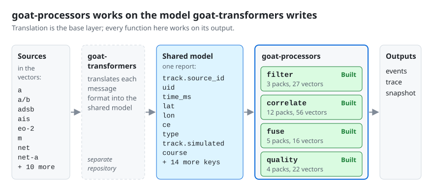
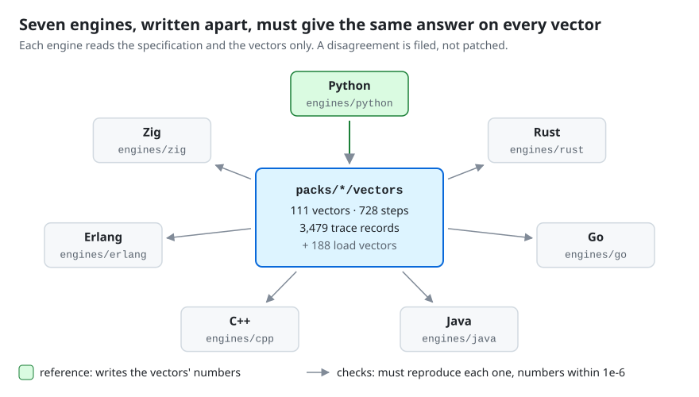

<!-- Written by tools/readme/make-readme.py from tools/readme/template.md. Edit those, not this file. -->
# goat-processors

[](https://github.com/USAREUR-AF/goat-processors/actions/workflows/conformance.yml)

goat-processors holds the functions that work on track data after it has been
translated: correlation, fusion, filtering, and quality measurement with the
actions that follow from it. [goat-transformers](https://github.com/USAREUR-AF/goat-transformers)
is the layer beneath it and translates messages between formats into one
shared model; goat-processors reads that model. Each function is a written
specification, a set of rule packs, and conformance vectors that seven
independent engines (Python, Rust, Go, Java, C++, Erlang, Zig) reproduce
exactly, down to every trace record.

<picture>
  <source media="(prefers-color-scheme: dark)" srcset="docs/figures/processing-layer-dark.svg">
  
</picture>

## Functions

| Function | What it does | Specification | Packs | Vectors | Status |
|---|---|---|---:|---:|---|
| correlate | decides which tracks from different sources are one object, groups them, emits one estimate per group | [correlate.md](spec/correlate.md) 0.8 | 6 | 29 | Built in seven languages |
| correlate, method assign | every track in one system track; per-source least-cost assignment at each tick; members fused by uncertainty weight | [correlate-assign.md](spec/correlate-assign.md) 0.6 | 6 | 27 | Built in seven languages |
| fuse | combines the members of each group named by `fuse.group` into one estimate: inverse variance, covariance intersection, best, priority or latest; one rule per attribute | [fuse.md](spec/fuse.md) 0.2 | 5 | 16 | Built in seven languages |
| filter | keeps or drops each report by the first matching rule: inside or outside a circle or polygon, within a distance of a reference such as own ship, by environment, affiliation, source, identity or any key, and thins a feed by interval | [filter.md](spec/filter.md) 0.1 | 3 | 27 | Built in seven languages |
| quality | measures each entity and source from its reports (update interval, age, latency, normalized innovation squared against reported error, implied against reported speed, order, missing keys) and applies the action a rule attaches to a measure: mark, downgrade, drop or alert | [quality.md](spec/quality.md) 0.1 | 2 | 15 | Built in seven languages |

Each function runs as `load_pack`, then `ingest(report)` and `tick(now_ms)`,
each returning events and trace records, and `snapshot()`, which returns the
whole state.

## Quick start

Run every vector in one language. Each engine uses only its language's
standard library.

```sh
cd engines/python && PYTHONPATH=src python3 -m unittest discover -s tests
```

The command for each language is in the conformance table below.

Open a vector in the replay viewer. It writes one HTML page that works offline:

```sh
python3 -I tools/explain/explain.py packs/correlate-gnn/vectors/04-separation-dissolves.json
# open 04-separation-dissolves.html in a browser

python3 -I tools/explain/explain.py --all build/explain   # every vector, with an index page
```

The page shows a plan view of every report and filter estimate with its
uncertainty ellipse, the groups as they form and dissolve, a step slider, and
for each step the input, the events, every trace record and the snapshot.
[tools/explain/README.md](tools/explain/README.md) lists its options,
including replaying a benchmark run against its ground truth.

## Every decision is observable

A function decides nothing that is not in its trace. Each test is a record of
what it compared, the value it computed, the limit and the result.

Step 3 of [`04-separation-dissolves.json`](packs/correlate-gnn/vectors/04-separation-dissolves.json) ingests a report from `radar-1/T1`. The engine's first test of it against `adsb/A7` is this record, copied from the vector:

```json
{"stage": "gate", "a": "radar-1/T1", "b": "adsb/A7", "test": "mahalanobis", "value": 0.10957452680004903, "limit": 9.21, "pass": true}
```

The value is the squared distance between the two tracks in units of their combined uncertainty. The limit is the pack's rule `gate mahalanobis gate=9.21` in [`packs/correlate-gnn/pack.def`](packs/correlate-gnn/pack.def). After 7 more records the step returns `{"ev": "correlate", "group": "g1", "members": ["adsb/A7", "radar-1/T1"]}`.

<picture>
  <source media="(prefers-color-scheme: dark)" srcset="docs/figures/correlate-decision-dark.svg">
  
</picture>

The assignment method keeps a cost matrix at each tick and records every
entry and every choice:

<picture>
  <source media="(prefers-color-scheme: dark)" srcset="docs/figures/assign-matrix-dark.svg">
  
</picture>

## Seven engines check each other

<picture>
  <source media="(prefers-color-scheme: dark)" srcset="docs/figures/seven-engines-dark.svg">
  
</picture>

The Python engine and `tools/make-*-vectors.py` write the vectors; each
generator states its scenarios' decisions by hand and refuses to write a
vector whose events differ from them. The other six engines are written from
the specification and the vectors alone, never from another engine's source.
An engine that disagrees with a vector records it in its `DISAGREEMENTS.md`;
the vector is changed only through the specification.

| Language | Engine | Lines of source | Runs every vector with |
|---|---|---:|---|
| Python | [`engines/python`](engines/python) | 2,471 | `cd engines/python && PYTHONPATH=src python3 -m unittest discover -s tests` |
| Rust | [`engines/rust`](engines/rust) | 5,074 | `cd engines/rust && cargo test` |
| Go | [`engines/go`](engines/go) | 2,393 | `cd engines/go && go test ./...` |
| Java | [`engines/java`](engines/java) | 4,258 | `engines/java/build.sh` |
| C++ | [`engines/cpp`](engines/cpp) | 4,566 | `cmake -S engines/cpp -B build/cpp && cmake --build build/cpp && ctest --test-dir build/cpp` |
| Erlang | [`engines/erlang`](engines/erlang) | 3,175 | `engines/erlang/run_tests` |
| Zig | [`engines/zig`](engines/zig) | 5,324 | `cd engines/zig && zig build test` |

Each engine runs all 114 scenario vectors (766 steps, 3,753 trace records) and 201 load vectors on every pull request and every push to `main`.

## Benchmark

The correlate packs are scored against ground truth on generated scenarios:
crossing, formation, splitting and turning objects; sensors with understated
or absent error, bias, latency, low detection, track number swaps and false
tracks. Every score and its formula is in [docs/benchmark.md](docs/benchmark.md),
which `tools/bench/bench.py report` writes.

| Pack | Set | Pairwise F1 | Precision | Recall | False merges | Missed merges | Identity swaps | GOSPA, m |
|---|---|---:|---:|---:|---:|---:|---:|---:|
| gnn | 21 named | 0.951 | 0.997 | 0.910 | 3 | 2 | 1 | 94.9 |
| gnn | 50 random | 0.820 | 0.988 | 0.701 | 61 | 81 | 23 | 414.5 |
| window | 21 named | 0.924 | 0.930 | 0.917 | 5 | 6 | 1 | 56.8 |
| window | 50 random | 0.934 | 0.988 | 0.887 | 77 | 40 | 17 | 308.1 |
| distance | 21 named | 0.884 | 0.857 | 0.913 | 13 | 2 | 1 | 108.8 |
| distance | 50 random | 0.807 | 0.996 | 0.678 | 21 | 76 | 14 | 418.1 |
| assign | 21 named | 0.937 | 1.000 | 0.881 | 0 | 2 | 2 | 109.6 |
| assign | 50 random | 0.715 | 0.997 | 0.558 | 15 | 99 | 130 | 474.7 |
| gnn-imm | 21 named | 0.968 | 0.996 | 0.941 | 3 | 2 | 1 | 69.8 |
| gnn-imm | 50 random | 0.884 | 0.993 | 0.796 | 71 | 55 | 21 | 344.2 |
| assign-imm | 21 named | 0.971 | 1.000 | 0.944 | 0 | 2 | 2 | 72.4 |
| assign-imm | 50 random | 0.796 | 0.998 | 0.661 | 12 | 54 | 160 | 399.0 |
| assign-window | 21 named | 0.929 | 1.000 | 0.867 | 2 | 2 | 2 | 115.7 |
| assign-window | 50 random | 0.698 | 0.994 | 0.538 | 62 | 91 | 229 | 477.0 |
| assign-bias | 21 named | 0.989 | 1.000 | 0.979 | 0 | 1 | 2 | 49.0 |
| assign-bias | 50 random | 0.906 | 0.999 | 0.830 | 11 | 47 | 64 | 313.0 |
| assign-full | 21 named | 0.997 | 1.000 | 0.994 | 0 | 0 | 0 | 41.4 |
| assign-full | 50 random | 0.958 | 0.999 | 0.919 | 10 | 4 | 37 | 247.2 |
| gnn-restart | 21 named | 0.956 | 0.997 | 0.919 | 3 | 2 | 1 | 89.6 |
| gnn-restart | 50 random | 0.851 | 0.990 | 0.746 | 60 | 64 | 18 | 382.6 |

Highest pairwise F1 over the random set: `correlate-assign-full`, 0.958.

<picture>
  <source media="(prefers-color-scheme: dark)" srcset="docs/figures/bench/random-dark.svg">
  
</picture>

## Design principles

| Principle | In practice |
|---|---|
| Deterministic | The only clock is the time in the input. Every collection is visited in an order the specification states. The same input gives the same output and trace in every language. |
| Rules are data | A pack (`packs/<function>-<name>/pack.def`) names fixed, specified tests and their parameters. A pack holds no code and no expressions. |
| Every decision is traced | Every test is a trace record with its inputs, value, limit and result. `snapshot()` returns the whole state, including each track's filter. |
| Engines check each other | Seven engines written apart must reproduce every vector: events, trace and final snapshot, numbers within a relative 1e-6. |
| Standard library only | No engine or tool depends on a third-party package. |

## Layout

| Path | What |
|---|---|
| [`spec/`](spec/) | one specification per function, the shared [vector format](spec/vector-format.md), load vectors |
| [`packs/`](packs/) | 22 rule packs, each with its `pack.def` and its scenario vectors (114 in all) |
| [`engines/`](engines/) | one independent engine per language, each with its test runner |
| [`tools/`](tools/) | the vector generators, the replay viewer (`explain/`), the benchmark (`bench/`), this README's generator (`readme/`) |
| [`docs/`](docs/) | the benchmark results and the figures, each drawn by a script from the vectors |

## Contributing

[CONTRIBUTING.md](CONTRIBUTING.md) explains how to add a function, a pack or
an engine, and the clean-room rule every engine follows.

## License

Apache License 2.0; see [LICENSE](LICENSE), [NOTICE](NOTICE) and
[INTENT.md](INTENT.md). Portions written by U.S. Federal government employees
within the scope of their employment are in the public domain in the United
States.
