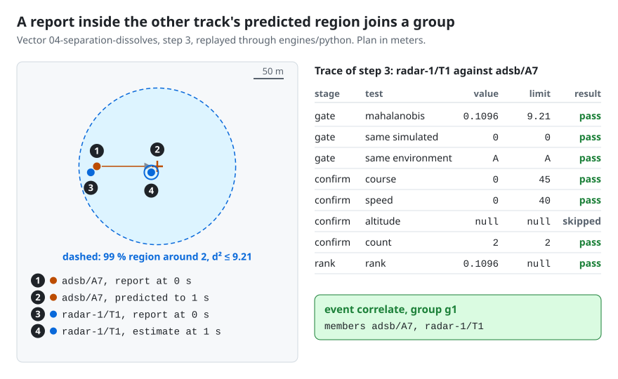
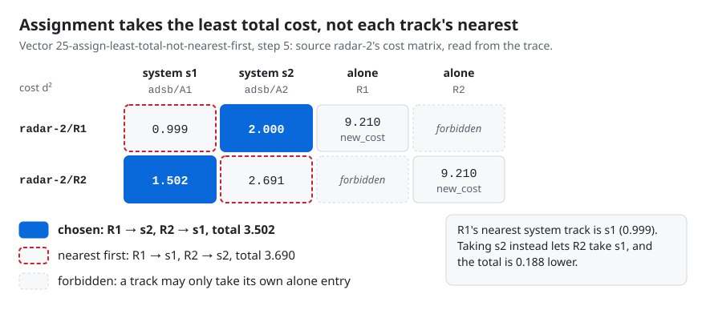
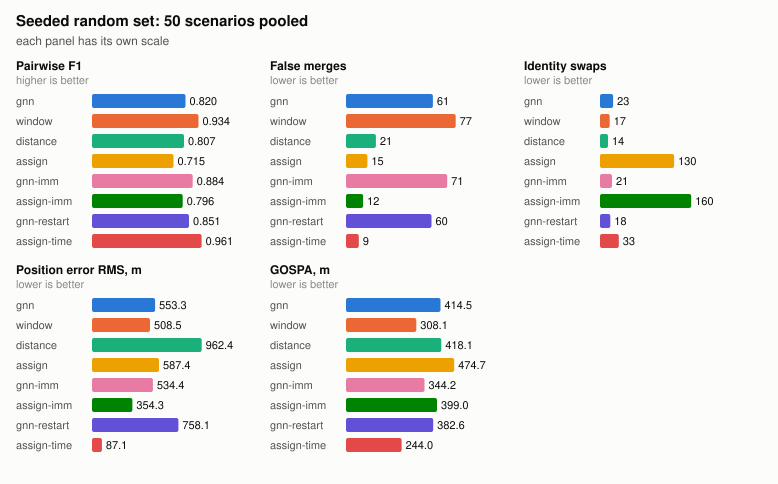

<!-- Written by tools/readme/make-readme.py from tools/readme/template.md. Edit those, not this file. -->
# goat-processors

[](https://github.com/USAREUR-AF/goat-processors/actions/workflows/conformance.yml)

goat-processors holds the functions that work on track data after it has been
translated: correlation, fusion, filtering, and quality measurement with the
actions that follow from it. [goat-transformers](https://github.com/USAREUR-AF/goat-transformers)
is the layer beneath it and translates messages between formats into one
shared model; goat-processors reads that model. Each function is a written
specification, a set of settings files (packs), and test cases (vectors) that
seven independent engines (Python, Rust, Go, Java, C++, Erlang, Zig)
reproduce exactly, down to the record of every test they run.

<picture>
  <source media="(prefers-color-scheme: dark)" srcset="docs/figures/processing-layer-dark.svg">
  
</picture>

## Words used here

| Word | Meaning |
|---|---|
| report | one message from one source about one object, after translation: its time, position, reported position error (`ce`, meters) and identity keys |
| track | the reports of one source about one object, under that source's track number; named `<source>/<uid>`, for example `radar-1/T1` |
| motion filter | a small Kalman filter kept for each track: it predicts where the track will be, and how uncertain that prediction is |
| tick | a call `tick(now_ms)` that moves the function's clock to `now_ms` and returns its output for that moment |
| group, system track | the output for one object: the tracks judged to describe it, with one estimate. The per-report method makes groups of two or more tracks; the assignment method keeps one system track per object, even for a track seen by one source |
| pack | a named settings file for one function, `packs/<function>-<name>/pack.def`: which tests run and with which limits. A pack holds no code |
| vector | a test case: a list of inputs with the exact events, trace and final state every engine must produce |
| trace record | one line per test the engine ran: what it compared, the value it computed, the limit and the result |

## Functions

| Function | What it does | Specification | Packs | Vectors | Status |
|---|---|---|---:|---:|---|
| correlate | decides which tracks from different sources describe the same object, groups them, and outputs one estimate per group. This row is the per-report method, `confirm`: each new report is tested, and a pair is grouped after passing on two reports in a row | [correlate.md](spec/correlate.md) 1.0 | 8 | 32 | Built in seven languages |
| correlate, method assign | the per-tick method, `assign`: at each tick, places all of one source's tracks at once into one output track per object (a system track) by the least total cost, and combines the members' positions weighted by their uncertainty | [correlate-assign.md](spec/correlate-assign.md) 0.7 | 6 | 27 | Built in seven languages |
| fuse | combines the tracks of one group (those whose reports carry the same `fuse.group` key) into one estimate: weighted by each member's uncertainty (inverse variance), or by covariance intersection when members may share an error, or by taking the best, highest-priority or latest member; each other attribute (identity, for example) by its own rule | [fuse.md](spec/fuse.md) 0.2 | 5 | 16 | Built in seven languages |
| filter | keeps or drops each report by the first matching rule: inside or outside a circle or polygon, within a distance of a reference such as own ship, by environment, affiliation, source, identity or any key, and thins a feed by interval | [filter.md](spec/filter.md) 0.1 | 3 | 27 | Built in seven languages |
| quality | measures each track and each source from its reports (time between updates, age, latency, how far reports fall from the track's prediction in units of the reported error, the speed implied by successive positions against the reported speed, reports out of order, missing keys, lateness against the other sources, and the clock error and clock state the source reports) and applies the action a rule attaches to a measure: mark, downgrade, drop or alert | [quality.md](spec/quality.md) 0.2 | 4 | 22 | Built in seven languages |

Each function runs as `load_pack`, then `ingest(report)` and `tick(now_ms)`,
each returning events and trace records, and `snapshot()`, which returns the
whole state.

## Methods and packs

The correlate function decides which tracks from different sources describe
the same object. It has two **methods**, chosen by a line in the pack:

| Method | How it decides |
|---|---|
| `confirm` (per report) | each new report is tested against the other sources' tracks; a pair is grouped after passing on two reports in a row, and ungrouped after failing twice |
| `assign` (per tick) | at each tick, all of one source's tracks are placed together by the least total cost (an exact minimum-cost assignment), so one close track cannot take another's match; every track is in exactly one system track |

Each **pack** below is one set of correlate settings. Most extend another
pack and add one capability. F1 is the [benchmark](#benchmark)'s association
score, from 0 to 1: how well a pack puts the tracks of one object together
and keeps different objects apart. It is measured on the benchmark's
evaluation set, scenarios held out from tuning, and the number in brackets is
its 95 % interval: two packs differ only when their intervals do not overlap.

| Pack | Method | What it does | Adds over the pack it extends | F1, 500 random scenarios (95 % interval) |
|---|---|---|---|---|
| [`gnn`](packs/correlate-gnn/pack.def) | `confirm` | pairs two tracks when one lies inside the other's predicted 99 % uncertainty region and they agree on course, speed and height, on two reports in a row; the nearest candidate wins | the base of the per-report packs: a statistical gate, a test of the distance between two tracks measured in units of their combined uncertainty | 0.816 (0.801 to 0.831) |
| [`gnn-imm`](packs/correlate-gnn-imm/pack.def) | `confirm` | as gnn, with a second motion model for turning or accelerating targets | `gnn`: a two-model filter, so a turning target stays inside its predicted region | 0.866 (0.851 to 0.878) |
| [`gnn-restart`](packs/correlate-gnn-restart/pack.def) | `confirm` | as gnn, restarting a track's motion filter when a report lands far outside its prediction | `gnn`: recovery when a sensor's track number moves to another object | 0.845 (0.830 to 0.859) |
| [`gnn-time`](packs/correlate-gnn-time/pack.def) | `confirm` | as gnn, widening the uncertainty of a source whose clock is known to be off (radar-1, 500 ms); no benchmark scenario has a source named radar-1, so there it scores exactly as gnn | `gnn`: time quality: a clock error becomes position uncertainty | 0.816 (0.801 to 0.831) |
| [`gnn-priority`](packs/correlate-gnn-priority/pack.def) | `confirm` | as gnn, reporting each output track from its highest-priority source (radar-1 before ais) | `gnn`: a source-priority output in place of the fused estimate | not scored |
| [`gnn-state`](packs/correlate-gnn-state/pack.def) | `confirm` | as gnn, with one chi-square test on position, velocity and height together in place of the course, speed and height tests | `gnn`: the full-state track-to-track statistic | not scored |
| [`sprt`](packs/correlate-sprt/pack.def) | `confirm` | pairs two tracks once the evidence that they are one object, added up report by report, passes a bound set by 1 % false and 1 % missed pairings, and releases them below the lower bound; tracks go stale after five times their source's usual update interval; the output combines the members by their uncertainty | the sequential likelihood-ratio test (Wald) in place of two passes in a row and a hold | 0.908 (0.894 to 0.920) |
| [`distance`](packs/correlate-distance/pack.def) | `confirm` | pairs two tracks closer than 200 m, for feeds that report no error; tracks of one source may pair; the output follows the latest report | `gnn`: plain distance, for sources with no error estimate | 0.793 (0.776 to 0.809) |
| [`assign`](packs/correlate-assign/pack.def) | `assign` | at each tick, places each source's tracks into one output track per object by the least total cost, and combines the members' positions weighted by their uncertainty | the base of the assignment packs | 0.688 (0.664 to 0.711) |
| [`assign-imm`](packs/correlate-assign-imm/pack.def) | `assign` | as assign, with a second motion model for turning or accelerating targets | `assign`: the two-model filter | 0.767 (0.744 to 0.789) |
| [`assign-window`](packs/correlate-assign-window/pack.def) | `assign` | as assign, keeping up to three candidate histories over two ticks before committing | `assign`: a multi-frame window | 0.676 (0.653 to 0.699) |
| [`assign-bias`](packs/correlate-assign-bias/pack.def) | `assign` | as assign-imm, estimating a position offset for each pair of sensors | `assign-imm`: sensor bias estimation, so a sensor off by a few hundred meters still joins | 0.893 (0.879 to 0.904) |
| [`assign-full`](packs/correlate-assign-full/pack.def) | `assign` | as assign-bias, with filter restart, the two-tick window with a margin, and a 20 s stale time | `assign-bias`: every option of assign 0.5 together | 0.947 (0.936 to 0.957) |
| [`assign-time`](packs/correlate-assign-time/pack.def) | `assign` | as assign-full, also fitting a clock offset for each pair of sources | `assign-full`: clock offset: a lag along the track that grows with speed is read as a clock error, not a position bias | 0.947 (0.936 to 0.957) |

**Default: `assign-time`**, the pack the runner ships. Every number here is from the evaluation set, with its 95 % interval in brackets; one pack is better than another only where the intervals do not overlap. F1 on the 500 random scenarios: 0.947 (0.936 to 0.957), equal within the interval to the highest, `assign-full` 0.947 (0.936 to 0.957). In 5 of the 9 scenario families it is highest or equal within the interval to the highest: formation, maneuver, sensor problems, clutter, track management. It is below in crossing (`sprt` 1.000 (1.000 to 1.000) against 0.990 (0.976 to 0.999)); mixed domains (`sprt` 1.000 (1.000 to 1.000) against 0.998 (0.997 to 0.999)); recorded ships (`sprt` 1.000 (1.000 to 1.000) against 0.999 (0.998 to 1.000)). It has no score in scale (3 of 3 scenarios over the 300 s limit). Its position error (GOSPA, a mean position error that also charges missed and false tracks) on the random set is 255 m (235 to 276), equal within the interval to the lowest. Its weak point is identity swaps (an object's output track changing to another): 428 (336 to 537) on the random set, against `gnn-imm` 224 (181 to 276) to `gnn` 370 (307 to 430) for the per-report packs, so the `confirm` method stays selectable.

## Quick start

Run every vector in one language. Each engine uses only its language's
standard library.

```sh
cd engines/python && PYTHONPATH=src python3 -m unittest discover -s tests
```

The command for each language is in the conformance table below.

Open a vector in the replay viewer. It writes one HTML page that works offline:

```sh
python3 -I tools/explain/explain.py packs/correlate-gnn/vectors/04-separation-dissolves.json
# open 04-separation-dissolves.html in a browser

python3 -I tools/explain/explain.py --all build/explain   # every vector, with an index page
```

The page shows a plan view of every report and filter estimate with its
uncertainty ellipse, the groups as they form and dissolve, a step slider, and
for each step the input, the events, every trace record and the snapshot.
[tools/explain/README.md](tools/explain/README.md) lists its options,
including replaying a benchmark run against its ground truth.

## Run it on a machine

The [runner](runner/README.md) runs the functions as a service. It reads
shared-model reports from the goat fabric, runs a declared pipeline (filter,
correlate, fuse, quality) on the Rust engine, and publishes system tracks and
quality marks. It installs on Ubuntu 24.04 from one `.deb`, is configured by
one file, and `goat-processors doctor` reports what is wrong.
[runner/INSTALL.md](runner/INSTALL.md) goes from a fresh machine to a healthy
runner, step by step; `runner/install.sh` does the same steps in one command.

## Every decision is observable

A function decides nothing that is not in its trace. Each test is a record of
what it compared, the value it computed, the limit and the result.

Step 3 of [`04-separation-dissolves.json`](packs/correlate-gnn/vectors/04-separation-dissolves.json) ingests a report from `radar-1/T1`. The engine's first test of it against `adsb/A7` is this record, copied from the vector:

```json
{"stage": "gate", "a": "radar-1/T1", "b": "adsb/A7", "test": "mahalanobis", "value": 0.10957452680004903, "limit": 9.21, "pass": true}
```

The value is the squared distance between the two tracks in units of their combined uncertainty. The limit is the pack's rule `gate mahalanobis gate=9.21` in [`packs/correlate-gnn/pack.def`](packs/correlate-gnn/pack.def). After 7 more records the step returns `{"ev": "correlate", "group": "g1", "members": ["adsb/A7", "radar-1/T1"]}`.

<picture>
  <source media="(prefers-color-scheme: dark)" srcset="docs/figures/correlate-decision-dark.svg">
  
</picture>

The assignment method keeps a cost matrix at each tick and records every
entry and every choice:

<picture>
  <source media="(prefers-color-scheme: dark)" srcset="docs/figures/assign-matrix-dark.svg">
  
</picture>

## Seven engines check each other

<picture>
  <source media="(prefers-color-scheme: dark)" srcset="docs/figures/seven-engines-dark.svg">
  
</picture>

The specification and the hand-stated decisions are the reference; every
vector is computed by the Rust engine and accepted only when all
seven engines agree. Each generator, `tools/make-*-vectors.py`, states its
scenarios' decisions by hand, refuses a vector whose events differ from them,
and writes a vector only when every engine reproduces its events, trace and
final snapshot. Every engine is written from the specification and the
vectors alone, never from another engine's source.
An engine that disagrees with a vector records it in its `DISAGREEMENTS.md`;
the vector is changed only through the specification.

| Language | Engine | Lines of source | Runs every vector with |
|---|---|---:|---|
| Python | [`engines/python`](engines/python) | 3,665 | `cd engines/python && PYTHONPATH=src python3 -m unittest discover -s tests` |
| Rust | [`engines/rust`](engines/rust) | 7,961 | `cd engines/rust && cargo test` |
| Go | [`engines/go`](engines/go) | 6,504 | `cd engines/go && go test ./...` |
| Java | [`engines/java`](engines/java) | 5,823 | `engines/java/build.sh` |
| C++ | [`engines/cpp`](engines/cpp) | 6,102 | `cmake -S engines/cpp -B build/cpp && cmake --build build/cpp && ctest --test-dir build/cpp` |
| Erlang | [`engines/erlang`](engines/erlang) | 4,153 | `engines/erlang/run_tests` |
| Zig | [`engines/zig`](engines/zig) | 8,223 | `cd engines/zig && zig build test` |

Each engine runs all 124 scenario vectors (867 steps, 4,426 trace records) and 235 load vectors (pack files every engine must accept, or must refuse) on every pull request and every push to `main`.

## Benchmark

The correlate packs are scored against ground truth on two separated sets of
scenarios. The **tuning set** is public and is the only one packs are tuned on.
The **evaluation set** comes from held-out seeds and gives every number below;
its seeds are published after each release and then replaced. Each set holds
500 random scenarios and the same families: formations that split and join,
shallow crossings and merges, 3 to 9 g turns, climbs and dives, stop-and-go
surface traffic, sensor dropouts, latency, out-of-order bursts, wrong stated
error and bias, scale up to 1,000 objects, clutter, mixed air, surface and
land traffic, track-number reuse and late sensors, and ships on recorded
public AIS tracks. Every score, its formula and its 95 % interval are in
[docs/benchmark.md](docs/benchmark.md), which `tools/bench/bench.py report`
writes; a difference counts only when the intervals separate. Pack names are
explained in [Methods and packs](#methods-and-packs).

| Measure | Meaning |
|---|---|
| pairwise F1 | at every tick, every pair of live tracks is checked: does the output put them together exactly when they are the same object? Precision is the share of output pairs that are right, recall the share of true pairs found; F1 is their harmonic mean, from 0 to 1, higher is better |
| false merge | two tracks of different objects put in one output track; counted each time it starts |
| missed merge | two tracks of one object kept apart for a whole stretch of at least 10 s |
| identity swap | an object's output track changes to another while the first still exists |
| GOSPA | the mean, over ticks, of the distance between output and true positions, with each error capped at 500 m and every missed or false track charged half the cap; lower is better |

| Pack | F1, 500 random | F1 per family, lowest | False merges | Identity swaps | GOSPA, m |
|---|---:|---|---:|---:|---:|
| [`gnn`](#methods-and-packs) | 0.816<br>(0.801 to 0.831) | 0.778 (formation) | 574<br>(498 to 651) | 370<br>(307 to 430) | 405<br>(386 to 425) |
| [`distance`](#methods-and-packs) | 0.793<br>(0.776 to 0.809) | 0.728 (sensor problems) | 115<br>(78 to 159) | 278<br>(237 to 320) | 424<br>(405 to 445) |
| [`assign`](#methods-and-packs) | 0.688<br>(0.664 to 0.711) | 0.748 (sensor problems) | 77<br>(55 to 101) | 1487<br>(1335 to 1659) | 473<br>(452 to 494) |
| [`gnn-imm`](#methods-and-packs) | 0.866<br>(0.851 to 0.878) | 0.898 (track management) | 652<br>(570 to 734) | 224<br>(181 to 276) | 354<br>(333 to 373) |
| [`assign-imm`](#methods-and-packs) | 0.767<br>(0.744 to 0.789) | 0.890 (sensor problems) | 83<br>(58 to 110) | 1934<br>(1659 to 2255) | 409<br>(387 to 432) |
| [`assign-window`](#methods-and-packs) | 0.676<br>(0.653 to 0.699) | 0.740 (sensor problems) | 423<br>(362 to 487) | 2146<br>(1941 to 2375) | 474<br>(453 to 495) |
| [`assign-bias`](#methods-and-packs) | 0.893<br>(0.879 to 0.904) | 0.897 (track management) | 65<br>(44 to 88) | 753<br>(660 to 871) | 324<br>(304 to 343) |
| [`assign-full`](#methods-and-packs) | 0.947<br>(0.936 to 0.957) | 0.945 (sensor problems) | 56<br>(34 to 80) | 421<br>(323 to 535) | 255<br>(235 to 276) |
| [`gnn-restart`](#methods-and-packs) | 0.845<br>(0.830 to 0.859) | 0.805 (formation) | 609<br>(530 to 692) | 357<br>(299 to 418) | 374<br>(355 to 395) |
| [`assign-time`](#methods-and-packs) | 0.947<br>(0.936 to 0.957) | 0.965 (formation) | 40<br>(24 to 58) | 428<br>(336 to 537) | 255<br>(235 to 276) |
| [`gnn-time`](#methods-and-packs) | 0.816<br>(0.801 to 0.831) | 0.778 (formation) | 574<br>(498 to 651) | 370<br>(307 to 430) | 405<br>(386 to 425) |
| [`sprt`](#methods-and-packs) | 0.908<br>(0.894 to 0.920) | 0.929 (sensor problems) | 41<br>(21 to 65) | 242<br>(165 to 338) | 306<br>(285 to 326) |

All numbers are from the evaluation set (663 scenarios, held-out seeds); brackets are 95 % bootstrap intervals. False merges, identity swaps and GOSPA are over the random scenarios; every family is in [docs/benchmark.md](docs/benchmark.md).

<picture>
  <source media="(prefers-color-scheme: dark)" srcset="docs/figures/bench/random-dark.svg">
  
</picture>

## Design principles

| Principle | In practice |
|---|---|
| Deterministic | The only clock is the time in the input. Every collection is visited in an order the specification states. The same input gives the same output and trace in every language. |
| Rules are data | A pack (`packs/<function>-<name>/pack.def`) names fixed, specified tests and their parameters. A pack holds no code and no expressions. |
| Every decision is traced | Every test is a trace record with its inputs, value, limit and result. `snapshot()` returns the whole state, including each track's filter. |
| Engines check each other | Seven engines written apart must reproduce every vector: events, trace and final snapshot, numbers within a relative 1e-6. |
| Standard library only | No engine or tool depends on a third-party package. The runner, which connects the engines to the fabric, is the one exception and lists its crates in [`runner/THIRD-PARTY.md`](runner/THIRD-PARTY.md). |

## Layout

| Path | What |
|---|---|
| [`spec/`](spec/) | one specification per function, the shared [vector format](spec/vector-format.md), load vectors |
| [`packs/`](packs/) | 26 rule packs, each with its `pack.def` and its scenario vectors (124 in all) |
| [`engines/`](engines/) | one independent engine per language, each with its test runner |
| [`tools/`](tools/) | the vector generators, the replay viewer (`explain/`), the benchmark (`bench/`), the performance harness (`perf/`), the research prototypes (`research/`), this README's generator (`readme/`) |
| [`runner/`](runner/) | the runner: a service for Ubuntu 24.04 that runs a pipeline of the functions on the goat fabric, with its `.deb`, [install guide](runner/INSTALL.md) and [deploy contract](runner/DEPLOY-CONTRACT.md) |
| [`docs/`](docs/) | the benchmark results, the [performance](docs/performance.md) baseline and the figures, each written by a script; the [methods survey](docs/research/correlation-and-fusion-methods.md) |

## Working with AI agents

An AI agent here is a program, usually driven by a language model, that reads
data and acts through tools. The processors stay fast and exact, with no model
inside the engines. Agents connect at the edges, through the same doors a
person uses, and every agent action carries the identity it acts for and is
written to an audit log.

Six of the seven interfaces are built. A row says Built only when its code and its tests are on main.

| Interface | What it lets you build | Status |
|---|---|---|
| [MCP server](runner/src/mcp.rs) | Connect an AI assistant to a running runner over MCP (Model Context Protocol, the common way an assistant calls a program's tools): it can read tracks and quality marks and propose changes, with the authority of the person it acts for and no more | Built |
| [Agent as a source](runner/src/api.rs) | Have an agent publish tracks or notes on the goat fabric (the network the runner reads and publishes on) under its own name, marked as agent-derived with its model and inputs; the processors take them in like any other source | Built |
| Agent as an adjudicator | Let an agent or an analyst settle a hard case with a hint ("treat A and B as one object", "keep A and B apart") that the engines record and trace like any other input, so a replay stays exact | Designed |
| [Settings proposals and site auto-approval](runner/src/proposals.rs) | Have an agent propose another installed pack for a function; a person approves it, or a site rule does, within the packs the rule allows and once its gate command (the benchmark, for example) passes; every change is logged and can be reverted in one step | Built |
| [Audit log](runner/src/api.rs) | See every agent call and action afterwards: who it acted for, which tool, a fingerprint (hash) of its inputs, and the result | Built |
| [The "why?" explainer](runner/src/agentic.rs) | Ask in plain words why two tracks were joined or kept apart, and get an answer in which every sentence cites the trace record it comes from | Built |
| [Build-your-own guide](runner/examples/README.md) | Build your own integration from one runnable example per built interface (MCP, source, settings), each run in CI; the adjudicator example follows when hints are built | Built |

Built: the code and its tests are on main. Written: the document exists. Designed: decided, not yet in the tree.

Every agent feature is optional: with all of them enabled and no agent
connected, the runner's output is the same, byte for byte (tested). Each site
declares which model its agent features may use, one on its own machines or
one hosted by a provider, and the highest level of data that may be sent to
it. The design, with the cost and the matching safeguard for each choice, is in [`docs/design/agentic-ai.md`](docs/design/agentic-ai.md).

## Contributing

[CONTRIBUTING.md](CONTRIBUTING.md) explains how to add a function, a pack or
an engine, and the clean-room rule every engine follows.

## License

Apache License 2.0; see [LICENSE](LICENSE), [NOTICE](NOTICE) and
[INTENT.md](INTENT.md). Portions written by U.S. Federal government employees
within the scope of their employment are in the public domain in the United
States.
