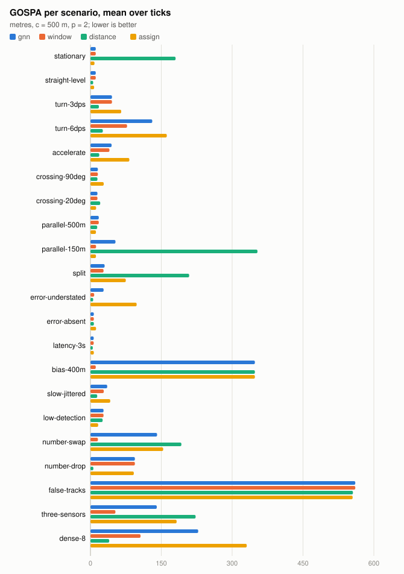

# Correlation benchmark

Status: Measured. Generated by `python3 -I tools/bench/bench.py report`; do not edit by hand. Formats and the formula of every score: [tools/bench/README.md](../tools/bench/README.md).

Each scenario places truth objects and sensors that report tracks of them with stated errors. Every correlate pack runs on the same report stream with the Python engine, and its output at each tick is scored against truth.

Each pack is one set of correlate settings; what each one does, and what it adds over the pack it extends, is in the README, [Methods and packs](../README.md#methods-and-packs). The measures, in short: **pairwise F1** checks, at every tick, every pair of live tracks (together in the output exactly when they are the same object?), from 0 to 1, higher is better; a **false merge** puts tracks of two objects together; a **missed merge** keeps one object's tracks apart for 10 s or more; an **identity swap** changes an object's output track while the old one still exists; **GOSPA** is the mean position error with each error capped at 500 m and every missed or false track charged half the cap, lower is better.

## Seeded random set

50 scenarios: 2 to 4 objects (still, straight, turning, accelerating), 2 or 3 sensors, each sensor with a chance of understated or absent error, bias, latency, low detection, a track number swap, a drop, and false tracks. Counts are summed and rates pooled over the set.

<picture>
  <source media="(prefers-color-scheme: dark)" srcset="figures/bench/random-dark.svg">
  
</picture>

The charts leave out assign-window (assign-full includes its multi-frame window); assign-bias (assign-full includes its bias estimate); assign-full (assign-time is assign-full plus a fitted clock offset); gnn-time (its time_default names source radar-1, which no scenario has, so it scores as gnn); the tables include every pack.

| Pack | Pairwise F1 | Precision | Recall | False merges | Missed merges | Identity swaps | Time to associate, s | Position error RMS, m | GOSPA, m |
|---|---|---|---|---|---|---|---|---|---|
| [gnn](../README.md#methods-and-packs) | 0.820 | 0.988 | 0.701 | 61 | 81 | 23 | 5.3 | 553.3 | 414.5 |
| [window](../README.md#methods-and-packs) | 0.934 | 0.988 | 0.887 | 77 | 40 | 17 | 3.5 | 508.5 | 308.1 |
| [distance](../README.md#methods-and-packs) | 0.807 | 0.996 | 0.678 | 21 | 76 | 14 | 8.2 | 962.4 | 418.1 |
| [assign](../README.md#methods-and-packs) | 0.715 | 0.997 | 0.557 | 15 | 99 | 131 | 4.3 | 587.2 | 475.0 |
| [gnn-imm](../README.md#methods-and-packs) | 0.884 | 0.993 | 0.797 | 71 | 55 | 21 | 4.8 | 534.4 | 344.2 |
| [assign-imm](../README.md#methods-and-packs) | 0.796 | 0.998 | 0.661 | 12 | 54 | 159 | 4.6 | 354.2 | 398.9 |
| [assign-window](../README.md#methods-and-packs) | 0.698 | 0.994 | 0.538 | 62 | 90 | 231 | 5.0 | 853.2 | 476.9 |
| [assign-bias](../README.md#methods-and-packs) | 0.906 | 0.999 | 0.829 | 11 | 47 | 65 | 2.5 | 576.3 | 313.2 |
| [assign-full](../README.md#methods-and-packs) | 0.958 | 0.999 | 0.919 | 10 | 4 | 37 | 0.9 | 88.5 | 247.2 |
| [gnn-restart](../README.md#methods-and-packs) | 0.851 | 0.990 | 0.746 | 60 | 64 | 18 | 3.2 | 758.1 | 382.6 |
| [assign-time](../README.md#methods-and-packs) | 0.961 | 0.999 | 0.926 | 9 | 2 | 33 | 0.8 | 87.1 | 244.0 |
| [gnn-time](../README.md#methods-and-packs) | 0.820 | 0.988 | 0.701 | 61 | 81 | 23 | 5.3 | 553.3 | 414.5 |

## Named scenarios, pooled

The 21 named scenarios outside the time family.

| Pack | Pairwise F1 | Precision | Recall | False merges | Missed merges | Identity swaps | Time to associate, s | Position error RMS, m | GOSPA, m |
|---|---|---|---|---|---|---|---|---|---|
| [gnn](../README.md#methods-and-packs) | 0.951 | 0.997 | 0.910 | 3 | 2 | 1 | 2.2 | 40.4 | 94.9 |
| [window](../README.md#methods-and-packs) | 0.924 | 0.930 | 0.917 | 5 | 6 | 1 | 0.7 | 40.4 | 56.8 |
| [distance](../README.md#methods-and-packs) | 0.884 | 0.857 | 0.913 | 13 | 2 | 1 | 2.6 | 939.0 | 108.8 |
| [assign](../README.md#methods-and-packs) | 0.937 | 1.000 | 0.881 | 0 | 2 | 2 | 1.2 | 67.1 | 109.7 |
| [gnn-imm](../README.md#methods-and-packs) | 0.968 | 0.996 | 0.941 | 3 | 2 | 1 | 2.4 | 9.6 | 69.8 |
| [assign-imm](../README.md#methods-and-packs) | 0.971 | 1.000 | 0.944 | 0 | 2 | 2 | 1.0 | 18.4 | 72.5 |
| [assign-window](../README.md#methods-and-packs) | 0.929 | 1.000 | 0.867 | 2 | 2 | 2 | 2.0 | 64.9 | 115.7 |
| [assign-bias](../README.md#methods-and-packs) | 0.990 | 1.000 | 0.979 | 0 | 1 | 2 | 0.9 | 14.1 | 48.9 |
| [assign-full](../README.md#methods-and-packs) | 0.997 | 1.000 | 0.994 | 0 | 0 | 0 | 0.4 | 11.4 | 41.2 |
| [gnn-restart](../README.md#methods-and-packs) | 0.956 | 0.997 | 0.919 | 3 | 2 | 1 | 1.3 | 38.3 | 89.6 |
| [assign-time](../README.md#methods-and-packs) | 0.997 | 1.000 | 0.994 | 0 | 0 | 0 | 0.4 | 11.4 | 41.2 |
| [gnn-time](../README.md#methods-and-packs) | 0.951 | 0.997 | 0.910 | 3 | 2 | 1 | 2.2 | 40.4 | 94.9 |

## Time quality set, pooled

The 7 scenarios of the time family, pooled on their own: a sensor whose clock is 200 ms ahead, drifting 10 ms per minute, or running free (1.5 s behind and drifting), each with every sensor reporting `time_error_ms` and `time_state` and as an "undescribed" twin with the same reports and no time keys; and reports arriving out of order. Truth is exact; only the stamped time is wrong. The object turns 90 degrees every 100 s, so a fixed position bias cannot stand in for a clock error.

| Pack | Pairwise F1 | Precision | Recall | False merges | Missed merges | Identity swaps | Time to associate, s | Position error RMS, m | GOSPA, m |
|---|---|---|---|---|---|---|---|---|---|
| [gnn](../README.md#methods-and-packs) | 0.959 | 1.000 | 0.922 | 0 | 3 | 0 | 1.6 | 82.4 | 86.8 |
| [window](../README.md#methods-and-packs) | 0.996 | 1.000 | 0.993 | 0 | 0 | 0 | 1.7 | 80.6 | 55.1 |
| [distance](../README.md#methods-and-packs) | 0.937 | 1.000 | 0.881 | 0 | 6 | 0 | 0.0 | 45.2 | 95.4 |
| [assign](../README.md#methods-and-packs) | 0.775 | 1.000 | 0.632 | 0 | 4 | 120 | 2.5 | 121.0 | 214.5 |
| [gnn-imm](../README.md#methods-and-packs) | 0.968 | 1.000 | 0.939 | 0 | 0 | 0 | 3.5 | 10.0 | 40.1 |
| [assign-imm](../README.md#methods-and-packs) | 0.881 | 1.000 | 0.787 | 0 | 4 | 21 | 1.8 | 17.8 | 120.0 |
| [assign-window](../README.md#methods-and-packs) | 0.740 | 1.000 | 0.587 | 0 | 4 | 141 | 4.2 | 117.2 | 234.9 |
| [assign-bias](../README.md#methods-and-packs) | 0.936 | 1.000 | 0.879 | 0 | 1 | 9 | 0.1 | 21.8 | 76.1 |
| [assign-full](../README.md#methods-and-packs) | 0.932 | 1.000 | 0.873 | 0 | 1 | 15 | 0.1 | 21.6 | 79.2 |
| [gnn-restart](../README.md#methods-and-packs) | 0.949 | 1.000 | 0.903 | 0 | 3 | 5 | 1.3 | 80.6 | 92.6 |
| [assign-time](../README.md#methods-and-packs) | 0.996 | 1.000 | 0.993 | 0 | 0 | 0 | 0.0 | 38.6 | 25.9 |
| [gnn-time](../README.md#methods-and-packs) | 0.959 | 1.000 | 0.922 | 0 | 3 | 0 | 1.6 | 82.4 | 86.8 |

## Scenarios

| Scenario | Family | Tests | Objects | Reports | False reports | Sensors |
|---|---|---|---|---|---|---|
| stationary | motion | one object that does not move, two sensors | 1 | 143 | 0 | radar 4s, sigma 60 m, jitter 0.2 s, Pd 0.9, latency 0.5 s; beacon 1s, sigma 15 m, jitter 0.1 s, Pd 0.98, latency 0.3 s |
| straight-level | motion | one object on a straight line at 200 m/s | 1 | 148 | 0 | radar 4s, sigma 60 m, jitter 0.2 s, Pd 0.9, latency 0.5 s; beacon 1s, sigma 15 m, jitter 0.1 s, Pd 0.98, latency 0.3 s |
| turn-3dps | motion | coordinated turn of 3 deg/s for 60 s at 150 m/s | 1 | 147 | 0 | radar 4s, sigma 60 m, jitter 0.2 s, Pd 0.9, latency 0.5 s; beacon 1s, sigma 15 m, jitter 0.1 s, Pd 0.98, latency 0.3 s |
| turn-6dps | motion | coordinated turn of 6 deg/s for 45 s at 200 m/s | 1 | 145 | 0 | radar 4s, sigma 60 m, jitter 0.2 s, Pd 0.9, latency 0.5 s; beacon 1s, sigma 15 m, jitter 0.1 s, Pd 0.98, latency 0.3 s |
| accelerate | motion | speed 100 to 300 m/s at 10 m/s^2, then back down | 1 | 143 | 0 | radar 4s, sigma 60 m, jitter 0.2 s, Pd 0.9, latency 0.5 s; beacon 1s, sigma 15 m, jitter 0.1 s, Pd 0.98, latency 0.3 s |
| crossing-90deg | geometry | two objects cross at right angles, 1 km apart in height | 2 | 295 | 0 | radar 4s, sigma 60 m, jitter 0.2 s, Pd 0.9, latency 0.5 s; beacon 1s, sigma 15 m, jitter 0.1 s, Pd 0.98, latency 0.3 s |
| crossing-20deg | geometry | two objects cross at 20 degrees at the same height | 2 | 292 | 0 | radar 4s, sigma 60 m, jitter 0.2 s, Pd 0.9, latency 0.5 s; beacon 1s, sigma 15 m, jitter 0.1 s, Pd 0.98, latency 0.3 s |
| parallel-500m | geometry | two objects abreast 500 m apart, same velocity | 2 | 284 | 0 | radar 4s, sigma 60 m, jitter 0.2 s, Pd 0.9, latency 0.5 s; beacon 1s, sigma 15 m, jitter 0.1 s, Pd 0.98, latency 0.3 s |
| parallel-150m | geometry | close formation: two objects abreast 150 m apart | 2 | 284 | 0 | radar 4s, sigma 60 m, jitter 0.2 s, Pd 0.9, latency 0.5 s; beacon 1s, sigma 15 m, jitter 0.1 s, Pd 0.98, latency 0.3 s |
| split | geometry | one object splits into two at 50 s; the new one turns away at 4 deg/s | 2 | 228 | 0 | radar 4s, sigma 60 m, jitter 0.2 s, Pd 0.9, latency 0.5 s; beacon 1s, sigma 15 m, jitter 0.1 s, Pd 0.98, latency 0.3 s |
| error-understated | sensor error | the radar reports a third of its true error | 1 | 143 | 0 | radar 4s, sigma 60 m, error reported /3, jitter 0.2 s, Pd 0.9, latency 0.5 s; beacon 1s, sigma 15 m, jitter 0.1 s, Pd 0.98, latency 0.3 s |
| error-absent | sensor error | neither sensor reports its error | 1 | 143 | 0 | radar 4s, sigma 60 m, no error reported, jitter 0.2 s, Pd 0.9, latency 0.5 s; beacon 1s, sigma 15 m, no error reported, jitter 0.1 s, Pd 0.98, latency 0.3 s |
| latency-3s | sensor error | the radar's reports arrive 3 s after their time, object at 250 m/s | 1 | 144 | 0 | radar 4s, sigma 60 m, jitter 0.2 s, Pd 0.9, latency 3 s; beacon 1s, sigma 15 m, jitter 0.1 s, Pd 0.98, latency 0.3 s |
| bias-400m | sensor error | the radar's positions are all 400 m off to the north-east | 1 | 147 | 0 | radar 4s, sigma 60 m, jitter 0.2 s, Pd 0.9, latency 0.5 s, bias 400.222 m; beacon 1s, sigma 15 m, jitter 0.1 s, Pd 0.98, latency 0.3 s |
| slow-jittered | sensor error | radar every 12 s with 3 s jitter | 1 | 129 | 0 | radar 12s, sigma 60 m, jitter 3 s, Pd 0.9, latency 0.5 s; beacon 1s, sigma 15 m, jitter 0.1 s, Pd 0.98, latency 0.3 s |
| low-detection | sensor error | both sensors detect half of the time | 2 | 153 | 0 | radar 4s, sigma 60 m, jitter 0.2 s, Pd 0.5, latency 0.5 s; beacon 1s, sigma 15 m, jitter 0.1 s, Pd 0.5, latency 0.3 s |
| number-swap | track management | the radar trades the track numbers of two objects at 60 s | 2 | 288 | 0 | radar 4s, sigma 60 m, jitter 0.2 s, Pd 0.9, latency 0.5 s, 1 number swap; beacon 1s, sigma 15 m, jitter 0.1 s, Pd 0.98, latency 0.3 s |
| number-drop | track management | each sensor drops its track and starts a new number | 1 | 136 | 0 | radar 4s, sigma 60 m, jitter 0.2 s, Pd 0.9, latency 0.5 s, 1 drop; beacon 1s, sigma 15 m, jitter 0.1 s, Pd 0.98, latency 0.3 s, 1 drop |
| false-tracks | clutter | the radar reports 8 false tracks near the objects | 2 | 357 | 72 | radar 4s, sigma 60 m, jitter 0.2 s, Pd 0.9, latency 0.5 s, 8 false; beacon 1s, sigma 15 m, jitter 0.1 s, Pd 0.98, latency 0.3 s |
| three-sensors | mixed | radar, beacon and a coarse passive sensor, three objects | 3 | 569 | 0 | radar 4s, sigma 60 m, jitter 0.2 s, Pd 0.9, latency 0.5 s; beacon 1s, sigma 15 m, jitter 0.1 s, Pd 0.98, latency 0.3 s; passive 2s, sigma 250 m, jitter 0.3 s, Pd 0.8, latency 1 s |
| dense-8 | mixed | eight objects in a 20 km box, some turning | 8 | 1166 | 0 | radar 4s, sigma 60 m, jitter 0.2 s, Pd 0.9, latency 0.5 s; beacon 1s, sigma 15 m, jitter 0.1 s, Pd 0.98, latency 0.3 s |
| clock-offset-200ms | time | beacon2's clock is 200 ms ahead, object at 300 m/s turning 90 deg every 100 s; every sensor reports its time quality | 1 | 261 | 0 | radar 4s, sigma 60 m, jitter 0.2 s, Pd 0.9, latency 0.5 s, time coherent; beacon 1s, sigma 15 m, jitter 0.1 s, Pd 0.98, latency 0.3 s, time coherent; beacon2 1s, sigma 15 m, jitter 0.1 s, Pd 0.98, latency 0.3 s, clock +200 ms, time coherent |
| clock-drift-10ms-min | time | beacon2's clock drifts 10 ms per minute from 0 to 200 ms over 20 min; every sensor reports its time quality | 1 | 2614 | 0 | radar 4s, sigma 60 m, jitter 0.2 s, Pd 0.9, latency 0.5 s, time coherent; beacon 1s, sigma 15 m, jitter 0.1 s, Pd 0.98, latency 0.3 s, time coherent; beacon2 1s, sigma 15 m, jitter 0.1 s, Pd 0.98, latency 0.3 s, clock drift +10 ms/min, time drifting |
| clock-free-running | time | beacon2's clock runs free: 1.5 s behind, drifting 30 ms per minute further; every sensor reports its time quality | 1 | 648 | 0 | radar 4s, sigma 60 m, jitter 0.2 s, Pd 0.9, latency 0.5 s, time coherent; beacon 1s, sigma 15 m, jitter 0.1 s, Pd 0.98, latency 0.3 s, time coherent; beacon2 1s, sigma 15 m, jitter 0.1 s, Pd 0.98, latency 0.3 s, clock -1500 ms, clock drift -30 ms/min, time free-running |
| clock-offset-200ms-undescribed | time | beacon2's clock is 200 ms ahead, object at 300 m/s turning 90 deg every 100 s; no time quality on any report | 1 | 261 | 0 | radar 4s, sigma 60 m, jitter 0.2 s, Pd 0.9, latency 0.5 s; beacon 1s, sigma 15 m, jitter 0.1 s, Pd 0.98, latency 0.3 s; beacon2 1s, sigma 15 m, jitter 0.1 s, Pd 0.98, latency 0.3 s, clock +200 ms |
| clock-drift-10ms-min-undescribed | time | beacon2's clock drifts 10 ms per minute from 0 to 200 ms over 20 min; no time quality on any report | 1 | 2614 | 0 | radar 4s, sigma 60 m, jitter 0.2 s, Pd 0.9, latency 0.5 s; beacon 1s, sigma 15 m, jitter 0.1 s, Pd 0.98, latency 0.3 s; beacon2 1s, sigma 15 m, jitter 0.1 s, Pd 0.98, latency 0.3 s, clock drift +10 ms/min |
| clock-free-running-undescribed | time | beacon2's clock runs free: 1.5 s behind, drifting 30 ms per minute further; no time quality on any report | 1 | 648 | 0 | radar 4s, sigma 60 m, jitter 0.2 s, Pd 0.9, latency 0.5 s; beacon 1s, sigma 15 m, jitter 0.1 s, Pd 0.98, latency 0.3 s; beacon2 1s, sigma 15 m, jitter 0.1 s, Pd 0.98, latency 0.3 s, clock -1500 ms, clock drift -30 ms/min |
| out-of-order | time | beacon2's reports arrive 0.3 to 2.8 s after their time, so out of order; clocks coherent | 1 | 264 | 0 | radar 4s, sigma 60 m, jitter 0.2 s, Pd 0.9, latency 0.5 s, time coherent; beacon 1s, sigma 15 m, jitter 0.1 s, Pd 0.98, latency 0.3 s, time coherent; beacon2 1s, sigma 15 m, jitter 0.1 s, Pd 0.98, latency 0.3 s, delivery +0 to 2.5 s, time coherent |

## Association per scenario

<picture>
  <source media="(prefers-color-scheme: dark)" srcset="figures/bench/f1-dark.svg">
  
</picture>

### Motion

| Scenario | Pack | F1 | Precision | Recall | False merges | Missed merges | Swaps | Time to associate, s | RMS, m | GOSPA, m |
|---|---|---|---|---|---|---|---|---|---|---|
| stationary | gnn | 0.996 | 1.000 | 0.992 | 0 | 0 | 0 | 1.0 | 9.3 | 11.2 |
| stationary | window | 0.996 | 1.000 | 0.992 | 0 | 0 | 0 | 1.0 | 9.3 | 11.2 |
| stationary | distance | 0.667 | 1.000 | 0.500 | 0 | 0 | 0 | 60.0 | 10.8 | 180.3 |
| stationary | assign | 1.000 | 1.000 | 1.000 | 0 | 0 | 0 | 0.0 | 9.5 | 8.6 |
| stationary | gnn-imm | 0.996 | 1.000 | 0.992 | 0 | 0 | 0 | 1.0 | 9.3 | 11.2 |
| stationary | assign-imm | 1.000 | 1.000 | 1.000 | 0 | 0 | 0 | 0.0 | 9.5 | 8.5 |
| stationary | assign-window | 0.996 | 1.000 | 0.992 | 0 | 0 | 0 | 1.0 | 9.5 | 11.4 |
| stationary | assign-bias | 1.000 | 1.000 | 1.000 | 0 | 0 | 0 | 0.0 | 9.5 | 8.5 |
| stationary | assign-full | 1.000 | 1.000 | 1.000 | 0 | 0 | 0 | 0.0 | 9.5 | 8.5 |
| stationary | gnn-restart | 0.996 | 1.000 | 0.992 | 0 | 0 | 0 | 1.0 | 9.3 | 11.2 |
| stationary | assign-time | 1.000 | 1.000 | 1.000 | 0 | 0 | 0 | 0.0 | 9.5 | 8.5 |
| stationary | gnn-time | 0.996 | 1.000 | 0.992 | 0 | 0 | 0 | 1.0 | 9.3 | 11.2 |
| straight-level | gnn | 0.996 | 1.000 | 0.992 | 0 | 0 | 0 | 1.0 | 9.3 | 11.2 |
| straight-level | window | 0.996 | 1.000 | 0.992 | 0 | 0 | 0 | 1.0 | 9.3 | 11.2 |
| straight-level | distance | 1.000 | 1.000 | 1.000 | 0 | 0 | 0 | 0.0 | 6.5 | 5.8 |
| straight-level | assign | 1.000 | 1.000 | 1.000 | 0 | 0 | 0 | 0.0 | 9.0 | 7.8 |
| straight-level | gnn-imm | 0.996 | 1.000 | 0.992 | 0 | 0 | 0 | 1.0 | 9.3 | 11.2 |
| straight-level | assign-imm | 1.000 | 1.000 | 1.000 | 0 | 0 | 0 | 0.0 | 9.0 | 7.8 |
| straight-level | assign-window | 0.996 | 1.000 | 0.992 | 0 | 0 | 0 | 1.0 | 9.0 | 10.8 |
| straight-level | assign-bias | 1.000 | 1.000 | 1.000 | 0 | 0 | 0 | 0.0 | 9.0 | 7.8 |
| straight-level | assign-full | 1.000 | 1.000 | 1.000 | 0 | 0 | 0 | 0.0 | 9.0 | 7.8 |
| straight-level | gnn-restart | 0.996 | 1.000 | 0.992 | 0 | 0 | 0 | 1.0 | 9.3 | 11.2 |
| straight-level | assign-time | 1.000 | 1.000 | 1.000 | 0 | 0 | 0 | 0.0 | 9.0 | 7.8 |
| straight-level | gnn-time | 0.996 | 1.000 | 0.992 | 0 | 0 | 0 | 1.0 | 9.3 | 11.2 |
| turn-3dps | gnn | 1.000 | 1.000 | 1.000 | 0 | 0 | 0 | 0.0 | 57.6 | 45.6 |
| turn-3dps | window | 1.000 | 1.000 | 1.000 | 0 | 0 | 0 | 0.0 | 57.6 | 45.6 |
| turn-3dps | distance | 1.000 | 1.000 | 1.000 | 0 | 0 | 0 | 0.0 | 20.7 | 17.8 |
| turn-3dps | assign | 0.965 | 1.000 | 0.933 | 0 | 0 | 0 | 0.0 | 86.0 | 65.2 |
| turn-3dps | gnn-imm | 1.000 | 1.000 | 1.000 | 0 | 0 | 0 | 0.0 | 10.0 | 8.9 |
| turn-3dps | assign-imm | 1.000 | 1.000 | 1.000 | 0 | 0 | 0 | 0.0 | 10.0 | 8.8 |
| turn-3dps | assign-window | 0.961 | 1.000 | 0.924 | 0 | 0 | 0 | 1.0 | 73.1 | 68.2 |
| turn-3dps | assign-bias | 1.000 | 1.000 | 1.000 | 0 | 0 | 0 | 0.0 | 10.0 | 8.8 |
| turn-3dps | assign-full | 1.000 | 1.000 | 1.000 | 0 | 0 | 0 | 0.0 | 10.0 | 8.8 |
| turn-3dps | gnn-restart | 1.000 | 1.000 | 1.000 | 0 | 0 | 0 | 0.0 | 57.6 | 45.6 |
| turn-3dps | assign-time | 1.000 | 1.000 | 1.000 | 0 | 0 | 0 | 0.0 | 10.0 | 8.8 |
| turn-3dps | gnn-time | 1.000 | 1.000 | 1.000 | 0 | 0 | 0 | 0.0 | 57.6 | 45.6 |
| turn-6dps | gnn | 0.860 | 1.000 | 0.754 | 0 | 0 | 0 | 0.0 | 113.7 | 130.8 |
| turn-6dps | window | 1.000 | 1.000 | 1.000 | 0 | 0 | 0 | 0.0 | 113.7 | 77.5 |
| turn-6dps | distance | 1.000 | 1.000 | 1.000 | 0 | 0 | 0 | 0.0 | 35.4 | 26.1 |
| turn-6dps | assign | 0.764 | 1.000 | 0.619 | 0 | 0 | 0 | 0.0 | 187.0 | 161.6 |
| turn-6dps | gnn-imm | 1.000 | 1.000 | 1.000 | 0 | 0 | 0 | 0.0 | 10.2 | 8.6 |
| turn-6dps | assign-imm | 0.996 | 1.000 | 0.992 | 0 | 0 | 0 | 0.0 | 20.2 | 11.4 |
| turn-6dps | assign-window | 0.771 | 1.000 | 0.627 | 0 | 0 | 0 | 1.0 | 182.0 | 161.8 |
| turn-6dps | assign-bias | 1.000 | 1.000 | 1.000 | 0 | 0 | 0 | 0.0 | 10.4 | 8.6 |
| turn-6dps | assign-full | 1.000 | 1.000 | 1.000 | 0 | 0 | 0 | 0.0 | 10.4 | 8.6 |
| turn-6dps | gnn-restart | 0.808 | 1.000 | 0.678 | 0 | 0 | 0 | 0.0 | 80.5 | 134.7 |
| turn-6dps | assign-time | 1.000 | 1.000 | 1.000 | 0 | 0 | 0 | 0.0 | 10.4 | 8.6 |
| turn-6dps | gnn-time | 0.860 | 1.000 | 0.754 | 0 | 0 | 0 | 0.0 | 113.7 | 130.8 |
| accelerate | gnn | 0.987 | 1.000 | 0.974 | 0 | 0 | 0 | 1.0 | 53.3 | 44.9 |
| accelerate | window | 0.996 | 1.000 | 0.991 | 0 | 0 | 0 | 1.0 | 53.3 | 40.2 |
| accelerate | distance | 1.000 | 1.000 | 1.000 | 0 | 0 | 0 | 0.0 | 24.7 | 18.6 |
| accelerate | assign | 0.922 | 1.000 | 0.855 | 0 | 0 | 0 | 0.0 | 96.7 | 82.3 |
| accelerate | gnn-imm | 0.996 | 1.000 | 0.991 | 0 | 0 | 0 | 1.0 | 9.4 | 11.4 |
| accelerate | assign-imm | 1.000 | 1.000 | 1.000 | 0 | 0 | 0 | 0.0 | 9.5 | 8.5 |
| accelerate | assign-window | 0.912 | 1.000 | 0.838 | 0 | 0 | 0 | 1.0 | 92.3 | 88.0 |
| accelerate | assign-bias | 1.000 | 1.000 | 1.000 | 0 | 0 | 0 | 0.0 | 9.5 | 8.5 |
| accelerate | assign-full | 1.000 | 1.000 | 1.000 | 0 | 0 | 0 | 0.0 | 9.5 | 8.5 |
| accelerate | gnn-restart | 0.987 | 1.000 | 0.974 | 0 | 0 | 0 | 1.0 | 53.3 | 44.9 |
| accelerate | assign-time | 1.000 | 1.000 | 1.000 | 0 | 0 | 0 | 0.0 | 9.5 | 8.5 |
| accelerate | gnn-time | 0.987 | 1.000 | 0.974 | 0 | 0 | 0 | 1.0 | 53.3 | 44.9 |

### Geometry

| Scenario | Pack | F1 | Precision | Recall | False merges | Missed merges | Swaps | Time to associate, s | RMS, m | GOSPA, m |
|---|---|---|---|---|---|---|---|---|---|---|
| crossing-90deg | gnn | 0.996 | 1.000 | 0.992 | 0 | 0 | 0 | 1.0 | 8.7 | 15.7 |
| crossing-90deg | window | 0.996 | 1.000 | 0.992 | 0 | 0 | 0 | 1.0 | 8.7 | 15.7 |
| crossing-90deg | distance | 1.000 | 1.000 | 1.000 | 0 | 0 | 0 | 0.0 | 16.6 | 14.8 |
| crossing-90deg | assign | 0.987 | 1.000 | 0.975 | 0 | 0 | 0 | 0.0 | 18.8 | 28.1 |
| crossing-90deg | gnn-imm | 0.996 | 1.000 | 0.992 | 0 | 0 | 0 | 1.0 | 8.7 | 15.7 |
| crossing-90deg | assign-imm | 0.987 | 1.000 | 0.975 | 0 | 0 | 0 | 0.0 | 18.8 | 28.1 |
| crossing-90deg | assign-window | 0.985 | 1.000 | 0.970 | 0 | 0 | 0 | 1.0 | 17.7 | 29.2 |
| crossing-90deg | assign-bias | 1.000 | 1.000 | 1.000 | 0 | 0 | 0 | 0.0 | 8.2 | 11.0 |
| crossing-90deg | assign-full | 1.000 | 1.000 | 1.000 | 0 | 0 | 0 | 0.0 | 8.2 | 11.0 |
| crossing-90deg | gnn-restart | 0.996 | 1.000 | 0.992 | 0 | 0 | 0 | 1.0 | 8.7 | 15.7 |
| crossing-90deg | assign-time | 1.000 | 1.000 | 1.000 | 0 | 0 | 0 | 0.0 | 8.2 | 11.0 |
| crossing-90deg | gnn-time | 0.996 | 1.000 | 0.992 | 0 | 0 | 0 | 1.0 | 8.7 | 15.7 |
| crossing-20deg | gnn | 0.998 | 1.000 | 0.996 | 0 | 0 | 0 | 0.5 | 9.2 | 14.9 |
| crossing-20deg | window | 0.998 | 1.000 | 0.996 | 0 | 0 | 0 | 0.5 | 9.2 | 14.9 |
| crossing-20deg | distance | 1.000 | 1.000 | 1.000 | 0 | 0 | 0 | 0.0 | 22.9 | 20.7 |
| crossing-20deg | assign | 1.000 | 1.000 | 1.000 | 0 | 0 | 0 | 0.0 | 9.1 | 12.0 |
| crossing-20deg | gnn-imm | 0.998 | 1.000 | 0.996 | 0 | 0 | 0 | 0.5 | 9.2 | 14.9 |
| crossing-20deg | assign-imm | 1.000 | 1.000 | 1.000 | 0 | 0 | 0 | 0.0 | 9.1 | 12.0 |
| crossing-20deg | assign-window | 0.996 | 1.000 | 0.992 | 0 | 0 | 0 | 1.0 | 9.0 | 16.0 |
| crossing-20deg | assign-bias | 1.000 | 1.000 | 1.000 | 0 | 0 | 0 | 0.0 | 9.1 | 12.0 |
| crossing-20deg | assign-full | 1.000 | 1.000 | 1.000 | 0 | 0 | 0 | 0.0 | 9.1 | 12.0 |
| crossing-20deg | gnn-restart | 0.998 | 1.000 | 0.996 | 0 | 0 | 0 | 0.5 | 9.2 | 14.9 |
| crossing-20deg | assign-time | 1.000 | 1.000 | 1.000 | 0 | 0 | 0 | 0.0 | 9.1 | 12.0 |
| crossing-20deg | gnn-time | 0.998 | 1.000 | 0.996 | 0 | 0 | 0 | 0.5 | 9.2 | 14.9 |
| parallel-500m | gnn | 0.995 | 1.000 | 0.991 | 0 | 0 | 0 | 0.4 | 9.0 | 17.6 |
| parallel-500m | window | 0.995 | 1.000 | 0.991 | 0 | 0 | 0 | 0.4 | 9.0 | 17.6 |
| parallel-500m | distance | 1.000 | 1.000 | 1.000 | 0 | 0 | 0 | 0.0 | 15.2 | 14.3 |
| parallel-500m | assign | 1.000 | 1.000 | 1.000 | 0 | 0 | 0 | 0.0 | 8.8 | 11.7 |
| parallel-500m | gnn-imm | 0.995 | 1.000 | 0.991 | 0 | 0 | 0 | 0.4 | 9.0 | 17.6 |
| parallel-500m | assign-imm | 1.000 | 1.000 | 1.000 | 0 | 0 | 0 | 0.0 | 8.8 | 11.7 |
| parallel-500m | assign-window | 0.995 | 1.000 | 0.991 | 0 | 0 | 0 | 0.4 | 8.4 | 15.5 |
| parallel-500m | assign-bias | 1.000 | 1.000 | 1.000 | 0 | 0 | 0 | 0.0 | 8.8 | 11.7 |
| parallel-500m | assign-full | 1.000 | 1.000 | 1.000 | 0 | 0 | 0 | 0.0 | 8.8 | 11.7 |
| parallel-500m | gnn-restart | 0.995 | 1.000 | 0.991 | 0 | 0 | 0 | 0.4 | 9.0 | 17.6 |
| parallel-500m | assign-time | 1.000 | 1.000 | 1.000 | 0 | 0 | 0 | 0.0 | 8.8 | 11.7 |
| parallel-500m | gnn-time | 0.995 | 1.000 | 0.991 | 0 | 0 | 0 | 0.4 | 9.0 | 17.6 |
| parallel-150m | gnn | 0.907 | 0.939 | 0.877 | 1 | 0 | 0 | 9.3 | 8.9 | 52.9 |
| parallel-150m | window | 0.000 | 0.000 | 0.000 | 3 | 3 | 0 | – | 102.6 | 11.9 |
| parallel-150m | distance | 0.498 | 0.331 | 1.000 | 6 | 0 | 0 | 0.0 | 105.4 | 353.6 |
| parallel-150m | assign | 1.000 | 1.000 | 1.000 | 0 | 0 | 0 | 0.0 | 8.8 | 11.7 |
| parallel-150m | gnn-imm | 0.879 | 0.919 | 0.842 | 1 | 0 | 0 | 12.0 | 8.9 | 64.4 |
| parallel-150m | assign-imm | 1.000 | 1.000 | 1.000 | 0 | 0 | 0 | 0.0 | 8.8 | 11.7 |
| parallel-150m | assign-window | 0.996 | 1.000 | 0.991 | 0 | 0 | 0 | 0.7 | 8.5 | 15.6 |
| parallel-150m | assign-bias | 1.000 | 1.000 | 1.000 | 0 | 0 | 0 | 0.0 | 8.8 | 11.7 |
| parallel-150m | assign-full | 1.000 | 1.000 | 1.000 | 0 | 0 | 0 | 0.0 | 8.8 | 11.7 |
| parallel-150m | gnn-restart | 0.907 | 0.939 | 0.877 | 1 | 0 | 0 | 9.3 | 8.9 | 52.9 |
| parallel-150m | assign-time | 1.000 | 1.000 | 1.000 | 0 | 0 | 0 | 0.0 | 8.8 | 11.7 |
| parallel-150m | gnn-time | 0.907 | 0.939 | 0.877 | 1 | 0 | 0 | 9.3 | 8.9 | 52.9 |
| split | gnn | 0.997 | 1.000 | 0.995 | 0 | 0 | 0 | 0.0 | 33.5 | 29.9 |
| split | window | 1.000 | 1.000 | 1.000 | 0 | 0 | 0 | 0.0 | 33.5 | 27.7 |
| split | distance | 0.576 | 0.404 | 1.000 | 4 | 0 | 0 | 0.0 | 4570.2 | 209.0 |
| split | assign | 0.946 | 1.000 | 0.898 | 0 | 0 | 0 | 0.0 | 81.9 | 74.8 |
| split | gnn-imm | 1.000 | 1.000 | 1.000 | 0 | 0 | 0 | 0.0 | 8.4 | 9.5 |
| split | assign-imm | 1.000 | 1.000 | 1.000 | 0 | 0 | 0 | 0.0 | 8.3 | 9.3 |
| split | assign-window | 0.949 | 1.000 | 0.903 | 0 | 0 | 0 | 1.0 | 75.6 | 72.3 |
| split | assign-bias | 1.000 | 1.000 | 1.000 | 0 | 0 | 0 | 0.0 | 8.3 | 9.3 |
| split | assign-full | 1.000 | 1.000 | 1.000 | 0 | 0 | 0 | 0.0 | 8.3 | 9.3 |
| split | gnn-restart | 0.997 | 1.000 | 0.995 | 0 | 0 | 0 | 0.0 | 33.5 | 29.9 |
| split | assign-time | 1.000 | 1.000 | 1.000 | 0 | 0 | 0 | 0.0 | 8.3 | 9.3 |
| split | gnn-time | 0.997 | 1.000 | 0.995 | 0 | 0 | 0 | 0.0 | 33.5 | 29.9 |

### Sensor error

| Scenario | Pack | F1 | Precision | Recall | False merges | Missed merges | Swaps | Time to associate, s | RMS, m | GOSPA, m |
|---|---|---|---|---|---|---|---|---|---|---|
| error-understated | gnn | 0.969 | 1.000 | 0.941 | 0 | 0 | 0 | 4.0 | 9.0 | 27.8 |
| error-understated | window | 1.000 | 1.000 | 1.000 | 0 | 0 | 0 | 0.0 | 9.0 | 7.9 |
| error-understated | distance | 1.000 | 1.000 | 1.000 | 0 | 0 | 0 | 0.0 | 6.8 | 5.8 |
| error-understated | assign | 0.849 | 1.000 | 0.737 | 0 | 0 | 0 | 4.0 | 40.2 | 97.8 |
| error-understated | gnn-imm | 0.969 | 1.000 | 0.941 | 0 | 0 | 0 | 4.0 | 9.1 | 27.8 |
| error-understated | assign-imm | 0.860 | 1.000 | 0.754 | 0 | 0 | 0 | 3.0 | 39.9 | 92.0 |
| error-understated | assign-window | 0.854 | 1.000 | 0.746 | 0 | 0 | 0 | 5.0 | 38.8 | 95.1 |
| error-understated | assign-bias | 1.000 | 1.000 | 1.000 | 0 | 0 | 0 | 0.0 | 10.6 | 9.3 |
| error-understated | assign-full | 1.000 | 1.000 | 1.000 | 0 | 0 | 0 | 0.0 | 10.6 | 9.3 |
| error-understated | gnn-restart | 0.969 | 1.000 | 0.941 | 0 | 0 | 0 | 4.0 | 9.0 | 27.8 |
| error-understated | assign-time | 1.000 | 1.000 | 1.000 | 0 | 0 | 0 | 0.0 | 10.6 | 9.3 |
| error-understated | gnn-time | 0.969 | 1.000 | 0.941 | 0 | 0 | 0 | 4.0 | 9.0 | 27.8 |
| error-absent | gnn | 0.996 | 1.000 | 0.992 | 0 | 0 | 0 | 1.0 | 5.2 | 7.2 |
| error-absent | window | 0.996 | 1.000 | 0.992 | 0 | 0 | 0 | 1.0 | 5.1 | 7.2 |
| error-absent | distance | 1.000 | 1.000 | 1.000 | 0 | 0 | 0 | 0.0 | 16.5 | 7.3 |
| error-absent | assign | 1.000 | 1.000 | 1.000 | 0 | 0 | 0 | 0.0 | 13.2 | 11.8 |
| error-absent | gnn-imm | 0.996 | 1.000 | 0.992 | 0 | 0 | 0 | 1.0 | 5.2 | 7.2 |
| error-absent | assign-imm | 1.000 | 1.000 | 1.000 | 0 | 0 | 0 | 0.0 | 13.0 | 11.5 |
| error-absent | assign-window | 0.996 | 1.000 | 0.992 | 0 | 0 | 0 | 1.0 | 12.8 | 14.4 |
| error-absent | assign-bias | 1.000 | 1.000 | 1.000 | 0 | 0 | 0 | 0.0 | 13.0 | 11.5 |
| error-absent | assign-full | 1.000 | 1.000 | 1.000 | 0 | 0 | 0 | 0.0 | 13.0 | 11.5 |
| error-absent | gnn-restart | 0.996 | 1.000 | 0.992 | 0 | 0 | 0 | 1.0 | 5.2 | 7.2 |
| error-absent | assign-time | 1.000 | 1.000 | 1.000 | 0 | 0 | 0 | 0.0 | 13.0 | 11.5 |
| error-absent | gnn-time | 0.996 | 1.000 | 0.992 | 0 | 0 | 0 | 1.0 | 5.2 | 7.2 |
| latency-3s | gnn | 1.000 | 1.000 | 1.000 | 0 | 0 | 0 | 0.0 | 7.8 | 6.9 |
| latency-3s | window | 1.000 | 1.000 | 1.000 | 0 | 0 | 0 | 0.0 | 7.8 | 6.9 |
| latency-3s | distance | 1.000 | 1.000 | 1.000 | 0 | 0 | 0 | 0.0 | 5.8 | 5.0 |
| latency-3s | assign | 1.000 | 1.000 | 1.000 | 0 | 0 | 0 | 0.0 | 8.1 | 7.1 |
| latency-3s | gnn-imm | 1.000 | 1.000 | 1.000 | 0 | 0 | 0 | 0.0 | 7.8 | 6.9 |
| latency-3s | assign-imm | 1.000 | 1.000 | 1.000 | 0 | 0 | 0 | 0.0 | 8.0 | 7.1 |
| latency-3s | assign-window | 0.995 | 1.000 | 0.991 | 0 | 0 | 0 | 0.5 | 8.1 | 10.0 |
| latency-3s | assign-bias | 1.000 | 1.000 | 1.000 | 0 | 0 | 0 | 0.0 | 8.0 | 7.1 |
| latency-3s | assign-full | 1.000 | 1.000 | 1.000 | 0 | 0 | 0 | 0.0 | 8.0 | 7.1 |
| latency-3s | gnn-restart | 1.000 | 1.000 | 1.000 | 0 | 0 | 0 | 0.0 | 7.8 | 6.9 |
| latency-3s | assign-time | 1.000 | 1.000 | 1.000 | 0 | 0 | 0 | 0.0 | 8.0 | 7.1 |
| latency-3s | gnn-time | 1.000 | 1.000 | 1.000 | 0 | 0 | 0 | 0.0 | 7.8 | 6.9 |
| bias-400m | gnn | 0.000 | – | 0.000 | 0 | 1 | 0 | – | 10.4 | 348.1 |
| bias-400m | window | 0.996 | 1.000 | 0.992 | 0 | 0 | 0 | 1.0 | 10.4 | 11.2 |
| bias-400m | distance | 0.000 | – | 0.000 | 0 | 1 | 0 | – | 8.6 | 348.1 |
| bias-400m | assign | 0.000 | – | 0.000 | 0 | 1 | 0 | – | 10.4 | 348.1 |
| bias-400m | gnn-imm | 0.000 | – | 0.000 | 0 | 1 | 0 | – | 10.4 | 348.1 |
| bias-400m | assign-imm | 0.000 | – | 0.000 | 0 | 1 | 0 | – | 10.4 | 348.1 |
| bias-400m | assign-window | 0.000 | – | 0.000 | 0 | 1 | 0 | – | 9.5 | 348.0 |
| bias-400m | assign-bias | 1.000 | 1.000 | 1.000 | 0 | 0 | 0 | 0.0 | 20.7 | 19.0 |
| bias-400m | assign-full | 1.000 | 1.000 | 1.000 | 0 | 0 | 0 | 0.0 | 20.7 | 19.0 |
| bias-400m | gnn-restart | 0.000 | – | 0.000 | 0 | 1 | 0 | – | 10.4 | 348.1 |
| bias-400m | assign-time | 1.000 | 1.000 | 1.000 | 0 | 0 | 0 | 0.0 | 20.7 | 19.0 |
| bias-400m | gnn-time | 0.000 | – | 0.000 | 0 | 1 | 0 | – | 10.4 | 348.1 |
| slow-jittered | gnn | 0.981 | 1.000 | 0.964 | 0 | 0 | 0 | 1.0 | 38.6 | 35.5 |
| slow-jittered | window | 0.995 | 1.000 | 0.991 | 0 | 0 | 0 | 1.0 | 38.6 | 28.2 |
| slow-jittered | distance | 0.995 | 1.000 | 0.991 | 0 | 0 | 0 | 0.0 | 15.6 | 14.3 |
| slow-jittered | assign | 0.967 | 1.000 | 0.936 | 0 | 0 | 0 | 0.0 | 115.3 | 41.9 |
| slow-jittered | gnn-imm | 0.995 | 1.000 | 0.991 | 0 | 0 | 0 | 1.0 | 9.7 | 11.1 |
| slow-jittered | assign-imm | 1.000 | 1.000 | 1.000 | 0 | 0 | 0 | 0.0 | 9.6 | 8.1 |
| slow-jittered | assign-window | 0.962 | 1.000 | 0.927 | 0 | 0 | 0 | 1.0 | 111.4 | 44.6 |
| slow-jittered | assign-bias | 1.000 | 1.000 | 1.000 | 0 | 0 | 0 | 0.0 | 9.6 | 8.1 |
| slow-jittered | assign-full | 1.000 | 1.000 | 1.000 | 0 | 0 | 0 | 0.0 | 9.6 | 8.1 |
| slow-jittered | gnn-restart | 0.981 | 1.000 | 0.964 | 0 | 0 | 0 | 1.0 | 38.6 | 35.5 |
| slow-jittered | assign-time | 1.000 | 1.000 | 1.000 | 0 | 0 | 0 | 0.0 | 9.6 | 8.1 |
| slow-jittered | gnn-time | 0.981 | 1.000 | 0.964 | 0 | 0 | 0 | 1.0 | 38.6 | 35.5 |
| low-detection | gnn | 0.987 | 1.000 | 0.975 | 0 | 0 | 0 | 0.6 | 15.3 | 27.7 |
| low-detection | window | 0.987 | 1.000 | 0.975 | 0 | 0 | 0 | 0.6 | 15.3 | 27.7 |
| low-detection | distance | 1.000 | 1.000 | 1.000 | 0 | 0 | 0 | 0.0 | 26.7 | 25.8 |
| low-detection | assign | 1.000 | 1.000 | 1.000 | 0 | 0 | 0 | 0.0 | 13.9 | 16.4 |
| low-detection | gnn-imm | 0.987 | 1.000 | 0.975 | 0 | 0 | 0 | 0.6 | 15.3 | 27.7 |
| low-detection | assign-imm | 1.000 | 1.000 | 1.000 | 0 | 0 | 0 | 0.0 | 14.2 | 16.8 |
| low-detection | assign-window | 0.995 | 1.000 | 0.990 | 0 | 0 | 0 | 0.2 | 11.8 | 20.3 |
| low-detection | assign-bias | 1.000 | 1.000 | 1.000 | 0 | 0 | 0 | 0.0 | 14.2 | 16.8 |
| low-detection | assign-full | 1.000 | 1.000 | 1.000 | 0 | 0 | 0 | 0.0 | 14.2 | 16.8 |
| low-detection | gnn-restart | 0.987 | 1.000 | 0.975 | 0 | 0 | 0 | 0.6 | 15.3 | 27.7 |
| low-detection | assign-time | 1.000 | 1.000 | 1.000 | 0 | 0 | 0 | 0.0 | 14.2 | 16.8 |
| low-detection | gnn-time | 0.987 | 1.000 | 0.975 | 0 | 0 | 0 | 0.6 | 15.3 | 27.7 |

### Track management

| Scenario | Pack | F1 | Precision | Recall | False merges | Missed merges | Swaps | Time to associate, s | RMS, m | GOSPA, m |
|---|---|---|---|---|---|---|---|---|---|---|
| number-swap | gnn | 0.835 | 0.983 | 0.725 | 2 | 0 | 0 | 16.5 | 8.8 | 141.0 |
| number-swap | window | 0.494 | 0.496 | 0.492 | 2 | 2 | 0 | 1.0 | 8.8 | 15.8 |
| number-swap | distance | 0.620 | 0.775 | 0.517 | 3 | 1 | 0 | 18.7 | 9.7 | 192.5 |
| number-swap | assign | 0.835 | 1.000 | 0.717 | 0 | 0 | 1 | 17.0 | 9.0 | 154.0 |
| number-swap | gnn-imm | 0.826 | 0.983 | 0.713 | 2 | 0 | 0 | 17.2 | 8.8 | 147.9 |
| number-swap | assign-imm | 0.835 | 1.000 | 0.717 | 0 | 0 | 1 | 14.0 | 37.9 | 154.0 |
| number-swap | assign-window | 0.825 | 0.988 | 0.708 | 2 | 0 | 1 | 17.5 | 9.3 | 152.5 |
| number-swap | assign-bias | 0.838 | 1.000 | 0.721 | 0 | 0 | 1 | 13.8 | 37.9 | 152.8 |
| number-swap | assign-full | 1.000 | 1.000 | 1.000 | 0 | 0 | 0 | 0.0 | 9.1 | 12.3 |
| number-swap | gnn-restart | 0.973 | 0.987 | 0.958 | 2 | 0 | 0 | 2.5 | 8.8 | 26.8 |
| number-swap | assign-time | 1.000 | 1.000 | 1.000 | 0 | 0 | 0 | 0.0 | 9.1 | 12.3 |
| number-swap | gnn-time | 0.835 | 0.983 | 0.725 | 2 | 0 | 0 | 16.5 | 8.8 | 141.0 |
| number-drop | gnn | 0.837 | 1.000 | 0.719 | 0 | 1 | 1 | 1.0 | 9.0 | 94.1 |
| number-drop | window | 0.837 | 1.000 | 0.719 | 0 | 1 | 1 | 1.0 | 9.0 | 94.1 |
| number-drop | distance | 1.000 | 1.000 | 1.000 | 0 | 0 | 0 | 0.0 | 7.0 | 6.1 |
| number-drop | assign | 0.848 | 1.000 | 0.736 | 0 | 1 | 1 | 0.0 | 9.1 | 91.8 |
| number-drop | gnn-imm | 0.837 | 1.000 | 0.719 | 0 | 1 | 1 | 1.0 | 9.0 | 94.1 |
| number-drop | assign-imm | 0.848 | 1.000 | 0.736 | 0 | 1 | 1 | 0.0 | 9.1 | 91.8 |
| number-drop | assign-window | 0.670 | 1.000 | 0.504 | 0 | 1 | 1 | 3.0 | 31.2 | 166.2 |
| number-drop | assign-bias | 0.848 | 1.000 | 0.736 | 0 | 1 | 1 | 0.0 | 9.1 | 91.8 |
| number-drop | assign-full | 0.885 | 1.000 | 0.793 | 0 | 0 | 0 | 7.3 | 14.4 | 71.3 |
| number-drop | gnn-restart | 0.837 | 1.000 | 0.719 | 0 | 1 | 1 | 1.0 | 9.0 | 94.1 |
| number-drop | assign-time | 0.885 | 1.000 | 0.793 | 0 | 0 | 0 | 7.3 | 14.4 | 71.3 |
| number-drop | gnn-time | 0.837 | 1.000 | 0.719 | 0 | 1 | 1 | 1.0 | 9.0 | 94.1 |

### Clutter

| Scenario | Pack | F1 | Precision | Recall | False merges | Missed merges | Swaps | Time to associate, s | RMS, m | GOSPA, m |
|---|---|---|---|---|---|---|---|---|---|---|
| false-tracks | gnn | 0.996 | 1.000 | 0.991 | 0 | 0 | 0 | 1.0 | 9.5 | 560.7 |
| false-tracks | window | 0.996 | 1.000 | 0.991 | 0 | 0 | 0 | 1.0 | 9.5 | 560.7 |
| false-tracks | distance | 1.000 | 1.000 | 1.000 | 0 | 0 | 0 | 0.0 | 16.6 | 555.7 |
| false-tracks | assign | 1.000 | 1.000 | 1.000 | 0 | 0 | 0 | 0.0 | 9.4 | 555.0 |
| false-tracks | gnn-imm | 0.996 | 1.000 | 0.991 | 0 | 0 | 0 | 1.0 | 9.5 | 560.7 |
| false-tracks | assign-imm | 1.000 | 1.000 | 1.000 | 0 | 0 | 0 | 0.0 | 9.4 | 555.0 |
| false-tracks | assign-window | 0.996 | 1.000 | 0.991 | 0 | 0 | 0 | 1.0 | 9.2 | 550.0 |
| false-tracks | assign-bias | 1.000 | 1.000 | 1.000 | 0 | 0 | 0 | 0.0 | 9.4 | 555.0 |
| false-tracks | assign-full | 1.000 | 1.000 | 1.000 | 0 | 0 | 0 | 0.0 | 9.4 | 555.0 |
| false-tracks | gnn-restart | 0.996 | 1.000 | 0.991 | 0 | 0 | 0 | 1.0 | 9.5 | 560.7 |
| false-tracks | assign-time | 1.000 | 1.000 | 1.000 | 0 | 0 | 0 | 0.0 | 9.4 | 555.0 |
| false-tracks | gnn-time | 0.996 | 1.000 | 0.991 | 0 | 0 | 0 | 1.0 | 9.5 | 560.7 |

### Mixed

| Scenario | Pack | F1 | Precision | Recall | False merges | Missed merges | Swaps | Time to associate, s | RMS, m | GOSPA, m |
|---|---|---|---|---|---|---|---|---|---|---|
| three-sensors | gnn | 0.960 | 1.000 | 0.924 | 0 | 0 | 0 | 1.4 | 89.2 | 140.4 |
| three-sensors | window | 0.993 | 1.000 | 0.986 | 0 | 0 | 0 | 1.4 | 31.3 | 52.8 |
| three-sensors | distance | 0.927 | 1.000 | 0.864 | 0 | 0 | 1 | 3.6 | 23.2 | 222.5 |
| three-sensors | assign | 0.944 | 1.000 | 0.893 | 0 | 0 | 0 | 0.0 | 59.1 | 182.4 |
| three-sensors | gnn-imm | 0.993 | 1.000 | 0.986 | 0 | 0 | 0 | 1.4 | 8.8 | 29.4 |
| three-sensors | assign-imm | 1.000 | 1.000 | 1.000 | 0 | 0 | 0 | 0.0 | 8.9 | 14.6 |
| three-sensors | assign-window | 0.939 | 1.000 | 0.886 | 0 | 0 | 0 | 0.8 | 56.5 | 186.8 |
| three-sensors | assign-bias | 1.000 | 1.000 | 1.000 | 0 | 0 | 0 | 0.0 | 8.9 | 14.6 |
| three-sensors | assign-full | 1.000 | 1.000 | 1.000 | 0 | 0 | 0 | 0.0 | 8.9 | 14.6 |
| three-sensors | gnn-restart | 0.960 | 1.000 | 0.924 | 0 | 0 | 0 | 1.4 | 89.2 | 140.4 |
| three-sensors | assign-time | 1.000 | 1.000 | 1.000 | 0 | 0 | 0 | 0.0 | 8.9 | 14.6 |
| three-sensors | gnn-time | 0.960 | 1.000 | 0.924 | 0 | 0 | 0 | 1.4 | 89.2 | 140.4 |
| dense-8 | gnn | 0.962 | 1.000 | 0.926 | 0 | 0 | 0 | 0.2 | 40.6 | 228.2 |
| dense-8 | window | 0.999 | 1.000 | 0.998 | 0 | 0 | 0 | 0.2 | 40.6 | 106.0 |
| dense-8 | distance | 1.000 | 1.000 | 1.000 | 0 | 0 | 0 | 0.0 | 15.3 | 39.7 |
| dense-8 | assign | 0.920 | 1.000 | 0.853 | 0 | 0 | 0 | 0.0 | 99.3 | 333.7 |
| dense-8 | gnn-imm | 0.999 | 1.000 | 0.998 | 0 | 0 | 0 | 0.2 | 9.8 | 31.0 |
| dense-8 | assign-imm | 0.984 | 1.000 | 0.969 | 0 | 0 | 0 | 0.0 | 24.7 | 105.8 |
| dense-8 | assign-window | 0.911 | 1.000 | 0.837 | 0 | 0 | 0 | 1.0 | 97.0 | 352.8 |
| dense-8 | assign-bias | 0.997 | 1.000 | 0.994 | 0 | 0 | 0 | 0.0 | 14.5 | 43.0 |
| dense-8 | assign-full | 0.997 | 1.000 | 0.994 | 0 | 0 | 0 | 0.0 | 14.5 | 43.0 |
| dense-8 | gnn-restart | 0.962 | 1.000 | 0.926 | 0 | 0 | 0 | 0.2 | 40.6 | 228.2 |
| dense-8 | assign-time | 0.997 | 1.000 | 0.994 | 0 | 0 | 0 | 0.0 | 14.5 | 43.0 |
| dense-8 | gnn-time | 0.962 | 1.000 | 0.926 | 0 | 0 | 0 | 0.2 | 40.6 | 228.2 |

### Time

| Scenario | Pack | F1 | Precision | Recall | False merges | Missed merges | Swaps | Time to associate, s | RMS, m | GOSPA, m |
|---|---|---|---|---|---|---|---|---|---|---|
| clock-offset-200ms | gnn | 0.989 | 1.000 | 0.977 | 0 | 0 | 0 | 2.7 | 75.2 | 56.4 |
| clock-offset-200ms | window | 0.989 | 1.000 | 0.977 | 0 | 0 | 0 | 2.7 | 75.2 | 56.4 |
| clock-offset-200ms | distance | 1.000 | 1.000 | 1.000 | 0 | 0 | 0 | 0.0 | 28.0 | 19.0 |
| clock-offset-200ms | assign | 0.868 | 1.000 | 0.766 | 0 | 0 | 1 | 0.0 | 133.1 | 143.8 |
| clock-offset-200ms | gnn-imm | 0.989 | 1.000 | 0.977 | 0 | 0 | 0 | 2.7 | 9.8 | 20.2 |
| clock-offset-200ms | assign-imm | 1.000 | 1.000 | 1.000 | 0 | 0 | 0 | 0.0 | 16.5 | 15.1 |
| clock-offset-200ms | assign-window | 0.842 | 1.000 | 0.727 | 0 | 0 | 4 | 1.0 | 134.5 | 160.7 |
| clock-offset-200ms | assign-bias | 1.000 | 1.000 | 1.000 | 0 | 0 | 0 | 0.0 | 16.5 | 15.1 |
| clock-offset-200ms | assign-full | 1.000 | 1.000 | 1.000 | 0 | 0 | 0 | 0.0 | 16.5 | 15.1 |
| clock-offset-200ms | gnn-restart | 0.965 | 1.000 | 0.932 | 0 | 0 | 0 | 2.7 | 92.6 | 74.1 |
| clock-offset-200ms | assign-time | 1.000 | 1.000 | 1.000 | 0 | 0 | 0 | 0.0 | 16.5 | 15.1 |
| clock-offset-200ms | gnn-time | 0.989 | 1.000 | 0.977 | 0 | 0 | 0 | 2.7 | 75.2 | 56.4 |
| clock-drift-10ms-min | gnn | 0.992 | 1.000 | 0.985 | 0 | 0 | 0 | 0.8 | 83.3 | 57.1 |
| clock-drift-10ms-min | window | 0.999 | 1.000 | 0.997 | 0 | 0 | 0 | 0.8 | 78.7 | 52.1 |
| clock-drift-10ms-min | distance | 1.000 | 1.000 | 1.000 | 0 | 0 | 0 | 0.0 | 51.1 | 44.5 |
| clock-drift-10ms-min | assign | 0.884 | 1.000 | 0.792 | 0 | 0 | 45 | 0.7 | 108.6 | 139.0 |
| clock-drift-10ms-min | gnn-imm | 0.999 | 1.000 | 0.997 | 0 | 0 | 0 | 0.8 | 9.8 | 10.0 |
| clock-drift-10ms-min | assign-imm | 0.999 | 1.000 | 0.998 | 0 | 0 | 0 | 0.0 | 12.5 | 11.8 |
| clock-drift-10ms-min | assign-window | 0.854 | 1.000 | 0.746 | 0 | 0 | 56 | 1.4 | 99.8 | 159.6 |
| clock-drift-10ms-min | assign-bias | 0.998 | 1.000 | 0.996 | 0 | 0 | 0 | 0.0 | 12.5 | 13.3 |
| clock-drift-10ms-min | assign-full | 0.998 | 1.000 | 0.996 | 0 | 0 | 0 | 0.0 | 12.5 | 13.3 |
| clock-drift-10ms-min | gnn-restart | 0.982 | 1.000 | 0.964 | 0 | 0 | 2 | 0.8 | 82.1 | 63.4 |
| clock-drift-10ms-min | assign-time | 0.998 | 1.000 | 0.996 | 0 | 0 | 0 | 0.0 | 12.5 | 13.0 |
| clock-drift-10ms-min | gnn-time | 0.992 | 1.000 | 0.985 | 0 | 0 | 0 | 0.8 | 83.3 | 57.1 |
| clock-free-running | gnn | 0.991 | 1.000 | 0.982 | 0 | 0 | 0 | 3.2 | 90.5 | 67.2 |
| clock-free-running | window | 0.991 | 1.000 | 0.982 | 0 | 0 | 0 | 3.2 | 90.5 | 67.2 |
| clock-free-running | distance | 0.492 | 1.000 | 0.326 | 0 | 3 | 0 | 0.0 | 41.5 | 355.2 |
| clock-free-running | assign | 0.904 | 1.000 | 0.825 | 0 | 0 | 5 | 6.4 | 91.8 | 120.8 |
| clock-free-running | gnn-imm | 0.991 | 1.000 | 0.982 | 0 | 0 | 0 | 3.2 | 10.9 | 18.4 |
| clock-free-running | assign-imm | 0.998 | 1.000 | 0.995 | 0 | 0 | 0 | 0.4 | 20.6 | 20.0 |
| clock-free-running | assign-window | 0.869 | 1.000 | 0.768 | 0 | 0 | 19 | 7.4 | 89.7 | 146.5 |
| clock-free-running | assign-bias | 0.991 | 1.000 | 0.982 | 0 | 0 | 0 | 0.0 | 20.2 | 27.7 |
| clock-free-running | assign-full | 0.991 | 1.000 | 0.982 | 0 | 0 | 0 | 0.0 | 20.2 | 27.7 |
| clock-free-running | gnn-restart | 0.991 | 1.000 | 0.982 | 0 | 0 | 0 | 3.2 | 85.0 | 63.0 |
| clock-free-running | assign-time | 1.000 | 1.000 | 1.000 | 0 | 0 | 0 | 0.0 | 20.4 | 17.6 |
| clock-free-running | gnn-time | 0.991 | 1.000 | 0.982 | 0 | 0 | 0 | 3.2 | 90.5 | 67.2 |
| clock-offset-200ms-undescribed | gnn | 0.999 | 1.000 | 0.997 | 0 | 0 | 0 | 0.3 | 75.2 | 47.7 |
| clock-offset-200ms-undescribed | window | 0.989 | 1.000 | 0.977 | 0 | 0 | 0 | 2.7 | 75.2 | 56.4 |
| clock-offset-200ms-undescribed | distance | 1.000 | 1.000 | 1.000 | 0 | 0 | 0 | 0.0 | 27.1 | 18.7 |
| clock-offset-200ms-undescribed | assign | 0.429 | 1.000 | 0.273 | 0 | 1 | 5 | 6.0 | 169.5 | 383.2 |
| clock-offset-200ms-undescribed | gnn-imm | 0.999 | 1.000 | 0.997 | 0 | 0 | 0 | 0.3 | 9.8 | 11.5 |
| clock-offset-200ms-undescribed | assign-imm | 0.499 | 1.000 | 0.332 | 0 | 1 | 4 | 6.0 | 31.2 | 350.8 |
| clock-offset-200ms-undescribed | assign-window | 0.429 | 1.000 | 0.273 | 0 | 1 | 2 | 7.0 | 159.3 | 382.0 |
| clock-offset-200ms-undescribed | assign-bias | 1.000 | 1.000 | 1.000 | 0 | 0 | 0 | 0.0 | 29.5 | 28.9 |
| clock-offset-200ms-undescribed | assign-full | 1.000 | 1.000 | 1.000 | 0 | 0 | 0 | 0.0 | 29.5 | 28.9 |
| clock-offset-200ms-undescribed | gnn-restart | 0.953 | 1.000 | 0.910 | 0 | 0 | 0 | 0.3 | 75.0 | 86.4 |
| clock-offset-200ms-undescribed | assign-time | 1.000 | 1.000 | 1.000 | 0 | 0 | 0 | 0.0 | 29.5 | 28.9 |
| clock-offset-200ms-undescribed | gnn-time | 0.999 | 1.000 | 0.997 | 0 | 0 | 0 | 0.3 | 75.2 | 47.7 |
| clock-drift-10ms-min-undescribed | gnn | 0.990 | 1.000 | 0.980 | 0 | 0 | 0 | 0.8 | 79.1 | 59.2 |
| clock-drift-10ms-min-undescribed | window | 0.999 | 1.000 | 0.997 | 0 | 0 | 0 | 0.8 | 78.7 | 52.1 |
| clock-drift-10ms-min-undescribed | distance | 1.000 | 1.000 | 1.000 | 0 | 0 | 0 | 0.0 | 44.8 | 39.5 |
| clock-drift-10ms-min-undescribed | assign | 0.681 | 1.000 | 0.516 | 0 | 0 | 56 | 2.6 | 111.3 | 271.7 |
| clock-drift-10ms-min-undescribed | gnn-imm | 0.999 | 1.000 | 0.997 | 0 | 0 | 0 | 0.8 | 9.8 | 10.0 |
| clock-drift-10ms-min-undescribed | assign-imm | 0.782 | 1.000 | 0.643 | 0 | 0 | 16 | 4.5 | 20.6 | 193.2 |
| clock-drift-10ms-min-undescribed | assign-window | 0.625 | 1.000 | 0.455 | 0 | 0 | 53 | 6.5 | 110.7 | 300.1 |
| clock-drift-10ms-min-undescribed | assign-bias | 0.897 | 1.000 | 0.813 | 0 | 0 | 9 | 0.4 | 18.2 | 108.4 |
| clock-drift-10ms-min-undescribed | assign-full | 0.886 | 1.000 | 0.795 | 0 | 0 | 15 | 0.4 | 17.6 | 117.1 |
| clock-drift-10ms-min-undescribed | gnn-restart | 0.979 | 1.000 | 0.958 | 0 | 0 | 3 | 0.8 | 76.4 | 65.8 |
| clock-drift-10ms-min-undescribed | assign-time | 0.992 | 1.000 | 0.984 | 0 | 0 | 0 | 0.0 | 19.7 | 24.8 |
| clock-drift-10ms-min-undescribed | gnn-time | 0.990 | 1.000 | 0.980 | 0 | 0 | 0 | 0.8 | 79.1 | 59.2 |
| clock-free-running-undescribed | gnn | 0.452 | 1.000 | 0.292 | 0 | 3 | 0 | 6.0 | 90.5 | 377.4 |
| clock-free-running-undescribed | window | 0.991 | 1.000 | 0.982 | 0 | 0 | 0 | 3.2 | 90.5 | 67.2 |
| clock-free-running-undescribed | distance | 0.492 | 1.000 | 0.326 | 0 | 3 | 0 | 0.0 | 41.5 | 355.2 |
| clock-free-running-undescribed | assign | 0.416 | 1.000 | 0.263 | 0 | 3 | 2 | 5.0 | 192.9 | 389.2 |
| clock-free-running-undescribed | gnn-imm | 0.528 | 1.000 | 0.358 | 0 | 0 | 0 | 19.6 | 10.9 | 332.4 |
| clock-free-running-undescribed | assign-imm | 0.494 | 1.000 | 0.328 | 0 | 3 | 0 | 1.0 | 16.6 | 352.5 |
| clock-free-running-undescribed | assign-window | 0.413 | 1.000 | 0.260 | 0 | 3 | 2 | 6.0 | 191.6 | 389.7 |
| clock-free-running-undescribed | assign-bias | 0.601 | 1.000 | 0.429 | 0 | 1 | 0 | 0.0 | 49.8 | 317.3 |
| clock-free-running-undescribed | assign-full | 0.601 | 1.000 | 0.429 | 0 | 1 | 0 | 0.0 | 49.8 | 317.3 |
| clock-free-running-undescribed | gnn-restart | 0.463 | 1.000 | 0.301 | 0 | 3 | 0 | 1.0 | 85.0 | 372.7 |
| clock-free-running-undescribed | assign-time | 1.000 | 1.000 | 1.000 | 0 | 0 | 0 | 0.0 | 116.7 | 101.3 |
| clock-free-running-undescribed | gnn-time | 0.452 | 1.000 | 0.292 | 0 | 3 | 0 | 6.0 | 90.5 | 377.4 |
| out-of-order | gnn | 0.994 | 1.000 | 0.989 | 0 | 0 | 0 | 1.3 | 77.2 | 51.7 |
| out-of-order | window | 0.994 | 1.000 | 0.989 | 0 | 0 | 0 | 1.3 | 77.2 | 51.7 |
| out-of-order | distance | 1.000 | 1.000 | 1.000 | 0 | 0 | 0 | 0.0 | 27.4 | 18.6 |
| out-of-order | assign | 0.923 | 1.000 | 0.857 | 0 | 0 | 6 | 0.0 | 86.5 | 96.0 |
| out-of-order | gnn-imm | 0.994 | 1.000 | 0.989 | 0 | 0 | 0 | 1.3 | 9.1 | 13.8 |
| out-of-order | assign-imm | 0.994 | 1.000 | 0.989 | 0 | 0 | 1 | 0.0 | 10.2 | 12.8 |
| out-of-order | assign-window | 0.921 | 1.000 | 0.854 | 0 | 0 | 5 | 1.0 | 88.1 | 96.4 |
| out-of-order | assign-bias | 1.000 | 1.000 | 1.000 | 0 | 0 | 0 | 0.0 | 8.6 | 7.1 |
| out-of-order | assign-full | 1.000 | 1.000 | 1.000 | 0 | 0 | 0 | 0.0 | 8.6 | 7.1 |
| out-of-order | gnn-restart | 0.994 | 1.000 | 0.989 | 0 | 0 | 0 | 1.3 | 77.2 | 51.7 |
| out-of-order | assign-time | 1.000 | 1.000 | 1.000 | 0 | 0 | 0 | 0.0 | 8.6 | 7.1 |
| out-of-order | gnn-time | 0.994 | 1.000 | 0.989 | 0 | 0 | 0 | 1.3 | 77.2 | 51.7 |

## Position per scenario

<picture>
  <source media="(prefers-color-scheme: dark)" srcset="figures/bench/gospa-dark.svg">
  
</picture>

| Scenario | gnn | window | distance | assign | gnn-imm | assign-imm | assign-window | assign-bias | assign-full | gnn-restart | assign-time | gnn-time |
|---|---|---|---|---|---|---|---|---|---|---|---|---|
| stationary | 11.2 | 11.2 | 180.3 | 8.6 | 11.2 | 8.5 | 11.4 | 8.5 | 8.5 | 11.2 | 8.5 | 11.2 |
| straight-level | 11.2 | 11.2 | 5.8 | 7.8 | 11.2 | 7.8 | 10.8 | 7.8 | 7.8 | 11.2 | 7.8 | 11.2 |
| turn-3dps | 45.6 | 45.6 | 17.8 | 65.2 | 8.9 | 8.8 | 68.2 | 8.8 | 8.8 | 45.6 | 8.8 | 45.6 |
| turn-6dps | 130.8 | 77.5 | 26.1 | 161.6 | 8.6 | 11.4 | 161.8 | 8.6 | 8.6 | 134.7 | 8.6 | 130.8 |
| accelerate | 44.9 | 40.2 | 18.6 | 82.3 | 11.4 | 8.5 | 88.0 | 8.5 | 8.5 | 44.9 | 8.5 | 44.9 |
| crossing-90deg | 15.7 | 15.7 | 14.8 | 28.1 | 15.7 | 28.1 | 29.2 | 11.0 | 11.0 | 15.7 | 11.0 | 15.7 |
| crossing-20deg | 14.9 | 14.9 | 20.7 | 12.0 | 14.9 | 12.0 | 16.0 | 12.0 | 12.0 | 14.9 | 12.0 | 14.9 |
| parallel-500m | 17.6 | 17.6 | 14.3 | 11.7 | 17.6 | 11.7 | 15.5 | 11.7 | 11.7 | 17.6 | 11.7 | 17.6 |
| parallel-150m | 52.9 | 11.9 | 353.6 | 11.7 | 64.4 | 11.7 | 15.6 | 11.7 | 11.7 | 52.9 | 11.7 | 52.9 |
| split | 29.9 | 27.7 | 209.0 | 74.8 | 9.5 | 9.3 | 72.3 | 9.3 | 9.3 | 29.9 | 9.3 | 29.9 |
| error-understated | 27.8 | 7.9 | 5.8 | 97.8 | 27.8 | 92.0 | 95.1 | 9.3 | 9.3 | 27.8 | 9.3 | 27.8 |
| error-absent | 7.2 | 7.2 | 7.3 | 11.8 | 7.2 | 11.5 | 14.4 | 11.5 | 11.5 | 7.2 | 11.5 | 7.2 |
| latency-3s | 6.9 | 6.9 | 5.0 | 7.1 | 6.9 | 7.1 | 10.0 | 7.1 | 7.1 | 6.9 | 7.1 | 6.9 |
| bias-400m | 348.1 | 11.2 | 348.1 | 348.1 | 348.1 | 348.1 | 348.0 | 19.0 | 19.0 | 348.1 | 19.0 | 348.1 |
| slow-jittered | 35.5 | 28.2 | 14.3 | 41.9 | 11.1 | 8.1 | 44.6 | 8.1 | 8.1 | 35.5 | 8.1 | 35.5 |
| low-detection | 27.7 | 27.7 | 25.8 | 16.4 | 27.7 | 16.8 | 20.3 | 16.8 | 16.8 | 27.7 | 16.8 | 27.7 |
| number-swap | 141.0 | 15.8 | 192.5 | 154.0 | 147.9 | 154.0 | 152.5 | 152.8 | 12.3 | 26.8 | 12.3 | 141.0 |
| number-drop | 94.1 | 94.1 | 6.1 | 91.8 | 94.1 | 91.8 | 166.2 | 91.8 | 71.3 | 94.1 | 71.3 | 94.1 |
| false-tracks | 560.7 | 560.7 | 555.7 | 555.0 | 560.7 | 555.0 | 550.0 | 555.0 | 555.0 | 560.7 | 555.0 | 560.7 |
| three-sensors | 140.4 | 52.8 | 222.5 | 182.4 | 29.4 | 14.6 | 186.8 | 14.6 | 14.6 | 140.4 | 14.6 | 140.4 |
| dense-8 | 228.2 | 106.0 | 39.7 | 333.7 | 31.0 | 105.8 | 352.8 | 43.0 | 43.0 | 228.2 | 43.0 | 228.2 |
| clock-offset-200ms | 56.4 | 56.4 | 19.0 | 143.8 | 20.2 | 15.1 | 160.7 | 15.1 | 15.1 | 74.1 | 15.1 | 56.4 |
| clock-drift-10ms-min | 57.1 | 52.1 | 44.5 | 139.0 | 10.0 | 11.8 | 159.6 | 13.3 | 13.3 | 63.4 | 13.0 | 57.1 |
| clock-free-running | 67.2 | 67.2 | 355.2 | 120.8 | 18.4 | 20.0 | 146.5 | 27.7 | 27.7 | 63.0 | 17.6 | 67.2 |
| clock-offset-200ms-undescribed | 47.7 | 56.4 | 18.7 | 383.2 | 11.5 | 350.8 | 382.0 | 28.9 | 28.9 | 86.4 | 28.9 | 47.7 |
| clock-drift-10ms-min-undescribed | 59.2 | 52.1 | 39.5 | 271.7 | 10.0 | 193.2 | 300.1 | 108.4 | 117.1 | 65.8 | 24.8 | 59.2 |
| clock-free-running-undescribed | 377.4 | 67.2 | 355.2 | 389.2 | 332.4 | 352.5 | 389.7 | 317.3 | 317.3 | 372.7 | 101.3 | 377.4 |
| out-of-order | 51.7 | 51.7 | 18.6 | 96.0 | 13.8 | 12.8 | 96.4 | 7.1 | 7.1 | 51.7 | 7.1 | 51.7 |
