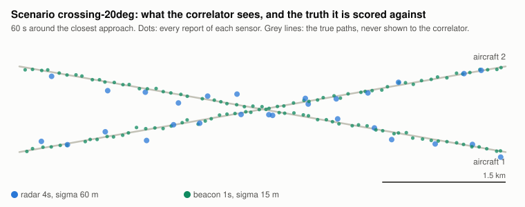

# Correlation benchmark

Status: Measured. Generated by `python3 -I tools/bench/bench.py report`; do not edit by hand. Every formula: [tools/bench/README.md](../tools/bench/README.md#scores).

Several sensors each report their own tracks of the same aircraft, vessels and vehicles. The correlate function decides which of those tracks belong to the same object and gives one system track per object. This page measures how well each correlate pack does that, on scenarios where the true answer is known, and sets the packs against an outside tracker.

## Results

On the 500 random scenarios of the evaluation set, the default pack `assign-time` scores pairwise F1 0.947 (0.936 to 0.957), level with the highest, `assign-full` (0.947): the paired interval of their difference includes zero. Its IDF1 is 0.819 and its GOSPA 255 m. The outside baseline, a Stone Soup tracker, scores F1 0.714 and IDF1 0.595; against it the default is 9 better, 1 worse of the ten compared measures.

Evaluation set, 500 random scenarios. Packs in order of pairwise F1. **Bold**: the best value of the column, and every value not shown worse than it by the paired test below. *Against the default* counts the ten compared measures (F1, IDF1, completeness, ambiguity, spuriousness, longest segment, false merges, missed merges, identity swaps, GOSPA) on which the pack is better or worse than `assign-time`.

| Pack | Pairwise F1 (95 % interval) | IDF1 | Completeness | Spuriousness | Longest segment | GOSPA, m | Against the default |
|---|---|---|---|---|---|---|---|
| [assign-full](../README.md#methods-and-packs) | **0.947 (0.936 to 0.957)** | **0.817** | **1.000** | 0.173 | **0.919** | **255.3** | 2 worse |
| **[assign-time](../README.md#methods-and-packs)** | **0.947 (0.936 to 0.957)** | **0.819** | **1.000** | 0.173 | **0.922** | **255.4** | the default |
| [window](../README.md#methods-and-packs) | 0.927 (0.922 to 0.933) | 0.759 | 0.988 | 0.202 | 0.857 | 316.6 | 1 better, 8 worse |
| [assign-bias](../README.md#methods-and-packs) | 0.893 (0.879 to 0.904) | 0.754 | 0.999 | 0.197 | 0.879 | 323.8 | 10 worse |
| [gnn-imm](../README.md#methods-and-packs) | 0.866 (0.851 to 0.878) | 0.700 | 0.996 | 0.182 | 0.812 | 353.7 | 1 better, 9 worse |
| [gnn-restart](../README.md#methods-and-packs) | 0.845 (0.830 to 0.859) | 0.637 | 0.999 | 0.168 | 0.749 | 374.1 | 8 worse |
| [gnn](../README.md#methods-and-packs) | 0.817 (0.801 to 0.831) | 0.613 | 0.995 | 0.202 | 0.739 | 404.6 | 9 worse |
| [gnn-time](../README.md#methods-and-packs) | 0.817 (0.801 to 0.831) | 0.613 | 0.995 | 0.202 | 0.739 | 404.6 | 9 worse |
| [distance](../README.md#methods-and-packs) | 0.792 (0.774 to 0.808) | 0.633 | 0.996 | 0.242 | 0.793 | 427.1 | 1 better, 9 worse |
| [assign-imm](../README.md#methods-and-packs) | 0.767 (0.744 to 0.789) | 0.658 | 0.999 | 0.169 | 0.803 | 409.3 | 9 worse |
| [stonesoup-gnn](#outside-baseline) (outside baseline) | 0.714 (0.687 to 0.741) | 0.595 | 0.999 | **0.143** | 0.630 | 460.2 | 1 better, 9 worse |
| [assign](../README.md#methods-and-packs) | 0.688 (0.664 to 0.711) | 0.605 | 0.997 | 0.194 | 0.747 | 472.7 | 10 worse |
| [assign-window](../README.md#methods-and-packs) | 0.676 (0.653 to 0.699) | 0.602 | 0.988 | 0.192 | 0.714 | 473.6 | 10 worse |

<picture>
  <source media="(prefers-color-scheme: dark)" srcset="figures/bench/random-dark.svg">
  
</picture>

The chart leaves out assign-window (assign-full includes its multi-frame window); assign-bias (assign-full includes its bias estimate); assign-full (assign-time is assign-full plus a fitted clock offset); gnn-time (it differs from gnn only on the time scenarios); the tables include every pack.

Higher is better for F1, IDF1, completeness and longest segment; lower for spuriousness and GOSPA. What each measure asks is in [What is measured](#what-is-measured). Per family: [Results by family](#results-by-family). Every measure with its interval: [Full tables](#full-tables). Every scenario and pack: [per-scenario.csv](figures/bench/per-scenario.csv) (tuning set).

## What a scenario looks like

<picture>
  <source media="(prefers-color-scheme: dark)" srcset="figures/bench/scene-dark.svg">
  
</picture>

A scenario is a few minutes of input. Objects move on true paths: still, straight, turning, accelerating, in formation, crossing, or recorded ship motion. Each sensor reports its own track of each object it sees, with its own track number, at its own rate, with random position error and, usually, a stated error (`ce`, one standard deviation in meters). The correlator sees only the reports, in the order they arrive. Once a second it gives its picture: each system track and the sensor tracks it holds. Truth is used only to score that picture.

Sensors, unless a scenario changes them:

| Sensor | Report every | Position error (1 sigma) | Detection probability | Latency | Velocity | Height |
|---|---|---|---|---|---|---|
| radar | 4 s (0.2 s jitter) | 60 m | 0.9 | 0.5 s | yes, 5 m/s | yes |
| beacon | 1 s (0.1 s jitter) | 15 m | 0.98 | 0.3 s | yes, 1 m/s | yes |
| passive | 2 s (0.3 s jitter) | 250 m | 0.8 | 1 s | no | no |

The random generator places 2 to 4 objects (still, straight, turning or accelerating) and 2 or 3 sensors. Each sensor, independently, may state its error too small or not at all (25 %), carry a fixed bias of up to 300 m (20 %), arrive 1 to 3 s late (20 %), detect only 50 to 90 % of the time (20 %), swap two objects' track numbers (20 %), drop and renumber a track (20 %), and report 1 to 5 false tracks (20 %). The families each test one kind of difficulty:

| Family | What it tests |
|---|---|
| formation | 2 to 8 aircraft 200 to 1,000 m apart behind a turning leader; members hold, split away or join |
| crossing | 2 to 4 objects whose paths meet at 3 to 25 degrees; half then fly on together |
| maneuver | turns at 3 to 9 g, climbs and dives, surface traffic that stops and starts |
| sensor problems | two or three of: dropouts, intermittent updates, long latency, out-of-order delivery, wrong stated error, biases, clock drift |
| clutter | 0 to 40 false tracks on the radar, half as many on the passive sensor |
| mixed domains | surface vessels, a low slow helicopter, land vehicles and an aircraft together |
| track management | dropped tracks with and without number reuse, number swaps, sensors joining late |
| recorded ships | 30 minutes of real ship motion from public AIS data, with simulated sensors |

The 21 named scenarios each test one thing, and 7 more test clocks; they are listed in [Named scenarios](#named-scenarios). Every generator and its settings: [tools/bench/README.md](../tools/bench/README.md).

## The two sets

| Set | Content | Seeds | Use |
|---|---|---|---|
| evaluation | 660 scenarios: 500 random and the evaluation half of every family; names start `eval-` | private, held by the benchmark maintainer; published after each release, then replaced (this run: rotation 2) | **the numbers in Results, the README and the site**; never used to tune a pack |
| tuning | 688 scenarios: the 28 named, 500 random (the first 50 are the earlier random set) and the tuning half of every family | public (`tools/bench/dataset.py`) | developing and tuning packs; review records; CI re-runs a subset |

Keeping the evaluation seeds private means no pack can be tuned to the scenarios it is judged on, as public tracking benchmarks hold back their test sets. Publishing them after each release lets anyone check the numbers that were reported.

## What is measured

Each measure answers one question about the picture the correlator gives. The first two are about grouping and identity, the next five are the air-picture measures of the Single Integrated Air Picture (SIAP) program, and GOSPA is about position.

| Measure | The question | Best | Source |
|---|---|---|---|
| Pairwise F1 | Are two live sensor tracks in one system track exactly when they are the same object? Every pair of tracks, every second; F1 combines precision (no wrong pairs) and recall (no missed pairs) | 1 | the pairwise F1 of clustering and record linkage; correlation is a grouping of tracks |
| IDF1 | Does each object keep one system track for its life? The share of object-seconds covered by the system track matched to that object over the whole scenario | 1 | Ristani et al., *Performance Measures and a Data Set for Multi-Target, Multi-Camera Tracking*, ECCV 2016 |
| Completeness | What share of the time is each object covered by some system track? | 1 | SIAP |
| Ambiguity | How many system tracks are there per covered object? Above 1 is duplicates | 1 | SIAP |
| Spuriousness | What share of system tracks are on no object? | 0 | SIAP |
| Longest segment | The longest stretch an object is followed by one system track, as a share of its life | 1 | SIAP |
| Track changes per min | How often does the system track following an object change? | 0 | SIAP |
| GOSPA | Position: the distance between the system tracks and the objects, each error capped at 500 m, each missed or false track charged half the cap | 0 | Rahmathullah, García-Fernández and Svensson, *Generalized optimal sub-pattern assignment metric*, FUSION 2017 |

A system track is *on* an object when it is within 500 m of it (the GOSPA cut-off); IDF1 and the SIAP measures use that test. The SIAP measures are those defined by the SIAP Systems Engineering Task Force (2001), the set Stone Soup's `SIAPMetrics` also computes; here an object keeps the system track that follows it while that track stays within 500 m, and every formula is in tools/bench/README.md. This benchmark's own counts complete the picture: a **false merge** puts tracks of two objects together, a **missed merge** keeps one object's tracks apart for 10 s or more, an **identity swap** moves an object to another system track while the old one still exists, and **time to associate** is how long two tracks of one object wait before they are grouped.

## How "better" is decided

Every pack runs on the same scenarios, so two packs are compared scenario by scenario. The test is a paired bootstrap: draw as many scenarios as the group holds, with replacement; compute the measure for both packs on that same draw; keep the difference; repeat 1,000 times. One pack is **better** or **worse** than another only when the 95 % interval of the difference excludes zero; otherwise no difference is shown (Efron and Tibshirani, *An Introduction to the Bootstrap*, 1993, chapter 16). Pairing removes the variation between scenarios that both packs share, so it finds smaller real differences than comparing two separate intervals. The interval beside a single value is the same bootstrap for that pack alone: how far the value would move on another draw of scenarios like these. A pooled measure sums the counts of every scenario of a group and then divides. A run over 300 s on one scenario is reported as not finished and left out of its group.

## Reproduce

Python 3.12 and a clone; nothing to install for the packs.

```sh
git clone https://github.com/USAREUR-AF/goat-processors && cd goat-processors
python3 -I tools/bench/bench.py check      # a subset; confirms the committed numbers (minutes)
python3 -I tools/bench/bench.py report     # every pack on the tuning set
python3 -I tools/bench/bench.py diff docs/figures/bench/results.json mine.json --set tuning

# the outside baseline
python3 -m venv .venv && .venv/bin/pip install -r tools/baselines/requirements.txt
.venv/bin/python -I tools/bench/bench.py report --baselines
```

The tuning set took 2 min in 14 processes on the benchmark machine; the evaluation set 2 min. `report` writes `docs/figures/bench/results.json` and this page; `diff` compares two results files with the paired test. The evaluation set needs the private seeds: the maintainer runs it, and anyone can run it once the seeds are published. To score your own tracker on the same scenarios, see [Compare your tracker](../reviews/README.md#compare-your-tracker).

## Outside baseline

Stone Soup is the open tracking framework of the UK Defence Science and Technology Laboratory ([github.com/dstl/Stone-Soup](https://github.com/dstl/Stone-Soup)). `stonesoup-gnn` ([tools/baselines/stonesoup_gnn.py](../tools/baselines/stonesoup_gnn.py), Stone Soup 1.9.1) is the textbook tracker built from its components: every report of every sensor is one detection; a constant-velocity Kalman filter per track, with the report's own stated error; a 99.9 % Mahalanobis gate; global nearest-neighbor assignment; a new track from each report that fits no track; deletion after 20 s without a report. A sensor track belongs to the Stone Soup track that took its latest report, and that grouping is scored like any pack's. Tracking every report centrally is the classic alternative to correlating the sensors' tracks, so a correlator should beat it on these scenarios. It has none of the packs' options (bias and clock offsets, a two-model filter, a multi-frame window). Its speed is not what is measured, so its time limit is 4 times the packs'. Its two settings, the motion noise and the gate, were chosen on the tuning set, as the packs' were.

## Results by family

Evaluation set; values pooled over each family. **Bold**: the best, and every pack not shown worse than it by the paired test.

**Pairwise F1**

| Pack | clutter (20) | crossing (20) | formation (20) | maneuver (20) | mixed domains (20) | recorded ships (20) | sensor problems (20) | track management (20) |
|---|---|---|---|---|---|---|---|---|
| [gnn](../README.md#methods-and-packs) | 0.972 | 0.993 | 0.777 | 0.900 | 0.988 | **0.999** | 0.885 | 0.884 |
| [window](../README.md#methods-and-packs) | 0.956 | 0.974 | 0.775 | 0.962 | 0.967 | **0.999** | **0.973** | 0.904 |
| [distance](../README.md#methods-and-packs) | 0.964 | 0.974 | 0.765 | 0.877 | 0.957 | 0.978 | 0.728 | 0.853 |
| [assign](../README.md#methods-and-packs) | **0.984** | **0.998** | 0.785 | 0.872 | 0.990 | **0.999** | 0.748 | 0.879 |
| [gnn-imm](../README.md#methods-and-packs) | 0.971 | 0.993 | **0.903** | **0.989** | 0.985 | **0.999** | **0.935** | 0.898 |
| [assign-imm](../README.md#methods-and-packs) | 0.975 | **0.996** | **0.970** | 0.987 | **0.998** | 0.999 | 0.890 | 0.895 |
| [assign-window](../README.md#methods-and-packs) | 0.967 | 0.978 | 0.769 | 0.853 | 0.976 | 0.989 | 0.740 | 0.873 |
| [assign-bias](../README.md#methods-and-packs) | 0.977 | **0.997** | **0.966** | **0.991** | **0.999** | **0.999** | **0.937** | 0.897 |
| [assign-full](../README.md#methods-and-packs) | **0.985** | **0.997** | **0.968** | **0.992** | **0.999** | **0.999** | **0.945** | **0.994** |
| [gnn-restart](../README.md#methods-and-packs) | 0.972 | 0.993 | 0.805 | 0.914 | 0.988 | **0.999** | 0.886 | 0.943 |
| [assign-time](../README.md#methods-and-packs) | **0.985** | **0.990** | **0.965** | **0.993** | 0.998 | 0.999 | **0.967** | **0.994** |
| [gnn-time](../README.md#methods-and-packs) | 0.972 | 0.993 | 0.777 | 0.900 | 0.988 | **0.999** | 0.885 | 0.884 |
| [stonesoup-gnn](#outside-baseline) (outside baseline) | 0.958 | 0.918 | 0.888 | 0.970 | 0.967 | 0.978 | 0.594 | **0.989** |

**IDF1**

| Pack | clutter (20) | crossing (20) | formation (20) | maneuver (20) | mixed domains (20) | recorded ships (20) | sensor problems (20) | track management (20) |
|---|---|---|---|---|---|---|---|---|
| [gnn](../README.md#methods-and-packs) | 0.407 | 0.973 | 0.594 | 0.617 | 0.968 | **0.992** | 0.687 | 0.709 |
| [window](../README.md#methods-and-packs) | **0.415** | 0.967 | **0.905** | **0.931** | 0.955 | **0.992** | **0.872** | 0.728 |
| [distance](../README.md#methods-and-packs) | 0.395 | 0.965 | 0.685 | 0.724 | 0.939 | **0.986** | 0.660 | 0.660 |
| [assign](../README.md#methods-and-packs) | **0.411** | 0.996 | 0.645 | 0.762 | 0.974 | 0.987 | 0.606 | 0.778 |
| [gnn-imm](../README.md#methods-and-packs) | 0.407 | 0.973 | **0.863** | **0.939** | 0.965 | **0.992** | **0.776** | 0.724 |
| [assign-imm](../README.md#methods-and-packs) | 0.407 | 0.997 | 0.889 | 0.913 | 0.992 | 0.983 | 0.746 | 0.785 |
| [assign-window](../README.md#methods-and-packs) | 0.395 | 0.948 | 0.656 | 0.768 | 0.939 | 0.951 | 0.618 | 0.744 |
| [assign-bias](../README.md#methods-and-packs) | **0.411** | 0.998 | **0.905** | **0.936** | **0.999** | **0.994** | **0.867** | 0.786 |
| [assign-full](../README.md#methods-and-packs) | **0.412** | 0.999 | **0.903** | **0.954** | **0.998** | **0.994** | **0.861** | 0.956 |
| [gnn-restart](../README.md#methods-and-packs) | 0.407 | 0.973 | 0.609 | 0.651 | 0.968 | **0.992** | 0.687 | 0.782 |
| [assign-time](../README.md#methods-and-packs) | **0.414** | 0.988 | **0.891** | **0.939** | 0.998 | 0.980 | **0.890** | 0.950 |
| [gnn-time](../README.md#methods-and-packs) | 0.407 | 0.973 | 0.594 | 0.617 | 0.968 | **0.992** | 0.687 | 0.709 |
| [stonesoup-gnn](#outside-baseline) (outside baseline) | **0.413** | **1.000** | 0.678 | 0.758 | 0.991 | 0.975 | 0.530 | **0.985** |

**GOSPA, m**

| Pack | clutter (20) | crossing (20) | formation (20) | maneuver (20) | mixed domains (20) | recorded ships (20) | sensor problems (20) | track management (20) |
|---|---|---|---|---|---|---|---|---|
| [gnn](../README.md#methods-and-packs) | 803.9 | 26.8 | 307.3 | 159.0 | 60.5 | 57.9 | 392.6 | 218.4 |
| [window](../README.md#methods-and-packs) | **792.9** | 40.5 | 200.6 | 103.5 | 82.3 | 58.0 | **288.8** | 191.3 |
| [distance](../README.md#methods-and-packs) | 831.8 | 54.9 | 343.9 | 165.4 | 142.0 | 157.4 | 452.5 | 255.4 |
| [assign](../README.md#methods-and-packs) | 793.9 | 21.1 | 369.8 | 180.0 | 70.0 | **49.1** | 464.8 | 215.7 |
| [gnn-imm](../README.md#methods-and-packs) | 803.6 | 26.2 | **91.8** | **33.8** | 66.6 | 58.0 | **315.1** | 199.4 |
| [assign-imm](../README.md#methods-and-packs) | 797.7 | 20.7 | **119.3** | 40.1 | **37.4** | 49.4 | 327.9 | 199.1 |
| [assign-window](../README.md#methods-and-packs) | 796.5 | 42.3 | 392.1 | 199.1 | 114.6 | 55.5 | 470.2 | 216.0 |
| [assign-bias](../README.md#methods-and-packs) | 796.7 | **17.7** | **111.6** | **32.3** | **31.5** | **49.1** | 291.8 | 196.8 |
| [assign-full](../README.md#methods-and-packs) | **789.5** | **17.4** | **103.3** | **29.5** | **33.1** | **49.0** | 277.7 | **40.5** |
| [gnn-restart](../README.md#methods-and-packs) | 803.9 | 26.8 | 265.9 | 134.0 | 60.5 | 57.9 | 392.3 | 133.6 |
| [assign-time](../README.md#methods-and-packs) | **788.6** | **17.3** | **108.7** | **27.8** | 33.9 | 49.8 | **255.6** | **41.0** |
| [gnn-time](../README.md#methods-and-packs) | 803.9 | 26.8 | 307.3 | 159.0 | 60.5 | 57.9 | 392.6 | 218.4 |
| [stonesoup-gnn](#outside-baseline) (outside baseline) | **792.8** | 32.5 | 147.6 | 72.6 | 83.2 | 115.7 | 567.5 | 74.2 |

## Full tables

Every measure with its 95 % interval, on the random scenarios of each set.

**Association, evaluation set, 500 random scenarios**

| Pack | Pairwise F1 | Precision | Recall | False merges | Missed merges | Identity swaps | Time to associate, s |
|---|---|---|---|---|---|---|---|
| [gnn](../README.md#methods-and-packs) | 0.817 (0.801 to 0.831) | 0.991 (0.987 to 0.994) | 0.694 (0.672 to 0.715) | 573 (497 to 649) | 934 (830 to 1041) | 369 (306 to 429) | 5.4 (5.0 to 5.9) |
| [window](../README.md#methods-and-packs) | 0.927 (0.922 to 0.933) | 0.990 (0.989 to 0.992) | 0.872 (0.863 to 0.881) | 764 (675 to 850) | 521 (455 to 587) | 120 (99 to 143) | 3.7 (3.4 to 4.0) |
| [distance](../README.md#methods-and-packs) | 0.792 (0.774 to 0.808) | 0.995 (0.987 to 0.999) | 0.658 (0.635 to 0.679) | 113 (76 to 157) | 1091 (965 to 1217) | 280 (238 to 323) | 6.5 (5.9 to 7.2) |
| [assign](../README.md#methods-and-packs) | 0.688 (0.664 to 0.711) | 0.998 (0.997 to 0.999) | 0.524 (0.497 to 0.552) | 77 (55 to 101) | 1369 (1230 to 1523) | 1487 (1335 to 1659) | 5.3 (4.8 to 5.9) |
| [gnn-imm](../README.md#methods-and-packs) | 0.866 (0.851 to 0.878) | 0.989 (0.985 to 0.992) | 0.769 (0.747 to 0.788) | 651 (569 to 733) | 775 (695 to 853) | 223 (181 to 273) | 4.6 (4.2 to 5.1) |
| [assign-imm](../README.md#methods-and-packs) | 0.767 (0.744 to 0.789) | 0.999 (0.999 to 0.999) | 0.623 (0.593 to 0.652) | 83 (58 to 110) | 929 (822 to 1038) | 1934 (1659 to 2255) | 5.0 (4.5 to 5.5) |
| [assign-window](../README.md#methods-and-packs) | 0.676 (0.653 to 0.699) | 0.997 (0.996 to 0.997) | 0.512 (0.485 to 0.539) | 423 (362 to 487) | 1257 (1117 to 1396) | 2146 (1941 to 2375) | 5.7 (5.3 to 6.3) |
| [assign-bias](../README.md#methods-and-packs) | 0.893 (0.879 to 0.904) | 0.999 (0.999 to 1.000) | 0.807 (0.785 to 0.826) | 65 (44 to 88) | 516 (443 to 584) | 753 (660 to 871) | 3.0 (2.7 to 3.4) |
| [assign-full](../README.md#methods-and-packs) | 0.947 (0.936 to 0.957) | 1.000 (0.999 to 1.000) | 0.900 (0.880 to 0.918) | 56 (34 to 80) | 64 (33 to 100) | 421 (323 to 535) | 1.1 (1.0 to 1.3) |
| [gnn-restart](../README.md#methods-and-packs) | 0.845 (0.830 to 0.859) | 0.991 (0.987 to 0.994) | 0.737 (0.714 to 0.758) | 609 (530 to 692) | 760 (663 to 859) | 356 (297 to 416) | 3.8 (3.4 to 4.1) |
| [assign-time](../README.md#methods-and-packs) | 0.947 (0.936 to 0.957) | 1.000 (0.999 to 1.000) | 0.900 (0.880 to 0.919) | 40 (24 to 58) | 71 (44 to 104) | 428 (336 to 537) | 1.0 (0.9 to 1.1) |
| [gnn-time](../README.md#methods-and-packs) | 0.817 (0.801 to 0.831) | 0.991 (0.987 to 0.994) | 0.694 (0.672 to 0.715) | 573 (497 to 649) | 934 (830 to 1041) | 369 (306 to 429) | 5.4 (5.0 to 5.9) |
| [stonesoup-gnn](#outside-baseline) (outside baseline) | 0.714 (0.687 to 0.741) | 0.994 (0.992 to 0.996) | 0.557 (0.524 to 0.590) | 370 (254 to 509) | 467 (388 to 543) | 15761 (14290 to 17211) | 3.3 (2.9 to 3.8) |

**Picture, evaluation set, 500 random scenarios**

| Pack | IDF1 | Completeness | Ambiguity | Spuriousness | Longest segment | Track changes per min | Position accuracy, m | GOSPA, m |
|---|---|---|---|---|---|---|---|---|
| [gnn](../README.md#methods-and-packs) | 0.613 (0.599 to 0.628) | 0.995 (0.994 to 0.996) | 1.270 (1.243 to 1.297) | 0.202 (0.187 to 0.216) | 0.739 (0.724 to 0.754) | 1.23 (1.16 to 1.30) | 91.2 (83.8 to 98.7) | 404.6 (385.3 to 424.6) |
| [window](../README.md#methods-and-packs) | 0.759 (0.745 to 0.773) | 0.988 (0.984 to 0.990) | 1.066 (1.060 to 1.073) | 0.202 (0.185 to 0.218) | 0.857 (0.844 to 0.869) | 0.70 (0.68 to 0.72) | 67.2 (59.9 to 74.6) | 316.6 (299.2 to 333.6) |
| [distance](../README.md#methods-and-packs) | 0.633 (0.618 to 0.648) | 0.996 (0.994 to 0.997) | 1.228 (1.205 to 1.254) | 0.242 (0.226 to 0.256) | 0.793 (0.779 to 0.807) | 0.88 (0.83 to 0.93) | 90.8 (83.2 to 98.5) | 427.1 (407.7 to 447.7) |
| [assign](../README.md#methods-and-packs) | 0.605 (0.589 to 0.620) | 0.997 (0.996 to 0.998) | 1.440 (1.405 to 1.476) | 0.194 (0.181 to 0.208) | 0.747 (0.733 to 0.761) | 0.71 (0.66 to 0.77) | 103.4 (97.3 to 109.9) | 472.7 (452.3 to 494.1) |
| [gnn-imm](../README.md#methods-and-packs) | 0.700 (0.683 to 0.716) | 0.996 (0.995 to 0.998) | 1.216 (1.191 to 1.240) | 0.182 (0.167 to 0.196) | 0.812 (0.795 to 0.829) | 1.09 (1.00 to 1.20) | 73.1 (65.5 to 81.1) | 353.7 (333.3 to 373.0) |
| [assign-imm](../README.md#methods-and-packs) | 0.658 (0.640 to 0.677) | 0.999 (0.998 to 0.999) | 1.371 (1.338 to 1.404) | 0.169 (0.154 to 0.182) | 0.803 (0.786 to 0.819) | 0.66 (0.57 to 0.76) | 84.5 (77.7 to 91.7) | 409.3 (386.9 to 431.9) |
| [assign-window](../README.md#methods-and-packs) | 0.602 (0.588 to 0.617) | 0.988 (0.987 to 0.989) | 1.442 (1.406 to 1.478) | 0.192 (0.179 to 0.206) | 0.714 (0.700 to 0.728) | 0.75 (0.70 to 0.80) | 103.5 (97.4 to 110.0) | 473.6 (452.7 to 494.7) |
| [assign-bias](../README.md#methods-and-packs) | 0.754 (0.738 to 0.773) | 0.999 (0.998 to 0.999) | 1.127 (1.115 to 1.141) | 0.197 (0.180 to 0.212) | 0.879 (0.866 to 0.891) | 0.31 (0.27 to 0.36) | 67.0 (59.7 to 74.6) | 323.8 (304.2 to 342.9) |
| [assign-full](../README.md#methods-and-packs) | 0.817 (0.799 to 0.835) | 1.000 (1.000 to 1.000) | 1.061 (1.051 to 1.071) | 0.173 (0.155 to 0.189) | 0.919 (0.907 to 0.929) | 0.18 (0.16 to 0.22) | 59.3 (51.9 to 67.0) | 255.3 (234.9 to 276.2) |
| [gnn-restart](../README.md#methods-and-packs) | 0.637 (0.622 to 0.651) | 0.999 (0.999 to 0.999) | 1.270 (1.242 to 1.299) | 0.168 (0.153 to 0.183) | 0.749 (0.733 to 0.764) | 1.32 (1.25 to 1.40) | 86.6 (79.0 to 94.4) | 374.1 (354.6 to 394.4) |
| [assign-time](../README.md#methods-and-packs) | 0.819 (0.802 to 0.836) | 1.000 (1.000 to 1.000) | 1.062 (1.052 to 1.072) | 0.173 (0.154 to 0.188) | 0.922 (0.911 to 0.933) | 0.18 (0.15 to 0.22) | 59.2 (52.0 to 67.0) | 255.4 (235.1 to 276.2) |
| [gnn-time](../README.md#methods-and-packs) | 0.613 (0.599 to 0.628) | 0.995 (0.994 to 0.996) | 1.270 (1.243 to 1.297) | 0.202 (0.187 to 0.216) | 0.739 (0.724 to 0.754) | 1.23 (1.16 to 1.30) | 91.2 (83.8 to 98.7) | 404.6 (385.3 to 424.6) |
| [stonesoup-gnn](#outside-baseline) (outside baseline) | 0.595 (0.577 to 0.614) | 0.999 (0.999 to 1.000) | 1.497 (1.459 to 1.534) | 0.143 (0.130 to 0.156) | 0.630 (0.603 to 0.655) | 3.74 (3.32 to 4.21) | 113.4 (106.8 to 120.0) | 460.2 (437.0 to 483.8) |

**Association, tuning set, 500 random scenarios**

| Pack | Pairwise F1 | Precision | Recall | False merges | Missed merges | Identity swaps | Time to associate, s |
|---|---|---|---|---|---|---|---|
| [gnn](../README.md#methods-and-packs) | 0.826 (0.811 to 0.839) | 0.992 (0.990 to 0.994) | 0.707 (0.686 to 0.727) | 617 (535 to 701) | 842 (752 to 939) | 312 (264 to 360) | 5.2 (4.7 to 5.6) |
| [window](../README.md#methods-and-packs) | 0.932 (0.927 to 0.937) | 0.990 (0.988 to 0.992) | 0.881 (0.872 to 0.889) | 786 (690 to 880) | 466 (402 to 532) | 116 (93 to 142) | 3.5 (3.1 to 3.8) |
| [distance](../README.md#methods-and-packs) | 0.791 (0.776 to 0.805) | 0.997 (0.996 to 0.998) | 0.656 (0.635 to 0.675) | 153 (108 to 205) | 1027 (909 to 1151) | 310 (255 to 372) | 7.3 (6.6 to 7.9) |
| [assign](../README.md#methods-and-packs) | 0.692 (0.668 to 0.711) | 0.998 (0.997 to 0.999) | 0.529 (0.502 to 0.552) | 111 (80 to 150) | 1239 (1112 to 1365) | 1337 (1211 to 1480) | 5.0 (4.5 to 5.5) |
| [gnn-imm](../README.md#methods-and-packs) | 0.878 (0.865 to 0.889) | 0.991 (0.989 to 0.993) | 0.788 (0.768 to 0.807) | 710 (614 to 803) | 662 (584 to 742) | 207 (165 to 253) | 4.6 (4.1 to 5.0) |
| [assign-imm](../README.md#methods-and-packs) | 0.772 (0.750 to 0.791) | 0.999 (0.998 to 0.999) | 0.630 (0.600 to 0.655) | 125 (90 to 161) | 841 (737 to 941) | 1610 (1410 to 1837) | 4.6 (4.2 to 5.1) |
| [assign-window](../README.md#methods-and-packs) | 0.677 (0.654 to 0.697) | 0.996 (0.995 to 0.996) | 0.513 (0.487 to 0.536) | 509 (442 to 578) | 1126 (1000 to 1256) | 2260 (2033 to 2509) | 5.6 (5.1 to 6.1) |
| [assign-bias](../README.md#methods-and-packs) | 0.906 (0.893 to 0.917) | 0.999 (0.998 to 0.999) | 0.828 (0.808 to 0.847) | 100 (67 to 134) | 474 (413 to 537) | 656 (574 to 745) | 2.6 (2.3 to 2.9) |
| [assign-full](../README.md#methods-and-packs) | 0.955 (0.945 to 0.965) | 0.999 (0.999 to 1.000) | 0.915 (0.896 to 0.932) | 72 (45 to 102) | 53 (28 to 83) | 399 (312 to 510) | 0.9 (0.8 to 1.0) |
| [gnn-restart](../README.md#methods-and-packs) | 0.855 (0.841 to 0.867) | 0.993 (0.991 to 0.994) | 0.750 (0.729 to 0.769) | 646 (558 to 733) | 627 (548 to 711) | 289 (244 to 338) | 3.7 (3.4 to 4.0) |
| [assign-time](../README.md#methods-and-packs) | 0.956 (0.945 to 0.964) | 0.999 (0.999 to 1.000) | 0.916 (0.897 to 0.932) | 75 (45 to 108) | 45 (23 to 73) | 362 (288 to 441) | 0.8 (0.7 to 0.9) |
| [gnn-time](../README.md#methods-and-packs) | 0.826 (0.811 to 0.839) | 0.992 (0.990 to 0.994) | 0.707 (0.686 to 0.727) | 617 (535 to 701) | 842 (752 to 939) | 312 (264 to 360) | 5.2 (4.7 to 5.6) |
| [stonesoup-gnn](#outside-baseline) (outside baseline) | 0.723 (0.699 to 0.745) | 0.993 (0.991 to 0.995) | 0.568 (0.539 to 0.597) | 467 (352 to 596) | 469 (391 to 553) | 16386 (15002 to 17851) | 3.0 (2.6 to 3.4) |

**Picture, tuning set, 500 random scenarios**

| Pack | IDF1 | Completeness | Ambiguity | Spuriousness | Longest segment | Track changes per min | Position accuracy, m | GOSPA, m |
|---|---|---|---|---|---|---|---|---|
| [gnn](../README.md#methods-and-packs) | 0.612 (0.599 to 0.626) | 0.996 (0.994 to 0.996) | 1.272 (1.244 to 1.299) | 0.205 (0.188 to 0.219) | 0.740 (0.724 to 0.756) | 1.24 (1.16 to 1.31) | 94.8 (87.5 to 101.9) | 412.6 (393.4 to 430.8) |
| [window](../README.md#methods-and-packs) | 0.774 (0.761 to 0.788) | 0.990 (0.988 to 0.992) | 1.067 (1.060 to 1.074) | 0.202 (0.184 to 0.218) | 0.874 (0.863 to 0.887) | 0.68 (0.65 to 0.71) | 73.6 (65.8 to 81.1) | 323.6 (307.2 to 339.5) |
| [distance](../README.md#methods-and-packs) | 0.632 (0.618 to 0.646) | 0.995 (0.993 to 0.997) | 1.231 (1.207 to 1.254) | 0.249 (0.232 to 0.264) | 0.799 (0.787 to 0.812) | 0.86 (0.82 to 0.91) | 95.8 (88.9 to 102.8) | 437.5 (417.9 to 456.7) |
| [assign](../README.md#methods-and-packs) | 0.604 (0.589 to 0.618) | 0.998 (0.997 to 0.999) | 1.450 (1.417 to 1.484) | 0.198 (0.183 to 0.212) | 0.756 (0.741 to 0.770) | 0.72 (0.66 to 0.77) | 104.4 (98.6 to 109.9) | 483.2 (462.7 to 501.6) |
| [gnn-imm](../README.md#methods-and-packs) | 0.702 (0.687 to 0.717) | 0.997 (0.996 to 0.998) | 1.214 (1.189 to 1.240) | 0.183 (0.167 to 0.199) | 0.811 (0.792 to 0.828) | 1.12 (1.02 to 1.23) | 77.7 (69.9 to 85.3) | 356.2 (336.9 to 374.6) |
| [assign-imm](../README.md#methods-and-packs) | 0.654 (0.636 to 0.671) | 0.999 (0.999 to 0.999) | 1.378 (1.346 to 1.412) | 0.172 (0.157 to 0.186) | 0.805 (0.789 to 0.821) | 0.62 (0.55 to 0.70) | 85.3 (79.0 to 91.8) | 416.8 (395.9 to 436.9) |
| [assign-window](../README.md#methods-and-packs) | 0.599 (0.586 to 0.614) | 0.989 (0.988 to 0.989) | 1.455 (1.421 to 1.489) | 0.196 (0.181 to 0.210) | 0.720 (0.705 to 0.734) | 0.73 (0.68 to 0.78) | 104.6 (98.9 to 110.1) | 485.4 (465.0 to 503.9) |
| [assign-bias](../README.md#methods-and-packs) | 0.759 (0.741 to 0.777) | 0.999 (0.998 to 0.999) | 1.113 (1.102 to 1.125) | 0.203 (0.185 to 0.218) | 0.885 (0.872 to 0.897) | 0.31 (0.26 to 0.35) | 70.2 (62.8 to 77.3) | 326.2 (307.6 to 342.7) |
| [assign-full](../README.md#methods-and-packs) | 0.823 (0.805 to 0.841) | 1.000 (1.000 to 1.000) | 1.054 (1.045 to 1.064) | 0.178 (0.160 to 0.194) | 0.924 (0.913 to 0.934) | 0.19 (0.16 to 0.23) | 63.4 (55.8 to 70.7) | 263.7 (244.4 to 280.6) |
| [gnn-restart](../README.md#methods-and-packs) | 0.635 (0.622 to 0.649) | 0.999 (0.999 to 1.000) | 1.275 (1.246 to 1.303) | 0.170 (0.153 to 0.184) | 0.750 (0.735 to 0.765) | 1.36 (1.28 to 1.44) | 90.3 (82.6 to 97.6) | 381.0 (361.1 to 400.3) |
| [assign-time](../README.md#methods-and-packs) | 0.827 (0.810 to 0.844) | 1.000 (1.000 to 1.000) | 1.054 (1.045 to 1.063) | 0.178 (0.159 to 0.194) | 0.928 (0.918 to 0.938) | 0.17 (0.15 to 0.20) | 63.4 (55.8 to 70.7) | 263.5 (244.5 to 280.6) |
| [gnn-time](../README.md#methods-and-packs) | 0.612 (0.599 to 0.626) | 0.996 (0.994 to 0.996) | 1.272 (1.244 to 1.299) | 0.205 (0.188 to 0.219) | 0.740 (0.724 to 0.756) | 1.24 (1.16 to 1.31) | 94.8 (87.5 to 101.9) | 412.6 (393.4 to 430.8) |
| [stonesoup-gnn](#outside-baseline) (outside baseline) | 0.593 (0.575 to 0.610) | 1.000 (0.999 to 1.000) | 1.496 (1.464 to 1.530) | 0.147 (0.133 to 0.160) | 0.643 (0.618 to 0.669) | 3.58 (3.16 to 4.06) | 115.6 (109.5 to 121.7) | 467.7 (445.2 to 487.9) |

**Named scenarios and time scenarios, tuning set, pooled**

| Pack | Group | Pairwise F1 | IDF1 | Identity swaps | GOSPA, m |
|---|---|---|---|---|---|
| [gnn](../README.md#methods-and-packs) | named | 0.951 (0.912 to 0.975) | 0.784 (0.704 to 0.870) | 1 (0 to 3) | 94.9 (46.5 to 154.2) |
| [window](../README.md#methods-and-packs) | named | 0.924 (0.784 to 0.996) | 0.925 (0.842 to 0.976) | 1 (0 to 3) | 56.8 (22.1 to 112.1) |
| [distance](../README.md#methods-and-packs) | named | 0.884 (0.776 to 0.962) | 0.843 (0.723 to 0.927) | 1 (0 to 3) | 108.8 (51.7 to 175.6) |
| [assign](../README.md#methods-and-packs) | named | 0.937 (0.898 to 0.967) | 0.862 (0.786 to 0.931) | 2 (0 to 5) | 109.7 (59.2 to 170.5) |
| [gnn-imm](../README.md#methods-and-packs) | named | 0.968 (0.922 to 0.992) | 0.867 (0.758 to 0.946) | 1 (0 to 3) | 69.8 (22.0 to 129.6) |
| [assign-imm](../README.md#methods-and-packs) | named | 0.971 (0.930 to 0.994) | 0.906 (0.808 to 0.978) | 2 (0 to 5) | 72.5 (25.9 to 132.8) |
| [assign-window](../README.md#methods-and-packs) | named | 0.929 (0.886 to 0.961) | 0.861 (0.788 to 0.929) | 2 (0 to 5) | 115.7 (62.9 to 177.6) |
| [assign-bias](../README.md#methods-and-packs) | named | 0.990 (0.969 to 1.000) | 0.924 (0.821 to 0.999) | 2 (0 to 5) | 48.9 (12.5 to 108.4) |
| [assign-full](../README.md#methods-and-packs) | named | 0.997 (0.990 to 1.000) | 0.949 (0.865 to 1.000) | 0 (0 to 0) | 41.2 (10.9 to 94.7) |
| [gnn-restart](../README.md#methods-and-packs) | named | 0.956 (0.921 to 0.979) | 0.786 (0.707 to 0.869) | 1 (0 to 3) | 89.6 (41.5 to 148.9) |
| [assign-time](../README.md#methods-and-packs) | named | 0.997 (0.990 to 1.000) | 0.949 (0.865 to 1.000) | 0 (0 to 0) | 41.2 (10.9 to 94.7) |
| [gnn-time](../README.md#methods-and-packs) | named | 0.951 (0.912 to 0.975) | 0.784 (0.704 to 0.870) | 1 (0 to 3) | 94.9 (46.5 to 154.2) |
| [stonesoup-gnn](#outside-baseline) (outside baseline) | named | 0.954 (0.892 to 0.985) | 0.885 (0.809 to 0.950) | 21 (8 to 34) | 98.2 (47.2 to 161.3) |
| [gnn](../README.md#methods-and-packs) | time | 0.959 (0.812 to 0.993) | 0.896 (0.753 to 0.986) | 0 (0 to 0) | 86.8 (56.4 to 197.5) |
| [window](../README.md#methods-and-packs) | time | 0.996 (0.991 to 0.998) | 0.993 (0.981 to 0.996) | 0 (0 to 0) | 55.1 (52.3 to 63.5) |
| [distance](../README.md#methods-and-packs) | time | 0.937 (0.720 to 1.000) | 0.916 (0.749 to 0.999) | 0 (0 to 0) | 95.4 (37.3 to 238.2) |
| [assign](../README.md#methods-and-packs) | time | 0.775 (0.626 to 0.879) | 0.248 (0.149 to 0.575) | 120 (23 to 225) | 214.5 (137.2 to 298.4) |
| [gnn-imm](../README.md#methods-and-packs) | time | 0.968 (0.832 to 0.998) | 0.953 (0.818 to 0.996) | 0 (0 to 0) | 40.1 (10.4 to 154.4) |
| [assign-imm](../README.md#methods-and-packs) | time | 0.881 (0.722 to 0.991) | 0.566 (0.475 to 0.831) | 21 (1 to 52) | 120.0 (19.9 to 232.8) |
| [assign-window](../README.md#methods-and-packs) | time | 0.740 (0.596 to 0.852) | 0.278 (0.198 to 0.575) | 141 (37 to 250) | 234.9 (157.5 to 310.6) |
| [assign-bias](../README.md#methods-and-packs) | time | 0.936 (0.835 to 0.997) | 0.781 (0.581 to 0.996) | 9 (0 to 27) | 76.1 (14.9 to 166.0) |
| [assign-full](../README.md#methods-and-packs) | time | 0.932 (0.831 to 0.997) | 0.780 (0.579 to 0.996) | 15 (0 to 45) | 79.2 (14.9 to 166.5) |
| [gnn-restart](../README.md#methods-and-packs) | time | 0.949 (0.802 to 0.983) | 0.530 (0.410 to 0.848) | 5 (0 to 11) | 92.6 (63.3 to 201.5) |
| [assign-time](../README.md#methods-and-packs) | time | 0.996 (0.994 to 1.000) | 0.995 (0.991 to 1.000) | 0 (0 to 0) | 25.9 (13.9 to 54.1) |
| [gnn-time](../README.md#methods-and-packs) | time | 0.984 (0.937 to 0.997) | 0.925 (0.688 to 0.993) | 0 (0 to 0) | 65.3 (53.7 to 103.5) |
| [stonesoup-gnn](#outside-baseline) (outside baseline) | time | 0.788 (0.422 to 0.870) | 0.201 (0.170 to 0.292) | 336 (145 to 524) | 196.1 (138.9 to 379.6) |

## Named scenarios

Each named scenario tests one thing, with the sensors above unless the row says otherwise. F1 of the default and of the best pack on it; every pack and measure is in [per-scenario.csv](figures/bench/per-scenario.csv).

| Scenario | Family | Tests | F1, default | F1, best (pack) |
|---|---|---|---|---|
| stationary | motion | one object that does not move, two sensors | 1.000 | 1.000 (assign) |
| straight-level | motion | one object on a straight line at 200 m/s | 1.000 | 1.000 (distance) |
| turn-3dps | motion | coordinated turn of 3 deg/s for 60 s at 150 m/s | 1.000 | 1.000 (gnn) |
| turn-6dps | motion | coordinated turn of 6 deg/s for 45 s at 200 m/s | 1.000 | 1.000 (window) |
| accelerate | motion | speed 100 to 300 m/s at 10 m/s^2, then back down | 1.000 | 1.000 (distance) |
| crossing-90deg | geometry | two objects cross at right angles, 1 km apart in height | 1.000 | 1.000 (distance) |
| crossing-20deg | geometry | two objects cross at 20 degrees at the same height | 1.000 | 1.000 (distance) |
| parallel-500m | geometry | two objects abreast 500 m apart, same velocity | 1.000 | 1.000 (distance) |
| parallel-150m | geometry | close formation: two objects abreast 150 m apart | 1.000 | 1.000 (assign) |
| split | geometry | one object splits into two at 50 s; the new one turns away at 4 deg/s | 1.000 | 1.000 (window) |
| error-understated | sensor error | the radar reports a third of its true error | 1.000 | 1.000 (window) |
| error-absent | sensor error | neither sensor reports its error | 1.000 | 1.000 (distance) |
| latency-3s | sensor error | the radar's reports arrive 3 s after their time, object at 250 m/s | 1.000 | 1.000 (gnn) |
| bias-400m | sensor error | the radar's positions are all 400 m off to the north-east | 1.000 | 1.000 (assign-bias) |
| slow-jittered | sensor error | radar every 12 s with 3 s jitter | 1.000 | 1.000 (assign-imm) |
| low-detection | sensor error | both sensors detect half of the time | 1.000 | 1.000 (distance) |
| number-swap | track management | the radar trades the track numbers of two objects at 60 s | 1.000 | 1.000 (assign-full) |
| number-drop | track management | each sensor drops its track and starts a new number | 0.885 | 1.000 (distance) |
| false-tracks | clutter | the radar reports 8 false tracks near the objects | 1.000 | 1.000 (distance) |
| three-sensors | mixed | radar, beacon and a coarse passive sensor, three objects | 1.000 | 1.000 (assign-imm) |
| dense-8 | mixed | eight objects in a 20 km box, some turning | 0.997 | 1.000 (distance) |
| clock-offset-200ms | time | beacon2's clock is 200 ms ahead, object at 300 m/s turning 90 deg every 100 s; every sensor reports its time quality | 1.000 | 1.000 (distance) |
| clock-drift-10ms-min | time | beacon2's clock drifts 10 ms per minute from 0 to 200 ms over 20 min; every sensor reports its time quality | 0.998 | 1.000 (distance) |
| clock-free-running | time | beacon2's clock runs free: 1.5 s behind, drifting 30 ms per minute further; every sensor reports its time quality | 1.000 | 1.000 (assign-time) |
| clock-offset-200ms-undescribed | time | beacon2's clock is 200 ms ahead, object at 300 m/s turning 90 deg every 100 s; no time quality on any report | 1.000 | 1.000 (distance) |
| clock-drift-10ms-min-undescribed | time | beacon2's clock drifts 10 ms per minute from 0 to 200 ms over 20 min; no time quality on any report | 0.992 | 1.000 (distance) |
| clock-free-running-undescribed | time | beacon2's clock runs free: 1.5 s behind, drifting 30 ms per minute further; no time quality on any report | 1.000 | 1.000 (assign-time) |
| out-of-order | time | beacon2's reports arrive 0.3 to 2.8 s after their time, so out of order; clocks coherent | 1.000 | 1.000 (distance) |

The time scenarios stamp one sensor's reports with a wrong clock: 200 ms ahead, drifting 10 ms per minute, or running free (1.5 s behind and drifting); each also as an "undescribed" twin whose reports carry no time quality. Truth is exact; only the stamped time is wrong. The object turns 90 degrees every 100 s, so a fixed position bias cannot stand in for a clock error.

## Data sources

| Data | Source | Terms | In the repository |
|---|---|---|---|
| generated scenarios | `tools/bench/scenarios.py`, `tools/bench/dataset.py` | this repository's license | the generator; the tuning seeds; the evaluation seeds only after a release |
| recorded ship motion (family "recorded ships") | NOAA Office for Coastal Management and BOEM, MarineCadastre.gov "Vessel Traffic (AIS)", daily file AIS_2023_01_01 (SHA-256 in `tools/bench/data/recorded-ships.json`) | U.S. Government material, not subject to copyright protection within the United States (17 U.S.C. 403 notice in NOTICE) | times and positions of 40 thirty-minute windows from open water about 100 km or more offshore, identifiers removed, moved to the notional reference point (`tools/bench/recorded.py`) |
| Stone Soup | [github.com/dstl/Stone-Soup](https://github.com/dstl/Stone-Soup), version 1.9.1 from PyPI | MIT license | nothing: installed by `tools/baselines/requirements.txt` |
