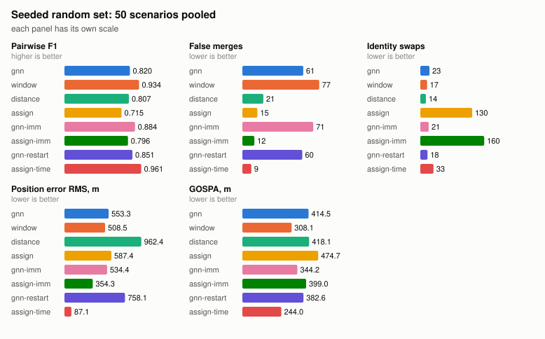
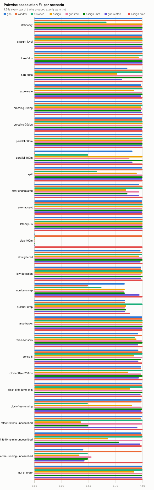

# Correlation benchmark

Status: Measured. Generated by `python3 -I tools/bench/bench.py report`; do not edit by hand. Formats and the formula of every score: [tools/bench/README.md](../tools/bench/README.md).

Each scenario places truth objects and sensors that report tracks of them with stated errors. Every correlate pack runs on the same report stream with the Python engine, and its output at each tick is scored against truth.

Each pack is one set of correlate settings; what each one does, and what it adds over the pack it extends, is in the README, [Methods and packs](../README.md#methods-and-packs). The measures, in short: **pairwise F1** checks, at every tick, every pair of live tracks (together in the output exactly when they are the same object?), from 0 to 1, higher is better; a **false merge** puts tracks of two objects together; a **missed merge** keeps one object's tracks apart for 10 s or more; an **identity swap** changes an object's output track while the old one still exists; **GOSPA** is the mean position error with each error capped at 500 m and every missed or false track charged half the cap, lower is better.

## Which numbers come from which set

| Set | Content | Seeds | Use |
|---|---|---|---|
| evaluation | 500 random scenarios and the evaluation half of every family (clutter, crossing, formation, maneuver, mixed domains, recorded ships, scale, sensor problems, track management); names start `eval-` | private: held by the benchmark maintainer, published after each release and then rotated | **every number in the README, the comparison and the PDF**; never used to tune a pack |
| tuning | the 21 named and 7 time scenarios, 500 random scenarios (the first 50 are the earlier random set) and the tuning half of every family | public (`tools/bench/dataset.py`) | developing and tuning packs; CI re-runs a subset of it |

A pooled measure sums the counts of every scenario of a group and then divides (tools/bench/README.md, "Scores"); its 95 % interval comes from a bootstrap over the group's scenarios (1,000 resamples, `tools/bench/stats.py`). A difference between two packs, or two versions of one, counts as better or worse only when their intervals do not overlap. A run that exceeds 300 s on one scenario is reported as not finished and left out of its group's pooled measures; the cell says how many.

## Evaluation set

663 scenarios, run in 14 parallel processes in 17 min on the benchmark machine (the time a full evaluation run takes there).

<picture>
  <source media="(prefers-color-scheme: dark)" srcset="figures/bench/random-dark.svg">
  
</picture>

The charts leave out assign-window (assign-full includes its multi-frame window); assign-bias (assign-full includes its bias estimate); assign-full (assign-time is assign-full plus a fitted clock offset); gnn-time (its time_default names source radar-1, which no scenario has, so it scores as gnn); the tables include every pack.

### Random scenarios (500 scenarios), pooled, 95 % intervals

| Pack | Pairwise F1 | Precision | Recall | False merges | Missed merges | Identity swaps | Time to associate, s | Position error RMS, m | GOSPA, m |
|---|---|---|---|---|---|---|---|---|---|
| [gnn](../README.md#methods-and-packs) | 0.819 (0.802 to 0.833) | 0.994 (0.993 to 0.995) | 0.696 (0.672 to 0.717) | 508 (432 to 582) | 898 (801 to 993) | 321 (270 to 373) | 5.1 (4.6 to 5.6) | 573.4 (475.6 to 682.3) | 410.6 (392.9 to 428.5) |
| [window](../README.md#methods-and-packs) | 0.934 (0.928 to 0.940) | 0.991 (0.988 to 0.993) | 0.884 (0.875 to 0.893) | 680 (597 to 768) | 453 (394 to 512) | 122 (100 to 146) | 3.4 (3.1 to 3.7) | 722.9 (550.0 to 891.7) | 315.1 (300.6 to 331.2) |
| [distance](../README.md#methods-and-packs) | 0.812 (0.797 to 0.825) | 0.998 (0.997 to 0.999) | 0.684 (0.664 to 0.703) | 119 (82 to 156) | 995 (883 to 1101) | 277 (235 to 323) | 6.3 (5.7 to 6.9) | 774.0 (645.8 to 902.1) | 410.9 (393.8 to 428.9) |
| [assign](../README.md#methods-and-packs) | 0.681 (0.656 to 0.704) | 0.999 (0.998 to 0.999) | 0.516 (0.489 to 0.543) | 78 (55 to 103) | 1236 (1109 to 1363) | 1424 (1266 to 1579) | 5.4 (4.8 to 5.9) | 618.3 (520.6 to 720.2) | 478.6 (459.9 to 497.9) |
| [gnn-imm](../README.md#methods-and-packs) | 0.856 (0.839 to 0.870) | 0.991 (0.989 to 0.993) | 0.753 (0.729 to 0.774) | 595 (513 to 674) | 800 (714 to 889) | 217 (175 to 262) | 4.4 (4.0 to 4.8) | 751.8 (635.8 to 868.7) | 368.8 (351.3 to 388.0) |
| [assign-imm](../README.md#methods-and-packs) | 0.750 (0.726 to 0.771) | 0.999 (0.999 to 0.999) | 0.600 (0.570 to 0.628) | 83 (59 to 109) | 838 (748 to 940) | 1830 (1558 to 2112) | 4.8 (4.3 to 5.2) | 557.9 (454.0 to 666.9) | 423.8 (404.5 to 444.5) |
| [assign-window](../README.md#methods-and-packs) | 0.669 (0.644 to 0.692) | 0.997 (0.996 to 0.997) | 0.503 (0.476 to 0.530) | 428 (369 to 490) | 1143 (1025 to 1268) | 2180 (1936 to 2418) | 5.7 (5.2 to 6.3) | 625.6 (527.5 to 731.7) | 479.6 (460.7 to 498.6) |
| [assign-bias](../README.md#methods-and-packs) | 0.885 (0.870 to 0.899) | 0.999 (0.999 to 1.000) | 0.794 (0.770 to 0.817) | 48 (31 to 66) | 497 (431 to 565) | 767 (664 to 876) | 2.7 (2.4 to 3.0) | 589.3 (482.3 to 696.9) | 331.6 (314.5 to 349.9) |
| [assign-full](../README.md#methods-and-packs) | 0.935 (0.922 to 0.947) | 0.999 (0.999 to 1.000) | 0.878 (0.856 to 0.900) | 57 (36 to 83) | 80 (45 to 119) | 495 (383 to 610) | 1.1 (0.9 to 1.2) | 105.9 (95.6 to 115.4) | 267.4 (249.5 to 286.6) |
| [gnn-restart](../README.md#methods-and-packs) | 0.843 (0.827 to 0.856) | 0.995 (0.994 to 0.996) | 0.731 (0.708 to 0.751) | 513 (433 to 587) | 722 (639 to 813) | 301 (247 to 357) | 3.8 (3.4 to 4.2) | 525.6 (444.3 to 617.7) | 383.4 (365.6 to 402.6) |
| [assign-time](../README.md#methods-and-packs) | 0.934 (0.921 to 0.947) | 1.000 (0.999 to 1.000) | 0.877 (0.855 to 0.900) | 51 (33 to 70) | 80 (44 to 120) | 471 (371 to 580) | 1.0 (0.9 to 1.2) | 104.4 (94.0 to 113.9) | 268.3 (250.4 to 287.0) |
| [gnn-time](../README.md#methods-and-packs) | 0.819 (0.802 to 0.833) | 0.994 (0.993 to 0.995) | 0.696 (0.672 to 0.717) | 508 (432 to 582) | 898 (801 to 993) | 321 (270 to 373) | 5.1 (4.6 to 5.6) | 573.4 (475.6 to 682.3) | 410.6 (392.9 to 428.5) |

### Families: Pairwise F1, 95 % intervals

| Pack | clutter (20) | crossing (20) | formation (20) | maneuver (20) | mixed domains (20) | recorded ships (20) | scale (3) | sensor problems (20) | track management (20) |
|---|---|---|---|---|---|---|---|---|---|
| [gnn](../README.md#methods-and-packs) | 0.972 (0.961 to 0.981) | 0.993 (0.991 to 0.994) | 0.806 (0.747 to 0.877) | 0.924 (0.879 to 0.963) | 0.971 (0.930 to 0.995) | 0.999 (0.999 to 0.999) | 0.631 (1 scenario, no interval) (2 of 3 not finished) | 0.833 (0.744 to 0.896) | 0.888 (0.853 to 0.919) |
| [window](../README.md#methods-and-packs) | 0.953 (0.927 to 0.973) | 0.993 (0.991 to 0.994) | 0.821 (0.720 to 0.917) | 0.971 (0.951 to 0.987) | 0.942 (0.899 to 0.990) | 0.999 (0.999 to 0.999) | 0.599 (1 scenario, no interval) (2 of 3 not finished) | 0.972 (0.958 to 0.988) | 0.919 (0.892 to 0.944) |
| [distance](../README.md#methods-and-packs) | 0.964 (0.955 to 0.971) | 0.972 (0.957 to 0.985) | 0.793 (0.730 to 0.881) | 0.874 (0.815 to 0.931) | 0.958 (0.919 to 0.987) | 0.973 (0.924 to 0.999) | 0.925 (1 scenario, no interval) (2 of 3 not finished) | 0.706 (0.585 to 0.809) | 0.845 (0.786 to 0.893) |
| [assign](../README.md#methods-and-packs) | 0.983 (0.973 to 0.991) | 0.986 (0.975 to 0.998) | 0.793 (0.752 to 0.849) | 0.884 (0.833 to 0.932) | 0.991 (0.987 to 0.996) | 0.983 (0.948 to 1.000) | – (3 of 3 not finished) | 0.707 (0.587 to 0.800) | 0.879 (0.836 to 0.916) |
| [gnn-imm](../README.md#methods-and-packs) | 0.971 (0.959 to 0.981) | 0.993 (0.991 to 0.994) | 0.889 (0.783 to 0.979) | 0.989 (0.985 to 0.992) | 0.962 (0.921 to 0.995) | 0.999 (0.999 to 0.999) | 0.595 (1 scenario, no interval) (2 of 3 not finished) | 0.934 (0.861 to 0.973) | 0.904 (0.868 to 0.931) |
| [assign-imm](../README.md#methods-and-packs) | 0.982 (0.972 to 0.990) | 0.995 (0.988 to 1.000) | 0.961 (0.949 to 0.974) | 0.989 (0.978 to 0.997) | 0.997 (0.994 to 0.999) | 0.977 (0.928 to 1.000) | – (3 of 3 not finished) | 0.852 (0.720 to 0.945) | 0.895 (0.855 to 0.925) |
| [assign-window](../README.md#methods-and-packs) | 0.972 (0.963 to 0.979) | 0.960 (0.939 to 0.980) | 0.782 (0.737 to 0.844) | 0.876 (0.823 to 0.926) | 0.983 (0.976 to 0.991) | 0.989 (0.972 to 0.999) | – (3 of 3 not finished) | 0.700 (0.583 to 0.794) | 0.877 (0.837 to 0.914) |
| [assign-bias](../README.md#methods-and-packs) | 0.981 (0.971 to 0.989) | 0.996 (0.992 to 0.999) | 0.968 (0.956 to 0.980) | 0.979 (0.945 to 0.998) | 0.999 (0.998 to 1.000) | 0.997 (0.992 to 1.000) | – (3 of 3 not finished) | 0.915 (0.827 to 0.999) | 0.898 (0.859 to 0.926) |
| [assign-full](../README.md#methods-and-packs) | 0.985 (0.975 to 0.992) | 0.994 (0.989 to 0.999) | 0.970 (0.958 to 0.982) | 0.986 (0.971 to 0.997) | 0.999 (0.998 to 1.000) | 0.991 (0.972 to 1.000) | – (3 of 3 not finished) | 0.935 (0.875 to 0.990) | 0.992 (0.989 to 0.996) |
| [gnn-restart](../README.md#methods-and-packs) | 0.972 (0.961 to 0.981) | 0.993 (0.991 to 0.994) | 0.817 (0.756 to 0.889) | 0.928 (0.889 to 0.964) | 0.971 (0.930 to 0.995) | 0.999 (0.999 to 0.999) | 0.631 (1 scenario, no interval) (2 of 3 not finished) | 0.834 (0.745 to 0.896) | 0.941 (0.916 to 0.965) |
| [assign-time](../README.md#methods-and-packs) | 0.984 (0.975 to 0.992) | 0.995 (0.990 to 1.000) | 0.942 (0.894 to 0.971) | 0.981 (0.959 to 0.996) | 0.999 (0.998 to 1.000) | 0.997 (0.993 to 1.000) | – (3 of 3 not finished) | 0.968 (0.924 to 0.998) | 0.992 (0.989 to 0.996) |
| [gnn-time](../README.md#methods-and-packs) | 0.972 (0.961 to 0.981) | 0.993 (0.991 to 0.994) | 0.806 (0.747 to 0.877) | 0.924 (0.879 to 0.963) | 0.971 (0.930 to 0.995) | 0.999 (0.999 to 0.999) | 0.631 (1 scenario, no interval) (2 of 3 not finished) | 0.833 (0.744 to 0.896) | 0.888 (0.853 to 0.919) |

### Families: GOSPA, m, 95 % intervals

| Pack | clutter (20) | crossing (20) | formation (20) | maneuver (20) | mixed domains (20) | recorded ships (20) | scale (3) | sensor problems (20) | track management (20) |
|---|---|---|---|---|---|---|---|---|---|
| [gnn](../README.md#methods-and-packs) | 795 (570 to 1013) | 28 (25 to 31) | 291 (232 to 349) | 123 (81 to 173) | 50 (41 to 62) | 57 (54 to 60) | 2873 (1 scenario, no interval) (2 of 3 not finished) | 334 (249 to 415) | 199 (163 to 241) |
| [window](../README.md#methods-and-packs) | 783 (567 to 993) | 28 (25 to 31) | 166 (127 to 204) | 80 (54 to 111) | 50 (41 to 62) | 57 (54 to 60) | 3020 (1 scenario, no interval) (2 of 3 not finished) | 225 (141 to 315) | 170 (137 to 208) |
| [distance](../README.md#methods-and-packs) | 825 (607 to 1043) | 62 (45 to 79) | 278 (185 to 374) | 154 (96 to 223) | 113 (76 to 164) | 125 (88 to 167) | 1574 (1 scenario, no interval) (2 of 3 not finished) | 380 (270 to 482) | 245 (188 to 302) |
| [assign](../README.md#methods-and-packs) | 785 (556 to 1008) | 24 (17 to 35) | 346 (274 to 415) | 156 (103 to 213) | 60 (44 to 82) | 49 (47 to 52) | – (3 of 3 not finished) | 407 (317 to 490) | 197 (155 to 242) |
| [gnn-imm](../README.md#methods-and-packs) | 794 (570 to 1012) | 27 (23 to 30) | 92 (61 to 130) | 30 (24 to 38) | 61 (40 to 95) | 57 (54 to 60) | 3011 (1 scenario, no interval) (2 of 3 not finished) | 221 (129 to 324) | 187 (148 to 227) |
| [assign-imm](../README.md#methods-and-packs) | 783 (555 to 1003) | 18 (15 to 23) | 114 (82 to 151) | 30 (19 to 46) | 39 (35 to 46) | 49 (47 to 51) | – (3 of 3 not finished) | 274 (170 to 379) | 198 (155 to 241) |
| [assign-window](../README.md#methods-and-packs) | 787 (567 to 1001) | 58 (38 to 81) | 356 (282 to 428) | 163 (109 to 222) | 82 (56 to 115) | 54 (50 to 58) | – (3 of 3 not finished) | 411 (322 to 494) | 188 (145 to 231) |
| [assign-bias](../README.md#methods-and-packs) | 783 (554 to 1002) | 17 (16 to 19) | 101 (70 to 138) | 43 (19 to 81) | 29 (27 to 33) | 49 (46 to 51) | – (3 of 3 not finished) | 213 (108 to 312) | 196 (155 to 240) |
| [assign-full](../README.md#methods-and-packs) | 779 (551 to 1000) | 19 (16 to 23) | 98 (69 to 134) | 33 (19 to 51) | 31 (28 to 34) | 49 (46 to 51) | – (3 of 3 not finished) | 191 (95 to 284) | 43 (33 to 52) |
| [gnn-restart](../README.md#methods-and-packs) | 795 (570 to 1013) | 28 (25 to 31) | 254 (197 to 308) | 112 (74 to 153) | 50 (41 to 62) | 57 (54 to 60) | 2873 (1 scenario, no interval) (2 of 3 not finished) | 333 (248 to 415) | 131 (85 to 175) |
| [assign-time](../README.md#methods-and-packs) | 778 (550 to 999) | 17 (15 to 20) | 144 (85 to 225) | 46 (22 to 78) | 30 (27 to 34) | 49 (47 to 52) | – (3 of 3 not finished) | 168 (84 to 260) | 42 (33 to 51) |
| [gnn-time](../README.md#methods-and-packs) | 795 (570 to 1013) | 28 (25 to 31) | 291 (232 to 349) | 123 (81 to 173) | 50 (41 to 62) | 57 (54 to 60) | 2873 (1 scenario, no interval) (2 of 3 not finished) | 334 (249 to 415) | 199 (163 to 241) |

## Data sources

| Data | Source | Terms | In the repository |
|---|---|---|---|
| generated scenarios | `tools/bench/scenarios.py`, `tools/bench/dataset.py` | this repository's license | the generator; the tuning seeds; the evaluation seeds only after a release |
| recorded ship motion (family "recorded ships") | NOAA Office for Coastal Management and BOEM, MarineCadastre.gov "Vessel Traffic (AIS)", daily file AIS_2023_01_01 (SHA-256 in `tools/bench/data/recorded-ships.json`) | U.S. Government material, not subject to copyright protection within the United States (17 U.S.C. 403 notice in NOTICE) | times and positions of 40 thirty-minute windows from open water about 100 km or more offshore, identifiers removed, moved to the notional reference point (`tools/bench/recorded.py`) |
| recorded aircraft motion | OpenSky Network historical data | not yet checked: the terms could not be read from the benchmark machine | nothing |

## Tuning set

The random generator places 2 to 4 objects (still, straight, turning, accelerating) and 2 or 3 sensors, each sensor with a chance of understated or absent error, bias, latency, low detection, a track number swap, a drop, and false tracks. The families are named generators with stated ground truth; tools/bench/README.md describes each.

691 scenarios, run in 14 parallel processes in 16 min.

### Random scenarios (500 scenarios), pooled, 95 % intervals

| Pack | Pairwise F1 | Precision | Recall | False merges | Missed merges | Identity swaps | Time to associate, s | Position error RMS, m | GOSPA, m |
|---|---|---|---|---|---|---|---|---|---|
| [gnn](../README.md#methods-and-packs) | 0.826 (0.811 to 0.839) | 0.992 (0.990 to 0.994) | 0.707 (0.686 to 0.727) | 617 (535 to 701) | 842 (752 to 939) | 312 (264 to 360) | 5.2 (4.7 to 5.6) | 648.1 (479.1 to 807.0) | 412.6 (393.4 to 430.8) |
| [window](../README.md#methods-and-packs) | 0.932 (0.927 to 0.937) | 0.990 (0.988 to 0.992) | 0.881 (0.872 to 0.889) | 786 (690 to 880) | 466 (402 to 532) | 116 (93 to 142) | 3.5 (3.1 to 3.8) | 833.3 (553.9 to 1091.3) | 323.6 (307.2 to 339.5) |
| [distance](../README.md#methods-and-packs) | 0.791 (0.776 to 0.805) | 0.997 (0.996 to 0.998) | 0.656 (0.635 to 0.675) | 153 (108 to 205) | 1027 (909 to 1151) | 310 (255 to 372) | 7.3 (6.6 to 7.9) | 896.1 (705.0 to 1074.0) | 437.5 (417.9 to 456.7) |
| [assign](../README.md#methods-and-packs) | 0.692 (0.668 to 0.711) | 0.998 (0.997 to 0.999) | 0.529 (0.502 to 0.552) | 111 (80 to 150) | 1239 (1112 to 1365) | 1337 (1211 to 1480) | 5.0 (4.5 to 5.5) | 581.8 (481.9 to 669.2) | 483.2 (462.7 to 501.6) |
| [gnn-imm](../README.md#methods-and-packs) | 0.878 (0.865 to 0.889) | 0.991 (0.989 to 0.993) | 0.788 (0.768 to 0.807) | 710 (614 to 803) | 662 (584 to 742) | 207 (165 to 253) | 4.6 (4.1 to 5.0) | 799.6 (576.8 to 997.2) | 356.2 (336.9 to 374.6) |
| [assign-imm](../README.md#methods-and-packs) | 0.772 (0.750 to 0.791) | 0.999 (0.998 to 0.999) | 0.630 (0.600 to 0.655) | 125 (90 to 161) | 841 (737 to 941) | 1610 (1410 to 1837) | 4.6 (4.2 to 5.1) | 456.9 (372.2 to 539.8) | 416.8 (395.9 to 436.9) |
| [assign-window](../README.md#methods-and-packs) | 0.677 (0.654 to 0.697) | 0.996 (0.995 to 0.996) | 0.513 (0.487 to 0.536) | 509 (442 to 578) | 1126 (1000 to 1256) | 2260 (2033 to 2509) | 5.6 (5.1 to 6.1) | 617.3 (505.4 to 716.4) | 485.4 (465.0 to 503.9) |
| [assign-bias](../README.md#methods-and-packs) | 0.906 (0.893 to 0.917) | 0.999 (0.998 to 0.999) | 0.828 (0.808 to 0.847) | 100 (67 to 134) | 474 (413 to 537) | 656 (574 to 745) | 2.6 (2.3 to 2.9) | 513.1 (389.9 to 626.9) | 326.2 (307.6 to 342.7) |
| [assign-full](../README.md#methods-and-packs) | 0.955 (0.945 to 0.965) | 0.999 (0.999 to 1.000) | 0.915 (0.896 to 0.932) | 72 (45 to 102) | 53 (28 to 83) | 399 (312 to 510) | 0.9 (0.8 to 1.0) | 110.5 (99.7 to 120.8) | 263.7 (244.4 to 280.6) |
| [gnn-restart](../README.md#methods-and-packs) | 0.855 (0.841 to 0.867) | 0.993 (0.991 to 0.994) | 0.750 (0.729 to 0.769) | 646 (558 to 733) | 627 (548 to 711) | 289 (244 to 338) | 3.7 (3.4 to 4.0) | 590.1 (505.0 to 668.8) | 381.0 (361.1 to 400.3) |
| [assign-time](../README.md#methods-and-packs) | 0.956 (0.945 to 0.964) | 0.999 (0.999 to 1.000) | 0.916 (0.897 to 0.932) | 75 (45 to 108) | 45 (23 to 73) | 362 (288 to 441) | 0.8 (0.7 to 0.9) | 110.4 (99.6 to 120.7) | 263.5 (244.5 to 280.6) |
| [gnn-time](../README.md#methods-and-packs) | 0.826 (0.811 to 0.839) | 0.992 (0.990 to 0.994) | 0.707 (0.686 to 0.727) | 617 (535 to 701) | 842 (752 to 939) | 312 (264 to 360) | 5.2 (4.7 to 5.6) | 648.1 (479.1 to 807.0) | 412.6 (393.4 to 430.8) |

### Families: Pairwise F1, 95 % intervals

| Pack | clutter (20) | crossing (20) | formation (20) | maneuver (20) | mixed domains (20) | recorded ships (20) | scale (3) | sensor problems (20) | track management (20) |
|---|---|---|---|---|---|---|---|---|---|
| [gnn](../README.md#methods-and-packs) | 0.978 (0.970 to 0.984) | 0.993 (0.992 to 0.996) | 0.844 (0.798 to 0.887) | 0.948 (0.907 to 0.977) | 0.979 (0.952 to 0.992) | 0.984 (0.948 to 0.999) | 0.710 (1 scenario, no interval) (2 of 3 not finished) | 0.809 (0.690 to 0.898) | 0.894 (0.832 to 0.937) |
| [window](../README.md#methods-and-packs) | 0.967 (0.950 to 0.979) | 0.918 (0.788 to 0.994) | 0.881 (0.804 to 0.948) | 0.915 (0.834 to 0.979) | 0.979 (0.952 to 0.992) | 0.977 (0.926 to 0.999) | 0.693 (1 scenario, no interval) (2 of 3 not finished) | 0.990 (0.983 to 0.994) | 0.914 (0.867 to 0.950) |
| [distance](../README.md#methods-and-packs) | 0.966 (0.954 to 0.974) | 0.967 (0.944 to 0.989) | 0.812 (0.752 to 0.879) | 0.920 (0.866 to 0.960) | 0.949 (0.909 to 0.979) | 0.964 (0.905 to 0.999) | 0.940 (1 scenario, no interval) (2 of 3 not finished) | 0.810 (0.714 to 0.895) | 0.863 (0.785 to 0.926) |
| [assign](../README.md#methods-and-packs) | 0.985 (0.974 to 0.994) | 0.991 (0.979 to 0.998) | 0.782 (0.738 to 0.827) | 0.915 (0.856 to 0.960) | 0.990 (0.985 to 0.994) | 0.999 (0.996 to 1.000) | – (3 of 3 not finished) | 0.636 (0.469 to 0.782) | 0.879 (0.810 to 0.931) |
| [gnn-imm](../README.md#methods-and-packs) | 0.977 (0.968 to 0.984) | 0.993 (0.992 to 0.996) | 0.967 (0.940 to 0.985) | 0.990 (0.988 to 0.992) | 0.979 (0.952 to 0.992) | 0.988 (0.961 to 0.999) | 0.663 (1 scenario, no interval) (2 of 3 not finished) | 0.912 (0.836 to 0.965) | 0.918 (0.877 to 0.949) |
| [assign-imm](../README.md#methods-and-packs) | 0.977 (0.964 to 0.988) | 0.997 (0.994 to 0.999) | 0.951 (0.933 to 0.964) | 0.991 (0.985 to 0.996) | 0.997 (0.995 to 0.998) | 0.999 (0.996 to 1.000) | – (3 of 3 not finished) | 0.746 (0.590 to 0.884) | 0.919 (0.871 to 0.952) |
| [assign-window](../README.md#methods-and-packs) | 0.970 (0.958 to 0.978) | 0.978 (0.966 to 0.988) | 0.767 (0.719 to 0.819) | 0.902 (0.841 to 0.947) | 0.976 (0.970 to 0.982) | 0.996 (0.991 to 0.999) | – (3 of 3 not finished) | 0.628 (0.463 to 0.771) | 0.876 (0.806 to 0.928) |
| [assign-bias](../README.md#methods-and-packs) | 0.982 (0.970 to 0.991) | 0.999 (0.999 to 1.000) | 0.954 (0.939 to 0.966) | 0.985 (0.960 to 1.000) | 0.998 (0.997 to 0.999) | 0.999 (0.996 to 1.000) | – (3 of 3 not finished) | 0.962 (0.909 to 0.993) | 0.923 (0.880 to 0.954) |
| [assign-full](../README.md#methods-and-packs) | 0.988 (0.980 to 0.994) | 1.000 (0.999 to 1.000) | 0.953 (0.937 to 0.965) | 0.976 (0.930 to 0.999) | 0.998 (0.996 to 0.999) | 0.998 (0.995 to 1.000) | – (3 of 3 not finished) | 0.964 (0.912 to 0.994) | 0.993 (0.991 to 0.996) |
| [gnn-restart](../README.md#methods-and-packs) | 0.978 (0.970 to 0.984) | 0.993 (0.992 to 0.996) | 0.870 (0.834 to 0.904) | 0.954 (0.924 to 0.977) | 0.979 (0.952 to 0.992) | 0.984 (0.948 to 0.999) | 0.710 (1 scenario, no interval) (2 of 3 not finished) | 0.809 (0.691 to 0.898) | 0.948 (0.923 to 0.969) |
| [assign-time](../README.md#methods-and-packs) | 0.988 (0.980 to 0.995) | 1.000 (0.999 to 1.000) | 0.948 (0.928 to 0.961) | 0.986 (0.965 to 0.998) | 0.998 (0.996 to 0.999) | 0.998 (0.995 to 1.000) | – (3 of 3 not finished) | 0.963 (0.908 to 0.994) | 0.993 (0.991 to 0.996) |
| [gnn-time](../README.md#methods-and-packs) | 0.978 (0.970 to 0.984) | 0.993 (0.992 to 0.996) | 0.844 (0.798 to 0.887) | 0.948 (0.907 to 0.977) | 0.979 (0.952 to 0.992) | 0.984 (0.948 to 0.999) | 0.710 (1 scenario, no interval) (2 of 3 not finished) | 0.809 (0.690 to 0.898) | 0.894 (0.832 to 0.937) |

### Families: GOSPA, m, 95 % intervals

| Pack | clutter (20) | crossing (20) | formation (20) | maneuver (20) | mixed domains (20) | recorded ships (20) | scale (3) | sensor problems (20) | track management (20) |
|---|---|---|---|---|---|---|---|---|---|
| [gnn](../README.md#methods-and-packs) | 815 (590 to 1028) | 26 (22 to 29) | 319 (261 to 375) | 96 (61 to 141) | 55 (50 to 60) | 58 (55 to 61) | 2196 (1 scenario, no interval) (2 of 3 not finished) | 369 (257 to 480) | 208 (153 to 266) |
| [window](../README.md#methods-and-packs) | 807 (586 to 1016) | 26 (22 to 29) | 214 (168 to 255) | 76 (50 to 111) | 55 (49 to 60) | 58 (55 to 61) | 2231 (1 scenario, no interval) (2 of 3 not finished) | 219 (140 to 298) | 178 (127 to 233) |
| [distance](../README.md#methods-and-packs) | 839 (615 to 1053) | 48 (30 to 67) | 310 (225 to 402) | 115 (72 to 168) | 162 (112 to 219) | 135 (95 to 174) | 1175 (1 scenario, no interval) (2 of 3 not finished) | 348 (231 to 461) | 229 (154 to 310) |
| [assign](../README.md#methods-and-packs) | 802 (573 to 1018) | 28 (21 to 37) | 391 (324 to 459) | 128 (86 to 178) | 76 (54 to 100) | 48 (46 to 50) | – (3 of 3 not finished) | 461 (344 to 570) | 202 (150 to 257) |
| [gnn-imm](../README.md#methods-and-packs) | 814 (589 to 1027) | 25 (21 to 28) | 90 (64 to 121) | 28 (23 to 35) | 54 (49 to 59) | 70 (55 to 95) | 2306 (1 scenario, no interval) (2 of 3 not finished) | 273 (163 to 386) | 190 (143 to 240) |
| [assign-imm](../README.md#methods-and-packs) | 806 (573 to 1022) | 20 (16 to 25) | 145 (114 to 178) | 29 (20 to 38) | 43 (34 to 55) | 49 (47 to 51) | – (3 of 3 not finished) | 367 (234 to 493) | 166 (124 to 211) |
| [assign-window](../README.md#methods-and-packs) | 808 (589 to 1020) | 44 (34 to 56) | 407 (337 to 479) | 142 (96 to 195) | 126 (92 to 164) | 53 (50 to 56) | – (3 of 3 not finished) | 466 (349 to 574) | 194 (145 to 250) |
| [assign-bias](../README.md#methods-and-packs) | 802 (572 to 1019) | 17 (15 to 18) | 134 (105 to 164) | 32 (14 to 59) | 33 (28 to 41) | 49 (47 to 51) | – (3 of 3 not finished) | 230 (145 to 318) | 162 (120 to 204) |
| [assign-full](../README.md#methods-and-packs) | 797 (569 to 1013) | 16 (15 to 17) | 136 (107 to 167) | 41 (15 to 85) | 37 (30 to 48) | 49 (47 to 51) | – (3 of 3 not finished) | 221 (134 to 312) | 43 (36 to 51) |
| [gnn-restart](../README.md#methods-and-packs) | 815 (590 to 1028) | 26 (22 to 29) | 278 (233 to 323) | 84 (57 to 113) | 55 (50 to 60) | 58 (55 to 61) | 2196 (1 scenario, no interval) (2 of 3 not finished) | 370 (258 to 481) | 141 (97 to 192) |
| [assign-time](../README.md#methods-and-packs) | 797 (569 to 1012) | 16 (15 to 17) | 147 (118 to 179) | 34 (17 to 60) | 37 (30 to 49) | 49 (47 to 51) | – (3 of 3 not finished) | 222 (135 to 314) | 44 (38 to 51) |
| [gnn-time](../README.md#methods-and-packs) | 815 (590 to 1028) | 26 (22 to 29) | 319 (261 to 375) | 96 (61 to 141) | 55 (50 to 60) | 58 (55 to 61) | 2196 (1 scenario, no interval) (2 of 3 not finished) | 369 (257 to 480) | 208 (153 to 266) |

### Named scenarios, pooled

The 21 named scenarios outside the time family.

| Pack | Pairwise F1 | Precision | Recall | False merges | Missed merges | Identity swaps | Time to associate, s | Position error RMS, m | GOSPA, m |
|---|---|---|---|---|---|---|---|---|---|
| [gnn](../README.md#methods-and-packs) | 0.951 | 0.997 | 0.910 | 3 | 2 | 1 | 2.2 | 40.4 | 94.9 |
| [window](../README.md#methods-and-packs) | 0.924 | 0.930 | 0.917 | 5 | 6 | 1 | 0.7 | 40.4 | 56.8 |
| [distance](../README.md#methods-and-packs) | 0.884 | 0.857 | 0.913 | 13 | 2 | 1 | 2.6 | 939.0 | 108.8 |
| [assign](../README.md#methods-and-packs) | 0.937 | 1.000 | 0.881 | 0 | 2 | 2 | 1.2 | 67.1 | 109.7 |
| [gnn-imm](../README.md#methods-and-packs) | 0.968 | 0.996 | 0.941 | 3 | 2 | 1 | 2.4 | 9.6 | 69.8 |
| [assign-imm](../README.md#methods-and-packs) | 0.971 | 1.000 | 0.944 | 0 | 2 | 2 | 1.0 | 18.4 | 72.5 |
| [assign-window](../README.md#methods-and-packs) | 0.929 | 1.000 | 0.867 | 2 | 2 | 2 | 2.0 | 64.9 | 115.7 |
| [assign-bias](../README.md#methods-and-packs) | 0.990 | 1.000 | 0.979 | 0 | 1 | 2 | 0.9 | 14.1 | 48.9 |
| [assign-full](../README.md#methods-and-packs) | 0.997 | 1.000 | 0.994 | 0 | 0 | 0 | 0.4 | 11.4 | 41.2 |
| [gnn-restart](../README.md#methods-and-packs) | 0.956 | 0.997 | 0.919 | 3 | 2 | 1 | 1.3 | 38.3 | 89.6 |
| [assign-time](../README.md#methods-and-packs) | 0.997 | 1.000 | 0.994 | 0 | 0 | 0 | 0.4 | 11.4 | 41.2 |
| [gnn-time](../README.md#methods-and-packs) | 0.951 | 0.997 | 0.910 | 3 | 2 | 1 | 2.2 | 40.4 | 94.9 |

### Time quality set, pooled

The 7 scenarios of the time family, pooled on their own: a sensor whose clock is 200 ms ahead, drifting 10 ms per minute, or running free (1.5 s behind and drifting), each with every sensor reporting `time_error_ms` and `time_state` and as an "undescribed" twin with the same reports and no time keys; and reports arriving out of order. Truth is exact; only the stamped time is wrong. The object turns 90 degrees every 100 s, so a fixed position bias cannot stand in for a clock error.

| Pack | Pairwise F1 | Precision | Recall | False merges | Missed merges | Identity swaps | Time to associate, s | Position error RMS, m | GOSPA, m |
|---|---|---|---|---|---|---|---|---|---|
| [gnn](../README.md#methods-and-packs) | 0.959 | 1.000 | 0.922 | 0 | 3 | 0 | 1.6 | 82.4 | 86.8 |
| [window](../README.md#methods-and-packs) | 0.996 | 1.000 | 0.993 | 0 | 0 | 0 | 1.7 | 80.6 | 55.1 |
| [distance](../README.md#methods-and-packs) | 0.937 | 1.000 | 0.881 | 0 | 6 | 0 | 0.0 | 45.2 | 95.4 |
| [assign](../README.md#methods-and-packs) | 0.775 | 1.000 | 0.632 | 0 | 4 | 120 | 2.5 | 121.0 | 214.5 |
| [gnn-imm](../README.md#methods-and-packs) | 0.968 | 1.000 | 0.939 | 0 | 0 | 0 | 3.5 | 10.0 | 40.1 |
| [assign-imm](../README.md#methods-and-packs) | 0.881 | 1.000 | 0.787 | 0 | 4 | 21 | 1.8 | 17.8 | 120.0 |
| [assign-window](../README.md#methods-and-packs) | 0.740 | 1.000 | 0.587 | 0 | 4 | 141 | 4.2 | 117.2 | 234.9 |
| [assign-bias](../README.md#methods-and-packs) | 0.936 | 1.000 | 0.879 | 0 | 1 | 9 | 0.1 | 21.8 | 76.1 |
| [assign-full](../README.md#methods-and-packs) | 0.932 | 1.000 | 0.873 | 0 | 1 | 15 | 0.1 | 21.6 | 79.2 |
| [gnn-restart](../README.md#methods-and-packs) | 0.949 | 1.000 | 0.903 | 0 | 3 | 5 | 1.3 | 80.6 | 92.6 |
| [assign-time](../README.md#methods-and-packs) | 0.996 | 1.000 | 0.993 | 0 | 0 | 0 | 0.0 | 38.6 | 25.9 |
| [gnn-time](../README.md#methods-and-packs) | 0.959 | 1.000 | 0.922 | 0 | 3 | 0 | 1.6 | 82.4 | 86.8 |

## Named scenarios

| Scenario | Family | Tests | Objects | Reports | False reports | Sensors |
|---|---|---|---|---|---|---|
| stationary | motion | one object that does not move, two sensors | 1 | 143 | 0 | radar 4s, sigma 60 m, jitter 0.2 s, Pd 0.9, latency 0.5 s; beacon 1s, sigma 15 m, jitter 0.1 s, Pd 0.98, latency 0.3 s |
| straight-level | motion | one object on a straight line at 200 m/s | 1 | 148 | 0 | radar 4s, sigma 60 m, jitter 0.2 s, Pd 0.9, latency 0.5 s; beacon 1s, sigma 15 m, jitter 0.1 s, Pd 0.98, latency 0.3 s |
| turn-3dps | motion | coordinated turn of 3 deg/s for 60 s at 150 m/s | 1 | 147 | 0 | radar 4s, sigma 60 m, jitter 0.2 s, Pd 0.9, latency 0.5 s; beacon 1s, sigma 15 m, jitter 0.1 s, Pd 0.98, latency 0.3 s |
| turn-6dps | motion | coordinated turn of 6 deg/s for 45 s at 200 m/s | 1 | 145 | 0 | radar 4s, sigma 60 m, jitter 0.2 s, Pd 0.9, latency 0.5 s; beacon 1s, sigma 15 m, jitter 0.1 s, Pd 0.98, latency 0.3 s |
| accelerate | motion | speed 100 to 300 m/s at 10 m/s^2, then back down | 1 | 143 | 0 | radar 4s, sigma 60 m, jitter 0.2 s, Pd 0.9, latency 0.5 s; beacon 1s, sigma 15 m, jitter 0.1 s, Pd 0.98, latency 0.3 s |
| crossing-90deg | geometry | two objects cross at right angles, 1 km apart in height | 2 | 295 | 0 | radar 4s, sigma 60 m, jitter 0.2 s, Pd 0.9, latency 0.5 s; beacon 1s, sigma 15 m, jitter 0.1 s, Pd 0.98, latency 0.3 s |
| crossing-20deg | geometry | two objects cross at 20 degrees at the same height | 2 | 292 | 0 | radar 4s, sigma 60 m, jitter 0.2 s, Pd 0.9, latency 0.5 s; beacon 1s, sigma 15 m, jitter 0.1 s, Pd 0.98, latency 0.3 s |
| parallel-500m | geometry | two objects abreast 500 m apart, same velocity | 2 | 284 | 0 | radar 4s, sigma 60 m, jitter 0.2 s, Pd 0.9, latency 0.5 s; beacon 1s, sigma 15 m, jitter 0.1 s, Pd 0.98, latency 0.3 s |
| parallel-150m | geometry | close formation: two objects abreast 150 m apart | 2 | 284 | 0 | radar 4s, sigma 60 m, jitter 0.2 s, Pd 0.9, latency 0.5 s; beacon 1s, sigma 15 m, jitter 0.1 s, Pd 0.98, latency 0.3 s |
| split | geometry | one object splits into two at 50 s; the new one turns away at 4 deg/s | 2 | 228 | 0 | radar 4s, sigma 60 m, jitter 0.2 s, Pd 0.9, latency 0.5 s; beacon 1s, sigma 15 m, jitter 0.1 s, Pd 0.98, latency 0.3 s |
| error-understated | sensor error | the radar reports a third of its true error | 1 | 143 | 0 | radar 4s, sigma 60 m, error reported /3, jitter 0.2 s, Pd 0.9, latency 0.5 s; beacon 1s, sigma 15 m, jitter 0.1 s, Pd 0.98, latency 0.3 s |
| error-absent | sensor error | neither sensor reports its error | 1 | 143 | 0 | radar 4s, sigma 60 m, no error reported, jitter 0.2 s, Pd 0.9, latency 0.5 s; beacon 1s, sigma 15 m, no error reported, jitter 0.1 s, Pd 0.98, latency 0.3 s |
| latency-3s | sensor error | the radar's reports arrive 3 s after their time, object at 250 m/s | 1 | 144 | 0 | radar 4s, sigma 60 m, jitter 0.2 s, Pd 0.9, latency 3 s; beacon 1s, sigma 15 m, jitter 0.1 s, Pd 0.98, latency 0.3 s |
| bias-400m | sensor error | the radar's positions are all 400 m off to the north-east | 1 | 147 | 0 | radar 4s, sigma 60 m, jitter 0.2 s, Pd 0.9, latency 0.5 s, bias 400.222 m; beacon 1s, sigma 15 m, jitter 0.1 s, Pd 0.98, latency 0.3 s |
| slow-jittered | sensor error | radar every 12 s with 3 s jitter | 1 | 129 | 0 | radar 12s, sigma 60 m, jitter 3 s, Pd 0.9, latency 0.5 s; beacon 1s, sigma 15 m, jitter 0.1 s, Pd 0.98, latency 0.3 s |
| low-detection | sensor error | both sensors detect half of the time | 2 | 153 | 0 | radar 4s, sigma 60 m, jitter 0.2 s, Pd 0.5, latency 0.5 s; beacon 1s, sigma 15 m, jitter 0.1 s, Pd 0.5, latency 0.3 s |
| number-swap | track management | the radar trades the track numbers of two objects at 60 s | 2 | 288 | 0 | radar 4s, sigma 60 m, jitter 0.2 s, Pd 0.9, latency 0.5 s, 1 number swap; beacon 1s, sigma 15 m, jitter 0.1 s, Pd 0.98, latency 0.3 s |
| number-drop | track management | each sensor drops its track and starts a new number | 1 | 136 | 0 | radar 4s, sigma 60 m, jitter 0.2 s, Pd 0.9, latency 0.5 s, 1 drop; beacon 1s, sigma 15 m, jitter 0.1 s, Pd 0.98, latency 0.3 s, 1 drop |
| false-tracks | clutter | the radar reports 8 false tracks near the objects | 2 | 357 | 72 | radar 4s, sigma 60 m, jitter 0.2 s, Pd 0.9, latency 0.5 s, 8 false; beacon 1s, sigma 15 m, jitter 0.1 s, Pd 0.98, latency 0.3 s |
| three-sensors | mixed | radar, beacon and a coarse passive sensor, three objects | 3 | 569 | 0 | radar 4s, sigma 60 m, jitter 0.2 s, Pd 0.9, latency 0.5 s; beacon 1s, sigma 15 m, jitter 0.1 s, Pd 0.98, latency 0.3 s; passive 2s, sigma 250 m, jitter 0.3 s, Pd 0.8, latency 1 s |
| dense-8 | mixed | eight objects in a 20 km box, some turning | 8 | 1166 | 0 | radar 4s, sigma 60 m, jitter 0.2 s, Pd 0.9, latency 0.5 s; beacon 1s, sigma 15 m, jitter 0.1 s, Pd 0.98, latency 0.3 s |
| clock-offset-200ms | time | beacon2's clock is 200 ms ahead, object at 300 m/s turning 90 deg every 100 s; every sensor reports its time quality | 1 | 261 | 0 | radar 4s, sigma 60 m, jitter 0.2 s, Pd 0.9, latency 0.5 s, time coherent; beacon 1s, sigma 15 m, jitter 0.1 s, Pd 0.98, latency 0.3 s, time coherent; beacon2 1s, sigma 15 m, jitter 0.1 s, Pd 0.98, latency 0.3 s, clock +200 ms, time coherent |
| clock-drift-10ms-min | time | beacon2's clock drifts 10 ms per minute from 0 to 200 ms over 20 min; every sensor reports its time quality | 1 | 2614 | 0 | radar 4s, sigma 60 m, jitter 0.2 s, Pd 0.9, latency 0.5 s, time coherent; beacon 1s, sigma 15 m, jitter 0.1 s, Pd 0.98, latency 0.3 s, time coherent; beacon2 1s, sigma 15 m, jitter 0.1 s, Pd 0.98, latency 0.3 s, clock drift +10 ms/min, time drifting |
| clock-free-running | time | beacon2's clock runs free: 1.5 s behind, drifting 30 ms per minute further; every sensor reports its time quality | 1 | 648 | 0 | radar 4s, sigma 60 m, jitter 0.2 s, Pd 0.9, latency 0.5 s, time coherent; beacon 1s, sigma 15 m, jitter 0.1 s, Pd 0.98, latency 0.3 s, time coherent; beacon2 1s, sigma 15 m, jitter 0.1 s, Pd 0.98, latency 0.3 s, clock -1500 ms, clock drift -30 ms/min, time free-running |
| clock-offset-200ms-undescribed | time | beacon2's clock is 200 ms ahead, object at 300 m/s turning 90 deg every 100 s; no time quality on any report | 1 | 261 | 0 | radar 4s, sigma 60 m, jitter 0.2 s, Pd 0.9, latency 0.5 s; beacon 1s, sigma 15 m, jitter 0.1 s, Pd 0.98, latency 0.3 s; beacon2 1s, sigma 15 m, jitter 0.1 s, Pd 0.98, latency 0.3 s, clock +200 ms |
| clock-drift-10ms-min-undescribed | time | beacon2's clock drifts 10 ms per minute from 0 to 200 ms over 20 min; no time quality on any report | 1 | 2614 | 0 | radar 4s, sigma 60 m, jitter 0.2 s, Pd 0.9, latency 0.5 s; beacon 1s, sigma 15 m, jitter 0.1 s, Pd 0.98, latency 0.3 s; beacon2 1s, sigma 15 m, jitter 0.1 s, Pd 0.98, latency 0.3 s, clock drift +10 ms/min |
| clock-free-running-undescribed | time | beacon2's clock runs free: 1.5 s behind, drifting 30 ms per minute further; no time quality on any report | 1 | 648 | 0 | radar 4s, sigma 60 m, jitter 0.2 s, Pd 0.9, latency 0.5 s; beacon 1s, sigma 15 m, jitter 0.1 s, Pd 0.98, latency 0.3 s; beacon2 1s, sigma 15 m, jitter 0.1 s, Pd 0.98, latency 0.3 s, clock -1500 ms, clock drift -30 ms/min |
| out-of-order | time | beacon2's reports arrive 0.3 to 2.8 s after their time, so out of order; clocks coherent | 1 | 264 | 0 | radar 4s, sigma 60 m, jitter 0.2 s, Pd 0.9, latency 0.5 s, time coherent; beacon 1s, sigma 15 m, jitter 0.1 s, Pd 0.98, latency 0.3 s, time coherent; beacon2 1s, sigma 15 m, jitter 0.1 s, Pd 0.98, latency 0.3 s, delivery +0 to 2.5 s, time coherent |

## Association per scenario

<picture>
  <source media="(prefers-color-scheme: dark)" srcset="figures/bench/f1-dark.svg">
  
</picture>

### Motion

| Scenario | Pack | F1 | Precision | Recall | False merges | Missed merges | Swaps | Time to associate, s | RMS, m | GOSPA, m |
|---|---|---|---|---|---|---|---|---|---|---|
| stationary | gnn | 0.996 | 1.000 | 0.992 | 0 | 0 | 0 | 1.0 | 9.3 | 11.2 |
| stationary | window | 0.996 | 1.000 | 0.992 | 0 | 0 | 0 | 1.0 | 9.3 | 11.2 |
| stationary | distance | 0.667 | 1.000 | 0.500 | 0 | 0 | 0 | 60.0 | 10.8 | 180.3 |
| stationary | assign | 1.000 | 1.000 | 1.000 | 0 | 0 | 0 | 0.0 | 9.5 | 8.6 |
| stationary | gnn-imm | 0.996 | 1.000 | 0.992 | 0 | 0 | 0 | 1.0 | 9.3 | 11.2 |
| stationary | assign-imm | 1.000 | 1.000 | 1.000 | 0 | 0 | 0 | 0.0 | 9.5 | 8.5 |
| stationary | assign-window | 0.996 | 1.000 | 0.992 | 0 | 0 | 0 | 1.0 | 9.5 | 11.4 |
| stationary | assign-bias | 1.000 | 1.000 | 1.000 | 0 | 0 | 0 | 0.0 | 9.5 | 8.5 |
| stationary | assign-full | 1.000 | 1.000 | 1.000 | 0 | 0 | 0 | 0.0 | 9.5 | 8.5 |
| stationary | gnn-restart | 0.996 | 1.000 | 0.992 | 0 | 0 | 0 | 1.0 | 9.3 | 11.2 |
| stationary | assign-time | 1.000 | 1.000 | 1.000 | 0 | 0 | 0 | 0.0 | 9.5 | 8.5 |
| stationary | gnn-time | 0.996 | 1.000 | 0.992 | 0 | 0 | 0 | 1.0 | 9.3 | 11.2 |
| straight-level | gnn | 0.996 | 1.000 | 0.992 | 0 | 0 | 0 | 1.0 | 9.3 | 11.2 |
| straight-level | window | 0.996 | 1.000 | 0.992 | 0 | 0 | 0 | 1.0 | 9.3 | 11.2 |
| straight-level | distance | 1.000 | 1.000 | 1.000 | 0 | 0 | 0 | 0.0 | 6.5 | 5.8 |
| straight-level | assign | 1.000 | 1.000 | 1.000 | 0 | 0 | 0 | 0.0 | 9.0 | 7.8 |
| straight-level | gnn-imm | 0.996 | 1.000 | 0.992 | 0 | 0 | 0 | 1.0 | 9.3 | 11.2 |
| straight-level | assign-imm | 1.000 | 1.000 | 1.000 | 0 | 0 | 0 | 0.0 | 9.0 | 7.8 |
| straight-level | assign-window | 0.996 | 1.000 | 0.992 | 0 | 0 | 0 | 1.0 | 9.0 | 10.8 |
| straight-level | assign-bias | 1.000 | 1.000 | 1.000 | 0 | 0 | 0 | 0.0 | 9.0 | 7.8 |
| straight-level | assign-full | 1.000 | 1.000 | 1.000 | 0 | 0 | 0 | 0.0 | 9.0 | 7.8 |
| straight-level | gnn-restart | 0.996 | 1.000 | 0.992 | 0 | 0 | 0 | 1.0 | 9.3 | 11.2 |
| straight-level | assign-time | 1.000 | 1.000 | 1.000 | 0 | 0 | 0 | 0.0 | 9.0 | 7.8 |
| straight-level | gnn-time | 0.996 | 1.000 | 0.992 | 0 | 0 | 0 | 1.0 | 9.3 | 11.2 |
| turn-3dps | gnn | 1.000 | 1.000 | 1.000 | 0 | 0 | 0 | 0.0 | 57.6 | 45.6 |
| turn-3dps | window | 1.000 | 1.000 | 1.000 | 0 | 0 | 0 | 0.0 | 57.6 | 45.6 |
| turn-3dps | distance | 1.000 | 1.000 | 1.000 | 0 | 0 | 0 | 0.0 | 20.7 | 17.8 |
| turn-3dps | assign | 0.965 | 1.000 | 0.933 | 0 | 0 | 0 | 0.0 | 86.0 | 65.2 |
| turn-3dps | gnn-imm | 1.000 | 1.000 | 1.000 | 0 | 0 | 0 | 0.0 | 10.0 | 8.9 |
| turn-3dps | assign-imm | 1.000 | 1.000 | 1.000 | 0 | 0 | 0 | 0.0 | 10.0 | 8.8 |
| turn-3dps | assign-window | 0.961 | 1.000 | 0.924 | 0 | 0 | 0 | 1.0 | 73.1 | 68.2 |
| turn-3dps | assign-bias | 1.000 | 1.000 | 1.000 | 0 | 0 | 0 | 0.0 | 10.0 | 8.8 |
| turn-3dps | assign-full | 1.000 | 1.000 | 1.000 | 0 | 0 | 0 | 0.0 | 10.0 | 8.8 |
| turn-3dps | gnn-restart | 1.000 | 1.000 | 1.000 | 0 | 0 | 0 | 0.0 | 57.6 | 45.6 |
| turn-3dps | assign-time | 1.000 | 1.000 | 1.000 | 0 | 0 | 0 | 0.0 | 10.0 | 8.8 |
| turn-3dps | gnn-time | 1.000 | 1.000 | 1.000 | 0 | 0 | 0 | 0.0 | 57.6 | 45.6 |
| turn-6dps | gnn | 0.860 | 1.000 | 0.754 | 0 | 0 | 0 | 0.0 | 113.7 | 130.8 |
| turn-6dps | window | 1.000 | 1.000 | 1.000 | 0 | 0 | 0 | 0.0 | 113.7 | 77.5 |
| turn-6dps | distance | 1.000 | 1.000 | 1.000 | 0 | 0 | 0 | 0.0 | 35.4 | 26.1 |
| turn-6dps | assign | 0.764 | 1.000 | 0.619 | 0 | 0 | 0 | 0.0 | 187.0 | 161.6 |
| turn-6dps | gnn-imm | 1.000 | 1.000 | 1.000 | 0 | 0 | 0 | 0.0 | 10.2 | 8.6 |
| turn-6dps | assign-imm | 0.996 | 1.000 | 0.992 | 0 | 0 | 0 | 0.0 | 20.2 | 11.4 |
| turn-6dps | assign-window | 0.771 | 1.000 | 0.627 | 0 | 0 | 0 | 1.0 | 182.0 | 161.8 |
| turn-6dps | assign-bias | 1.000 | 1.000 | 1.000 | 0 | 0 | 0 | 0.0 | 10.4 | 8.6 |
| turn-6dps | assign-full | 1.000 | 1.000 | 1.000 | 0 | 0 | 0 | 0.0 | 10.4 | 8.6 |
| turn-6dps | gnn-restart | 0.808 | 1.000 | 0.678 | 0 | 0 | 0 | 0.0 | 80.5 | 134.7 |
| turn-6dps | assign-time | 1.000 | 1.000 | 1.000 | 0 | 0 | 0 | 0.0 | 10.4 | 8.6 |
| turn-6dps | gnn-time | 0.860 | 1.000 | 0.754 | 0 | 0 | 0 | 0.0 | 113.7 | 130.8 |
| accelerate | gnn | 0.987 | 1.000 | 0.974 | 0 | 0 | 0 | 1.0 | 53.3 | 44.9 |
| accelerate | window | 0.996 | 1.000 | 0.991 | 0 | 0 | 0 | 1.0 | 53.3 | 40.2 |
| accelerate | distance | 1.000 | 1.000 | 1.000 | 0 | 0 | 0 | 0.0 | 24.7 | 18.6 |
| accelerate | assign | 0.922 | 1.000 | 0.855 | 0 | 0 | 0 | 0.0 | 96.7 | 82.3 |
| accelerate | gnn-imm | 0.996 | 1.000 | 0.991 | 0 | 0 | 0 | 1.0 | 9.4 | 11.4 |
| accelerate | assign-imm | 1.000 | 1.000 | 1.000 | 0 | 0 | 0 | 0.0 | 9.5 | 8.5 |
| accelerate | assign-window | 0.912 | 1.000 | 0.838 | 0 | 0 | 0 | 1.0 | 92.3 | 88.0 |
| accelerate | assign-bias | 1.000 | 1.000 | 1.000 | 0 | 0 | 0 | 0.0 | 9.5 | 8.5 |
| accelerate | assign-full | 1.000 | 1.000 | 1.000 | 0 | 0 | 0 | 0.0 | 9.5 | 8.5 |
| accelerate | gnn-restart | 0.987 | 1.000 | 0.974 | 0 | 0 | 0 | 1.0 | 53.3 | 44.9 |
| accelerate | assign-time | 1.000 | 1.000 | 1.000 | 0 | 0 | 0 | 0.0 | 9.5 | 8.5 |
| accelerate | gnn-time | 0.987 | 1.000 | 0.974 | 0 | 0 | 0 | 1.0 | 53.3 | 44.9 |

### Geometry

| Scenario | Pack | F1 | Precision | Recall | False merges | Missed merges | Swaps | Time to associate, s | RMS, m | GOSPA, m |
|---|---|---|---|---|---|---|---|---|---|---|
| crossing-90deg | gnn | 0.996 | 1.000 | 0.992 | 0 | 0 | 0 | 1.0 | 8.7 | 15.7 |
| crossing-90deg | window | 0.996 | 1.000 | 0.992 | 0 | 0 | 0 | 1.0 | 8.7 | 15.7 |
| crossing-90deg | distance | 1.000 | 1.000 | 1.000 | 0 | 0 | 0 | 0.0 | 16.6 | 14.8 |
| crossing-90deg | assign | 0.987 | 1.000 | 0.975 | 0 | 0 | 0 | 0.0 | 18.8 | 28.1 |
| crossing-90deg | gnn-imm | 0.996 | 1.000 | 0.992 | 0 | 0 | 0 | 1.0 | 8.7 | 15.7 |
| crossing-90deg | assign-imm | 0.987 | 1.000 | 0.975 | 0 | 0 | 0 | 0.0 | 18.8 | 28.1 |
| crossing-90deg | assign-window | 0.985 | 1.000 | 0.970 | 0 | 0 | 0 | 1.0 | 17.7 | 29.2 |
| crossing-90deg | assign-bias | 1.000 | 1.000 | 1.000 | 0 | 0 | 0 | 0.0 | 8.2 | 11.0 |
| crossing-90deg | assign-full | 1.000 | 1.000 | 1.000 | 0 | 0 | 0 | 0.0 | 8.2 | 11.0 |
| crossing-90deg | gnn-restart | 0.996 | 1.000 | 0.992 | 0 | 0 | 0 | 1.0 | 8.7 | 15.7 |
| crossing-90deg | assign-time | 1.000 | 1.000 | 1.000 | 0 | 0 | 0 | 0.0 | 8.2 | 11.0 |
| crossing-90deg | gnn-time | 0.996 | 1.000 | 0.992 | 0 | 0 | 0 | 1.0 | 8.7 | 15.7 |
| crossing-20deg | gnn | 0.998 | 1.000 | 0.996 | 0 | 0 | 0 | 0.5 | 9.2 | 14.9 |
| crossing-20deg | window | 0.998 | 1.000 | 0.996 | 0 | 0 | 0 | 0.5 | 9.2 | 14.9 |
| crossing-20deg | distance | 1.000 | 1.000 | 1.000 | 0 | 0 | 0 | 0.0 | 22.9 | 20.7 |
| crossing-20deg | assign | 1.000 | 1.000 | 1.000 | 0 | 0 | 0 | 0.0 | 9.1 | 12.0 |
| crossing-20deg | gnn-imm | 0.998 | 1.000 | 0.996 | 0 | 0 | 0 | 0.5 | 9.2 | 14.9 |
| crossing-20deg | assign-imm | 1.000 | 1.000 | 1.000 | 0 | 0 | 0 | 0.0 | 9.1 | 12.0 |
| crossing-20deg | assign-window | 0.996 | 1.000 | 0.992 | 0 | 0 | 0 | 1.0 | 9.0 | 16.0 |
| crossing-20deg | assign-bias | 1.000 | 1.000 | 1.000 | 0 | 0 | 0 | 0.0 | 9.1 | 12.0 |
| crossing-20deg | assign-full | 1.000 | 1.000 | 1.000 | 0 | 0 | 0 | 0.0 | 9.1 | 12.0 |
| crossing-20deg | gnn-restart | 0.998 | 1.000 | 0.996 | 0 | 0 | 0 | 0.5 | 9.2 | 14.9 |
| crossing-20deg | assign-time | 1.000 | 1.000 | 1.000 | 0 | 0 | 0 | 0.0 | 9.1 | 12.0 |
| crossing-20deg | gnn-time | 0.998 | 1.000 | 0.996 | 0 | 0 | 0 | 0.5 | 9.2 | 14.9 |
| parallel-500m | gnn | 0.995 | 1.000 | 0.991 | 0 | 0 | 0 | 0.4 | 9.0 | 17.6 |
| parallel-500m | window | 0.995 | 1.000 | 0.991 | 0 | 0 | 0 | 0.4 | 9.0 | 17.6 |
| parallel-500m | distance | 1.000 | 1.000 | 1.000 | 0 | 0 | 0 | 0.0 | 15.2 | 14.3 |
| parallel-500m | assign | 1.000 | 1.000 | 1.000 | 0 | 0 | 0 | 0.0 | 8.8 | 11.7 |
| parallel-500m | gnn-imm | 0.995 | 1.000 | 0.991 | 0 | 0 | 0 | 0.4 | 9.0 | 17.6 |
| parallel-500m | assign-imm | 1.000 | 1.000 | 1.000 | 0 | 0 | 0 | 0.0 | 8.8 | 11.7 |
| parallel-500m | assign-window | 0.995 | 1.000 | 0.991 | 0 | 0 | 0 | 0.4 | 8.4 | 15.5 |
| parallel-500m | assign-bias | 1.000 | 1.000 | 1.000 | 0 | 0 | 0 | 0.0 | 8.8 | 11.7 |
| parallel-500m | assign-full | 1.000 | 1.000 | 1.000 | 0 | 0 | 0 | 0.0 | 8.8 | 11.7 |
| parallel-500m | gnn-restart | 0.995 | 1.000 | 0.991 | 0 | 0 | 0 | 0.4 | 9.0 | 17.6 |
| parallel-500m | assign-time | 1.000 | 1.000 | 1.000 | 0 | 0 | 0 | 0.0 | 8.8 | 11.7 |
| parallel-500m | gnn-time | 0.995 | 1.000 | 0.991 | 0 | 0 | 0 | 0.4 | 9.0 | 17.6 |
| parallel-150m | gnn | 0.907 | 0.939 | 0.877 | 1 | 0 | 0 | 9.3 | 8.9 | 52.9 |
| parallel-150m | window | 0.000 | 0.000 | 0.000 | 3 | 3 | 0 | – | 102.6 | 11.9 |
| parallel-150m | distance | 0.498 | 0.331 | 1.000 | 6 | 0 | 0 | 0.0 | 105.4 | 353.6 |
| parallel-150m | assign | 1.000 | 1.000 | 1.000 | 0 | 0 | 0 | 0.0 | 8.8 | 11.7 |
| parallel-150m | gnn-imm | 0.879 | 0.919 | 0.842 | 1 | 0 | 0 | 12.0 | 8.9 | 64.4 |
| parallel-150m | assign-imm | 1.000 | 1.000 | 1.000 | 0 | 0 | 0 | 0.0 | 8.8 | 11.7 |
| parallel-150m | assign-window | 0.996 | 1.000 | 0.991 | 0 | 0 | 0 | 0.7 | 8.5 | 15.6 |
| parallel-150m | assign-bias | 1.000 | 1.000 | 1.000 | 0 | 0 | 0 | 0.0 | 8.8 | 11.7 |
| parallel-150m | assign-full | 1.000 | 1.000 | 1.000 | 0 | 0 | 0 | 0.0 | 8.8 | 11.7 |
| parallel-150m | gnn-restart | 0.907 | 0.939 | 0.877 | 1 | 0 | 0 | 9.3 | 8.9 | 52.9 |
| parallel-150m | assign-time | 1.000 | 1.000 | 1.000 | 0 | 0 | 0 | 0.0 | 8.8 | 11.7 |
| parallel-150m | gnn-time | 0.907 | 0.939 | 0.877 | 1 | 0 | 0 | 9.3 | 8.9 | 52.9 |
| split | gnn | 0.997 | 1.000 | 0.995 | 0 | 0 | 0 | 0.0 | 33.5 | 29.9 |
| split | window | 1.000 | 1.000 | 1.000 | 0 | 0 | 0 | 0.0 | 33.5 | 27.7 |
| split | distance | 0.576 | 0.404 | 1.000 | 4 | 0 | 0 | 0.0 | 4570.2 | 209.0 |
| split | assign | 0.946 | 1.000 | 0.898 | 0 | 0 | 0 | 0.0 | 81.9 | 74.8 |
| split | gnn-imm | 1.000 | 1.000 | 1.000 | 0 | 0 | 0 | 0.0 | 8.4 | 9.5 |
| split | assign-imm | 1.000 | 1.000 | 1.000 | 0 | 0 | 0 | 0.0 | 8.3 | 9.3 |
| split | assign-window | 0.949 | 1.000 | 0.903 | 0 | 0 | 0 | 1.0 | 75.6 | 72.3 |
| split | assign-bias | 1.000 | 1.000 | 1.000 | 0 | 0 | 0 | 0.0 | 8.3 | 9.3 |
| split | assign-full | 1.000 | 1.000 | 1.000 | 0 | 0 | 0 | 0.0 | 8.3 | 9.3 |
| split | gnn-restart | 0.997 | 1.000 | 0.995 | 0 | 0 | 0 | 0.0 | 33.5 | 29.9 |
| split | assign-time | 1.000 | 1.000 | 1.000 | 0 | 0 | 0 | 0.0 | 8.3 | 9.3 |
| split | gnn-time | 0.997 | 1.000 | 0.995 | 0 | 0 | 0 | 0.0 | 33.5 | 29.9 |

### Sensor error

| Scenario | Pack | F1 | Precision | Recall | False merges | Missed merges | Swaps | Time to associate, s | RMS, m | GOSPA, m |
|---|---|---|---|---|---|---|---|---|---|---|
| error-understated | gnn | 0.969 | 1.000 | 0.941 | 0 | 0 | 0 | 4.0 | 9.0 | 27.8 |
| error-understated | window | 1.000 | 1.000 | 1.000 | 0 | 0 | 0 | 0.0 | 9.0 | 7.9 |
| error-understated | distance | 1.000 | 1.000 | 1.000 | 0 | 0 | 0 | 0.0 | 6.8 | 5.8 |
| error-understated | assign | 0.849 | 1.000 | 0.737 | 0 | 0 | 0 | 4.0 | 40.2 | 97.8 |
| error-understated | gnn-imm | 0.969 | 1.000 | 0.941 | 0 | 0 | 0 | 4.0 | 9.1 | 27.8 |
| error-understated | assign-imm | 0.860 | 1.000 | 0.754 | 0 | 0 | 0 | 3.0 | 39.9 | 92.0 |
| error-understated | assign-window | 0.854 | 1.000 | 0.746 | 0 | 0 | 0 | 5.0 | 38.8 | 95.1 |
| error-understated | assign-bias | 1.000 | 1.000 | 1.000 | 0 | 0 | 0 | 0.0 | 10.6 | 9.3 |
| error-understated | assign-full | 1.000 | 1.000 | 1.000 | 0 | 0 | 0 | 0.0 | 10.6 | 9.3 |
| error-understated | gnn-restart | 0.969 | 1.000 | 0.941 | 0 | 0 | 0 | 4.0 | 9.0 | 27.8 |
| error-understated | assign-time | 1.000 | 1.000 | 1.000 | 0 | 0 | 0 | 0.0 | 10.6 | 9.3 |
| error-understated | gnn-time | 0.969 | 1.000 | 0.941 | 0 | 0 | 0 | 4.0 | 9.0 | 27.8 |
| error-absent | gnn | 0.996 | 1.000 | 0.992 | 0 | 0 | 0 | 1.0 | 5.2 | 7.2 |
| error-absent | window | 0.996 | 1.000 | 0.992 | 0 | 0 | 0 | 1.0 | 5.1 | 7.2 |
| error-absent | distance | 1.000 | 1.000 | 1.000 | 0 | 0 | 0 | 0.0 | 16.5 | 7.3 |
| error-absent | assign | 1.000 | 1.000 | 1.000 | 0 | 0 | 0 | 0.0 | 13.2 | 11.8 |
| error-absent | gnn-imm | 0.996 | 1.000 | 0.992 | 0 | 0 | 0 | 1.0 | 5.2 | 7.2 |
| error-absent | assign-imm | 1.000 | 1.000 | 1.000 | 0 | 0 | 0 | 0.0 | 13.0 | 11.5 |
| error-absent | assign-window | 0.996 | 1.000 | 0.992 | 0 | 0 | 0 | 1.0 | 12.8 | 14.4 |
| error-absent | assign-bias | 1.000 | 1.000 | 1.000 | 0 | 0 | 0 | 0.0 | 13.0 | 11.5 |
| error-absent | assign-full | 1.000 | 1.000 | 1.000 | 0 | 0 | 0 | 0.0 | 13.0 | 11.5 |
| error-absent | gnn-restart | 0.996 | 1.000 | 0.992 | 0 | 0 | 0 | 1.0 | 5.2 | 7.2 |
| error-absent | assign-time | 1.000 | 1.000 | 1.000 | 0 | 0 | 0 | 0.0 | 13.0 | 11.5 |
| error-absent | gnn-time | 0.996 | 1.000 | 0.992 | 0 | 0 | 0 | 1.0 | 5.2 | 7.2 |
| latency-3s | gnn | 1.000 | 1.000 | 1.000 | 0 | 0 | 0 | 0.0 | 7.8 | 6.9 |
| latency-3s | window | 1.000 | 1.000 | 1.000 | 0 | 0 | 0 | 0.0 | 7.8 | 6.9 |
| latency-3s | distance | 1.000 | 1.000 | 1.000 | 0 | 0 | 0 | 0.0 | 5.8 | 5.0 |
| latency-3s | assign | 1.000 | 1.000 | 1.000 | 0 | 0 | 0 | 0.0 | 8.1 | 7.1 |
| latency-3s | gnn-imm | 1.000 | 1.000 | 1.000 | 0 | 0 | 0 | 0.0 | 7.8 | 6.9 |
| latency-3s | assign-imm | 1.000 | 1.000 | 1.000 | 0 | 0 | 0 | 0.0 | 8.0 | 7.1 |
| latency-3s | assign-window | 0.995 | 1.000 | 0.991 | 0 | 0 | 0 | 0.5 | 8.1 | 10.0 |
| latency-3s | assign-bias | 1.000 | 1.000 | 1.000 | 0 | 0 | 0 | 0.0 | 8.0 | 7.1 |
| latency-3s | assign-full | 1.000 | 1.000 | 1.000 | 0 | 0 | 0 | 0.0 | 8.0 | 7.1 |
| latency-3s | gnn-restart | 1.000 | 1.000 | 1.000 | 0 | 0 | 0 | 0.0 | 7.8 | 6.9 |
| latency-3s | assign-time | 1.000 | 1.000 | 1.000 | 0 | 0 | 0 | 0.0 | 8.0 | 7.1 |
| latency-3s | gnn-time | 1.000 | 1.000 | 1.000 | 0 | 0 | 0 | 0.0 | 7.8 | 6.9 |
| bias-400m | gnn | 0.000 | – | 0.000 | 0 | 1 | 0 | – | 10.4 | 348.1 |
| bias-400m | window | 0.996 | 1.000 | 0.992 | 0 | 0 | 0 | 1.0 | 10.4 | 11.2 |
| bias-400m | distance | 0.000 | – | 0.000 | 0 | 1 | 0 | – | 8.6 | 348.1 |
| bias-400m | assign | 0.000 | – | 0.000 | 0 | 1 | 0 | – | 10.4 | 348.1 |
| bias-400m | gnn-imm | 0.000 | – | 0.000 | 0 | 1 | 0 | – | 10.4 | 348.1 |
| bias-400m | assign-imm | 0.000 | – | 0.000 | 0 | 1 | 0 | – | 10.4 | 348.1 |
| bias-400m | assign-window | 0.000 | – | 0.000 | 0 | 1 | 0 | – | 9.5 | 348.0 |
| bias-400m | assign-bias | 1.000 | 1.000 | 1.000 | 0 | 0 | 0 | 0.0 | 20.7 | 19.0 |
| bias-400m | assign-full | 1.000 | 1.000 | 1.000 | 0 | 0 | 0 | 0.0 | 20.7 | 19.0 |
| bias-400m | gnn-restart | 0.000 | – | 0.000 | 0 | 1 | 0 | – | 10.4 | 348.1 |
| bias-400m | assign-time | 1.000 | 1.000 | 1.000 | 0 | 0 | 0 | 0.0 | 20.7 | 19.0 |
| bias-400m | gnn-time | 0.000 | – | 0.000 | 0 | 1 | 0 | – | 10.4 | 348.1 |
| slow-jittered | gnn | 0.981 | 1.000 | 0.964 | 0 | 0 | 0 | 1.0 | 38.6 | 35.5 |
| slow-jittered | window | 0.995 | 1.000 | 0.991 | 0 | 0 | 0 | 1.0 | 38.6 | 28.2 |
| slow-jittered | distance | 0.995 | 1.000 | 0.991 | 0 | 0 | 0 | 0.0 | 15.6 | 14.3 |
| slow-jittered | assign | 0.967 | 1.000 | 0.936 | 0 | 0 | 0 | 0.0 | 115.3 | 41.9 |
| slow-jittered | gnn-imm | 0.995 | 1.000 | 0.991 | 0 | 0 | 0 | 1.0 | 9.7 | 11.1 |
| slow-jittered | assign-imm | 1.000 | 1.000 | 1.000 | 0 | 0 | 0 | 0.0 | 9.6 | 8.1 |
| slow-jittered | assign-window | 0.962 | 1.000 | 0.927 | 0 | 0 | 0 | 1.0 | 111.4 | 44.6 |
| slow-jittered | assign-bias | 1.000 | 1.000 | 1.000 | 0 | 0 | 0 | 0.0 | 9.6 | 8.1 |
| slow-jittered | assign-full | 1.000 | 1.000 | 1.000 | 0 | 0 | 0 | 0.0 | 9.6 | 8.1 |
| slow-jittered | gnn-restart | 0.981 | 1.000 | 0.964 | 0 | 0 | 0 | 1.0 | 38.6 | 35.5 |
| slow-jittered | assign-time | 1.000 | 1.000 | 1.000 | 0 | 0 | 0 | 0.0 | 9.6 | 8.1 |
| slow-jittered | gnn-time | 0.981 | 1.000 | 0.964 | 0 | 0 | 0 | 1.0 | 38.6 | 35.5 |
| low-detection | gnn | 0.987 | 1.000 | 0.975 | 0 | 0 | 0 | 0.6 | 15.3 | 27.7 |
| low-detection | window | 0.987 | 1.000 | 0.975 | 0 | 0 | 0 | 0.6 | 15.3 | 27.7 |
| low-detection | distance | 1.000 | 1.000 | 1.000 | 0 | 0 | 0 | 0.0 | 26.7 | 25.8 |
| low-detection | assign | 1.000 | 1.000 | 1.000 | 0 | 0 | 0 | 0.0 | 13.9 | 16.4 |
| low-detection | gnn-imm | 0.987 | 1.000 | 0.975 | 0 | 0 | 0 | 0.6 | 15.3 | 27.7 |
| low-detection | assign-imm | 1.000 | 1.000 | 1.000 | 0 | 0 | 0 | 0.0 | 14.2 | 16.8 |
| low-detection | assign-window | 0.995 | 1.000 | 0.990 | 0 | 0 | 0 | 0.2 | 11.8 | 20.3 |
| low-detection | assign-bias | 1.000 | 1.000 | 1.000 | 0 | 0 | 0 | 0.0 | 14.2 | 16.8 |
| low-detection | assign-full | 1.000 | 1.000 | 1.000 | 0 | 0 | 0 | 0.0 | 14.2 | 16.8 |
| low-detection | gnn-restart | 0.987 | 1.000 | 0.975 | 0 | 0 | 0 | 0.6 | 15.3 | 27.7 |
| low-detection | assign-time | 1.000 | 1.000 | 1.000 | 0 | 0 | 0 | 0.0 | 14.2 | 16.8 |
| low-detection | gnn-time | 0.987 | 1.000 | 0.975 | 0 | 0 | 0 | 0.6 | 15.3 | 27.7 |

### Track management

| Scenario | Pack | F1 | Precision | Recall | False merges | Missed merges | Swaps | Time to associate, s | RMS, m | GOSPA, m |
|---|---|---|---|---|---|---|---|---|---|---|
| number-swap | gnn | 0.835 | 0.983 | 0.725 | 2 | 0 | 0 | 16.5 | 8.8 | 141.0 |
| number-swap | window | 0.494 | 0.496 | 0.492 | 2 | 2 | 0 | 1.0 | 8.8 | 15.8 |
| number-swap | distance | 0.620 | 0.775 | 0.517 | 3 | 1 | 0 | 18.7 | 9.7 | 192.5 |
| number-swap | assign | 0.835 | 1.000 | 0.717 | 0 | 0 | 1 | 17.0 | 9.0 | 154.0 |
| number-swap | gnn-imm | 0.826 | 0.983 | 0.713 | 2 | 0 | 0 | 17.2 | 8.8 | 147.9 |
| number-swap | assign-imm | 0.835 | 1.000 | 0.717 | 0 | 0 | 1 | 14.0 | 37.9 | 154.0 |
| number-swap | assign-window | 0.825 | 0.988 | 0.708 | 2 | 0 | 1 | 17.5 | 9.3 | 152.5 |
| number-swap | assign-bias | 0.838 | 1.000 | 0.721 | 0 | 0 | 1 | 13.8 | 37.9 | 152.8 |
| number-swap | assign-full | 1.000 | 1.000 | 1.000 | 0 | 0 | 0 | 0.0 | 9.1 | 12.3 |
| number-swap | gnn-restart | 0.973 | 0.987 | 0.958 | 2 | 0 | 0 | 2.5 | 8.8 | 26.8 |
| number-swap | assign-time | 1.000 | 1.000 | 1.000 | 0 | 0 | 0 | 0.0 | 9.1 | 12.3 |
| number-swap | gnn-time | 0.835 | 0.983 | 0.725 | 2 | 0 | 0 | 16.5 | 8.8 | 141.0 |
| number-drop | gnn | 0.837 | 1.000 | 0.719 | 0 | 1 | 1 | 1.0 | 9.0 | 94.1 |
| number-drop | window | 0.837 | 1.000 | 0.719 | 0 | 1 | 1 | 1.0 | 9.0 | 94.1 |
| number-drop | distance | 1.000 | 1.000 | 1.000 | 0 | 0 | 0 | 0.0 | 7.0 | 6.1 |
| number-drop | assign | 0.848 | 1.000 | 0.736 | 0 | 1 | 1 | 0.0 | 9.1 | 91.8 |
| number-drop | gnn-imm | 0.837 | 1.000 | 0.719 | 0 | 1 | 1 | 1.0 | 9.0 | 94.1 |
| number-drop | assign-imm | 0.848 | 1.000 | 0.736 | 0 | 1 | 1 | 0.0 | 9.1 | 91.8 |
| number-drop | assign-window | 0.670 | 1.000 | 0.504 | 0 | 1 | 1 | 3.0 | 31.2 | 166.2 |
| number-drop | assign-bias | 0.848 | 1.000 | 0.736 | 0 | 1 | 1 | 0.0 | 9.1 | 91.8 |
| number-drop | assign-full | 0.885 | 1.000 | 0.793 | 0 | 0 | 0 | 7.3 | 14.4 | 71.3 |
| number-drop | gnn-restart | 0.837 | 1.000 | 0.719 | 0 | 1 | 1 | 1.0 | 9.0 | 94.1 |
| number-drop | assign-time | 0.885 | 1.000 | 0.793 | 0 | 0 | 0 | 7.3 | 14.4 | 71.3 |
| number-drop | gnn-time | 0.837 | 1.000 | 0.719 | 0 | 1 | 1 | 1.0 | 9.0 | 94.1 |

### Clutter

| Scenario | Pack | F1 | Precision | Recall | False merges | Missed merges | Swaps | Time to associate, s | RMS, m | GOSPA, m |
|---|---|---|---|---|---|---|---|---|---|---|
| false-tracks | gnn | 0.996 | 1.000 | 0.991 | 0 | 0 | 0 | 1.0 | 9.5 | 560.7 |
| false-tracks | window | 0.996 | 1.000 | 0.991 | 0 | 0 | 0 | 1.0 | 9.5 | 560.7 |
| false-tracks | distance | 1.000 | 1.000 | 1.000 | 0 | 0 | 0 | 0.0 | 16.6 | 555.7 |
| false-tracks | assign | 1.000 | 1.000 | 1.000 | 0 | 0 | 0 | 0.0 | 9.4 | 555.0 |
| false-tracks | gnn-imm | 0.996 | 1.000 | 0.991 | 0 | 0 | 0 | 1.0 | 9.5 | 560.7 |
| false-tracks | assign-imm | 1.000 | 1.000 | 1.000 | 0 | 0 | 0 | 0.0 | 9.4 | 555.0 |
| false-tracks | assign-window | 0.996 | 1.000 | 0.991 | 0 | 0 | 0 | 1.0 | 9.2 | 550.0 |
| false-tracks | assign-bias | 1.000 | 1.000 | 1.000 | 0 | 0 | 0 | 0.0 | 9.4 | 555.0 |
| false-tracks | assign-full | 1.000 | 1.000 | 1.000 | 0 | 0 | 0 | 0.0 | 9.4 | 555.0 |
| false-tracks | gnn-restart | 0.996 | 1.000 | 0.991 | 0 | 0 | 0 | 1.0 | 9.5 | 560.7 |
| false-tracks | assign-time | 1.000 | 1.000 | 1.000 | 0 | 0 | 0 | 0.0 | 9.4 | 555.0 |
| false-tracks | gnn-time | 0.996 | 1.000 | 0.991 | 0 | 0 | 0 | 1.0 | 9.5 | 560.7 |

### Mixed

| Scenario | Pack | F1 | Precision | Recall | False merges | Missed merges | Swaps | Time to associate, s | RMS, m | GOSPA, m |
|---|---|---|---|---|---|---|---|---|---|---|
| three-sensors | gnn | 0.960 | 1.000 | 0.924 | 0 | 0 | 0 | 1.4 | 89.2 | 140.4 |
| three-sensors | window | 0.993 | 1.000 | 0.986 | 0 | 0 | 0 | 1.4 | 31.3 | 52.8 |
| three-sensors | distance | 0.927 | 1.000 | 0.864 | 0 | 0 | 1 | 3.6 | 23.2 | 222.5 |
| three-sensors | assign | 0.944 | 1.000 | 0.893 | 0 | 0 | 0 | 0.0 | 59.1 | 182.4 |
| three-sensors | gnn-imm | 0.993 | 1.000 | 0.986 | 0 | 0 | 0 | 1.4 | 8.8 | 29.4 |
| three-sensors | assign-imm | 1.000 | 1.000 | 1.000 | 0 | 0 | 0 | 0.0 | 8.9 | 14.6 |
| three-sensors | assign-window | 0.939 | 1.000 | 0.886 | 0 | 0 | 0 | 0.8 | 56.5 | 186.8 |
| three-sensors | assign-bias | 1.000 | 1.000 | 1.000 | 0 | 0 | 0 | 0.0 | 8.9 | 14.6 |
| three-sensors | assign-full | 1.000 | 1.000 | 1.000 | 0 | 0 | 0 | 0.0 | 8.9 | 14.6 |
| three-sensors | gnn-restart | 0.960 | 1.000 | 0.924 | 0 | 0 | 0 | 1.4 | 89.2 | 140.4 |
| three-sensors | assign-time | 1.000 | 1.000 | 1.000 | 0 | 0 | 0 | 0.0 | 8.9 | 14.6 |
| three-sensors | gnn-time | 0.960 | 1.000 | 0.924 | 0 | 0 | 0 | 1.4 | 89.2 | 140.4 |
| dense-8 | gnn | 0.962 | 1.000 | 0.926 | 0 | 0 | 0 | 0.2 | 40.6 | 228.2 |
| dense-8 | window | 0.999 | 1.000 | 0.998 | 0 | 0 | 0 | 0.2 | 40.6 | 106.0 |
| dense-8 | distance | 1.000 | 1.000 | 1.000 | 0 | 0 | 0 | 0.0 | 15.3 | 39.7 |
| dense-8 | assign | 0.920 | 1.000 | 0.853 | 0 | 0 | 0 | 0.0 | 99.3 | 333.7 |
| dense-8 | gnn-imm | 0.999 | 1.000 | 0.998 | 0 | 0 | 0 | 0.2 | 9.8 | 31.0 |
| dense-8 | assign-imm | 0.984 | 1.000 | 0.969 | 0 | 0 | 0 | 0.0 | 24.7 | 105.8 |
| dense-8 | assign-window | 0.911 | 1.000 | 0.837 | 0 | 0 | 0 | 1.0 | 97.0 | 352.8 |
| dense-8 | assign-bias | 0.997 | 1.000 | 0.994 | 0 | 0 | 0 | 0.0 | 14.5 | 43.0 |
| dense-8 | assign-full | 0.997 | 1.000 | 0.994 | 0 | 0 | 0 | 0.0 | 14.5 | 43.0 |
| dense-8 | gnn-restart | 0.962 | 1.000 | 0.926 | 0 | 0 | 0 | 0.2 | 40.6 | 228.2 |
| dense-8 | assign-time | 0.997 | 1.000 | 0.994 | 0 | 0 | 0 | 0.0 | 14.5 | 43.0 |
| dense-8 | gnn-time | 0.962 | 1.000 | 0.926 | 0 | 0 | 0 | 0.2 | 40.6 | 228.2 |

### Time

| Scenario | Pack | F1 | Precision | Recall | False merges | Missed merges | Swaps | Time to associate, s | RMS, m | GOSPA, m |
|---|---|---|---|---|---|---|---|---|---|---|
| clock-offset-200ms | gnn | 0.989 | 1.000 | 0.977 | 0 | 0 | 0 | 2.7 | 75.2 | 56.4 |
| clock-offset-200ms | window | 0.989 | 1.000 | 0.977 | 0 | 0 | 0 | 2.7 | 75.2 | 56.4 |
| clock-offset-200ms | distance | 1.000 | 1.000 | 1.000 | 0 | 0 | 0 | 0.0 | 28.0 | 19.0 |
| clock-offset-200ms | assign | 0.868 | 1.000 | 0.766 | 0 | 0 | 1 | 0.0 | 133.1 | 143.8 |
| clock-offset-200ms | gnn-imm | 0.989 | 1.000 | 0.977 | 0 | 0 | 0 | 2.7 | 9.8 | 20.2 |
| clock-offset-200ms | assign-imm | 1.000 | 1.000 | 1.000 | 0 | 0 | 0 | 0.0 | 16.5 | 15.1 |
| clock-offset-200ms | assign-window | 0.842 | 1.000 | 0.727 | 0 | 0 | 4 | 1.0 | 134.5 | 160.7 |
| clock-offset-200ms | assign-bias | 1.000 | 1.000 | 1.000 | 0 | 0 | 0 | 0.0 | 16.5 | 15.1 |
| clock-offset-200ms | assign-full | 1.000 | 1.000 | 1.000 | 0 | 0 | 0 | 0.0 | 16.5 | 15.1 |
| clock-offset-200ms | gnn-restart | 0.965 | 1.000 | 0.932 | 0 | 0 | 0 | 2.7 | 92.6 | 74.1 |
| clock-offset-200ms | assign-time | 1.000 | 1.000 | 1.000 | 0 | 0 | 0 | 0.0 | 16.5 | 15.1 |
| clock-offset-200ms | gnn-time | 0.989 | 1.000 | 0.977 | 0 | 0 | 0 | 2.7 | 75.2 | 56.4 |
| clock-drift-10ms-min | gnn | 0.992 | 1.000 | 0.985 | 0 | 0 | 0 | 0.8 | 83.3 | 57.1 |
| clock-drift-10ms-min | window | 0.999 | 1.000 | 0.997 | 0 | 0 | 0 | 0.8 | 78.7 | 52.1 |
| clock-drift-10ms-min | distance | 1.000 | 1.000 | 1.000 | 0 | 0 | 0 | 0.0 | 51.1 | 44.5 |
| clock-drift-10ms-min | assign | 0.884 | 1.000 | 0.792 | 0 | 0 | 45 | 0.7 | 108.6 | 139.0 |
| clock-drift-10ms-min | gnn-imm | 0.999 | 1.000 | 0.997 | 0 | 0 | 0 | 0.8 | 9.8 | 10.0 |
| clock-drift-10ms-min | assign-imm | 0.999 | 1.000 | 0.998 | 0 | 0 | 0 | 0.0 | 12.5 | 11.8 |
| clock-drift-10ms-min | assign-window | 0.854 | 1.000 | 0.746 | 0 | 0 | 56 | 1.4 | 99.8 | 159.6 |
| clock-drift-10ms-min | assign-bias | 0.998 | 1.000 | 0.996 | 0 | 0 | 0 | 0.0 | 12.5 | 13.3 |
| clock-drift-10ms-min | assign-full | 0.998 | 1.000 | 0.996 | 0 | 0 | 0 | 0.0 | 12.5 | 13.3 |
| clock-drift-10ms-min | gnn-restart | 0.982 | 1.000 | 0.964 | 0 | 0 | 2 | 0.8 | 82.1 | 63.4 |
| clock-drift-10ms-min | assign-time | 0.998 | 1.000 | 0.996 | 0 | 0 | 0 | 0.0 | 12.5 | 13.0 |
| clock-drift-10ms-min | gnn-time | 0.992 | 1.000 | 0.985 | 0 | 0 | 0 | 0.8 | 83.3 | 57.1 |
| clock-free-running | gnn | 0.991 | 1.000 | 0.982 | 0 | 0 | 0 | 3.2 | 90.5 | 67.2 |
| clock-free-running | window | 0.991 | 1.000 | 0.982 | 0 | 0 | 0 | 3.2 | 90.5 | 67.2 |
| clock-free-running | distance | 0.492 | 1.000 | 0.326 | 0 | 3 | 0 | 0.0 | 41.5 | 355.2 |
| clock-free-running | assign | 0.904 | 1.000 | 0.825 | 0 | 0 | 5 | 6.4 | 91.8 | 120.8 |
| clock-free-running | gnn-imm | 0.991 | 1.000 | 0.982 | 0 | 0 | 0 | 3.2 | 10.9 | 18.4 |
| clock-free-running | assign-imm | 0.998 | 1.000 | 0.995 | 0 | 0 | 0 | 0.4 | 20.6 | 20.0 |
| clock-free-running | assign-window | 0.869 | 1.000 | 0.768 | 0 | 0 | 19 | 7.4 | 89.7 | 146.5 |
| clock-free-running | assign-bias | 0.991 | 1.000 | 0.982 | 0 | 0 | 0 | 0.0 | 20.2 | 27.7 |
| clock-free-running | assign-full | 0.991 | 1.000 | 0.982 | 0 | 0 | 0 | 0.0 | 20.2 | 27.7 |
| clock-free-running | gnn-restart | 0.991 | 1.000 | 0.982 | 0 | 0 | 0 | 3.2 | 85.0 | 63.0 |
| clock-free-running | assign-time | 1.000 | 1.000 | 1.000 | 0 | 0 | 0 | 0.0 | 20.4 | 17.6 |
| clock-free-running | gnn-time | 0.991 | 1.000 | 0.982 | 0 | 0 | 0 | 3.2 | 90.5 | 67.2 |
| clock-offset-200ms-undescribed | gnn | 0.999 | 1.000 | 0.997 | 0 | 0 | 0 | 0.3 | 75.2 | 47.7 |
| clock-offset-200ms-undescribed | window | 0.989 | 1.000 | 0.977 | 0 | 0 | 0 | 2.7 | 75.2 | 56.4 |
| clock-offset-200ms-undescribed | distance | 1.000 | 1.000 | 1.000 | 0 | 0 | 0 | 0.0 | 27.1 | 18.7 |
| clock-offset-200ms-undescribed | assign | 0.429 | 1.000 | 0.273 | 0 | 1 | 5 | 6.0 | 169.5 | 383.2 |
| clock-offset-200ms-undescribed | gnn-imm | 0.999 | 1.000 | 0.997 | 0 | 0 | 0 | 0.3 | 9.8 | 11.5 |
| clock-offset-200ms-undescribed | assign-imm | 0.499 | 1.000 | 0.332 | 0 | 1 | 4 | 6.0 | 31.2 | 350.8 |
| clock-offset-200ms-undescribed | assign-window | 0.429 | 1.000 | 0.273 | 0 | 1 | 2 | 7.0 | 159.3 | 382.0 |
| clock-offset-200ms-undescribed | assign-bias | 1.000 | 1.000 | 1.000 | 0 | 0 | 0 | 0.0 | 29.5 | 28.9 |
| clock-offset-200ms-undescribed | assign-full | 1.000 | 1.000 | 1.000 | 0 | 0 | 0 | 0.0 | 29.5 | 28.9 |
| clock-offset-200ms-undescribed | gnn-restart | 0.953 | 1.000 | 0.910 | 0 | 0 | 0 | 0.3 | 75.0 | 86.4 |
| clock-offset-200ms-undescribed | assign-time | 1.000 | 1.000 | 1.000 | 0 | 0 | 0 | 0.0 | 29.5 | 28.9 |
| clock-offset-200ms-undescribed | gnn-time | 0.999 | 1.000 | 0.997 | 0 | 0 | 0 | 0.3 | 75.2 | 47.7 |
| clock-drift-10ms-min-undescribed | gnn | 0.990 | 1.000 | 0.980 | 0 | 0 | 0 | 0.8 | 79.1 | 59.2 |
| clock-drift-10ms-min-undescribed | window | 0.999 | 1.000 | 0.997 | 0 | 0 | 0 | 0.8 | 78.7 | 52.1 |
| clock-drift-10ms-min-undescribed | distance | 1.000 | 1.000 | 1.000 | 0 | 0 | 0 | 0.0 | 44.8 | 39.5 |
| clock-drift-10ms-min-undescribed | assign | 0.681 | 1.000 | 0.516 | 0 | 0 | 56 | 2.6 | 111.3 | 271.7 |
| clock-drift-10ms-min-undescribed | gnn-imm | 0.999 | 1.000 | 0.997 | 0 | 0 | 0 | 0.8 | 9.8 | 10.0 |
| clock-drift-10ms-min-undescribed | assign-imm | 0.782 | 1.000 | 0.643 | 0 | 0 | 16 | 4.5 | 20.6 | 193.2 |
| clock-drift-10ms-min-undescribed | assign-window | 0.625 | 1.000 | 0.455 | 0 | 0 | 53 | 6.5 | 110.7 | 300.1 |
| clock-drift-10ms-min-undescribed | assign-bias | 0.897 | 1.000 | 0.813 | 0 | 0 | 9 | 0.4 | 18.2 | 108.4 |
| clock-drift-10ms-min-undescribed | assign-full | 0.886 | 1.000 | 0.795 | 0 | 0 | 15 | 0.4 | 17.6 | 117.1 |
| clock-drift-10ms-min-undescribed | gnn-restart | 0.979 | 1.000 | 0.958 | 0 | 0 | 3 | 0.8 | 76.4 | 65.8 |
| clock-drift-10ms-min-undescribed | assign-time | 0.992 | 1.000 | 0.984 | 0 | 0 | 0 | 0.0 | 19.7 | 24.8 |
| clock-drift-10ms-min-undescribed | gnn-time | 0.990 | 1.000 | 0.980 | 0 | 0 | 0 | 0.8 | 79.1 | 59.2 |
| clock-free-running-undescribed | gnn | 0.452 | 1.000 | 0.292 | 0 | 3 | 0 | 6.0 | 90.5 | 377.4 |
| clock-free-running-undescribed | window | 0.991 | 1.000 | 0.982 | 0 | 0 | 0 | 3.2 | 90.5 | 67.2 |
| clock-free-running-undescribed | distance | 0.492 | 1.000 | 0.326 | 0 | 3 | 0 | 0.0 | 41.5 | 355.2 |
| clock-free-running-undescribed | assign | 0.416 | 1.000 | 0.263 | 0 | 3 | 2 | 5.0 | 192.9 | 389.2 |
| clock-free-running-undescribed | gnn-imm | 0.528 | 1.000 | 0.358 | 0 | 0 | 0 | 19.6 | 10.9 | 332.4 |
| clock-free-running-undescribed | assign-imm | 0.494 | 1.000 | 0.328 | 0 | 3 | 0 | 1.0 | 16.6 | 352.5 |
| clock-free-running-undescribed | assign-window | 0.413 | 1.000 | 0.260 | 0 | 3 | 2 | 6.0 | 191.6 | 389.7 |
| clock-free-running-undescribed | assign-bias | 0.601 | 1.000 | 0.429 | 0 | 1 | 0 | 0.0 | 49.8 | 317.3 |
| clock-free-running-undescribed | assign-full | 0.601 | 1.000 | 0.429 | 0 | 1 | 0 | 0.0 | 49.8 | 317.3 |
| clock-free-running-undescribed | gnn-restart | 0.463 | 1.000 | 0.301 | 0 | 3 | 0 | 1.0 | 85.0 | 372.7 |
| clock-free-running-undescribed | assign-time | 1.000 | 1.000 | 1.000 | 0 | 0 | 0 | 0.0 | 116.7 | 101.3 |
| clock-free-running-undescribed | gnn-time | 0.452 | 1.000 | 0.292 | 0 | 3 | 0 | 6.0 | 90.5 | 377.4 |
| out-of-order | gnn | 0.994 | 1.000 | 0.989 | 0 | 0 | 0 | 1.3 | 77.2 | 51.7 |
| out-of-order | window | 0.994 | 1.000 | 0.989 | 0 | 0 | 0 | 1.3 | 77.2 | 51.7 |
| out-of-order | distance | 1.000 | 1.000 | 1.000 | 0 | 0 | 0 | 0.0 | 27.4 | 18.6 |
| out-of-order | assign | 0.923 | 1.000 | 0.857 | 0 | 0 | 6 | 0.0 | 86.5 | 96.0 |
| out-of-order | gnn-imm | 0.994 | 1.000 | 0.989 | 0 | 0 | 0 | 1.3 | 9.1 | 13.8 |
| out-of-order | assign-imm | 0.994 | 1.000 | 0.989 | 0 | 0 | 1 | 0.0 | 10.2 | 12.8 |
| out-of-order | assign-window | 0.921 | 1.000 | 0.854 | 0 | 0 | 5 | 1.0 | 88.1 | 96.4 |
| out-of-order | assign-bias | 1.000 | 1.000 | 1.000 | 0 | 0 | 0 | 0.0 | 8.6 | 7.1 |
| out-of-order | assign-full | 1.000 | 1.000 | 1.000 | 0 | 0 | 0 | 0.0 | 8.6 | 7.1 |
| out-of-order | gnn-restart | 0.994 | 1.000 | 0.989 | 0 | 0 | 0 | 1.3 | 77.2 | 51.7 |
| out-of-order | assign-time | 1.000 | 1.000 | 1.000 | 0 | 0 | 0 | 0.0 | 8.6 | 7.1 |
| out-of-order | gnn-time | 0.994 | 1.000 | 0.989 | 0 | 0 | 0 | 1.3 | 77.2 | 51.7 |

## Position per scenario

<picture>
  <source media="(prefers-color-scheme: dark)" srcset="figures/bench/gospa-dark.svg">
  
</picture>

| Scenario | gnn | window | distance | assign | gnn-imm | assign-imm | assign-window | assign-bias | assign-full | gnn-restart | assign-time | gnn-time |
|---|---|---|---|---|---|---|---|---|---|---|---|---|
| stationary | 11.2 | 11.2 | 180.3 | 8.6 | 11.2 | 8.5 | 11.4 | 8.5 | 8.5 | 11.2 | 8.5 | 11.2 |
| straight-level | 11.2 | 11.2 | 5.8 | 7.8 | 11.2 | 7.8 | 10.8 | 7.8 | 7.8 | 11.2 | 7.8 | 11.2 |
| turn-3dps | 45.6 | 45.6 | 17.8 | 65.2 | 8.9 | 8.8 | 68.2 | 8.8 | 8.8 | 45.6 | 8.8 | 45.6 |
| turn-6dps | 130.8 | 77.5 | 26.1 | 161.6 | 8.6 | 11.4 | 161.8 | 8.6 | 8.6 | 134.7 | 8.6 | 130.8 |
| accelerate | 44.9 | 40.2 | 18.6 | 82.3 | 11.4 | 8.5 | 88.0 | 8.5 | 8.5 | 44.9 | 8.5 | 44.9 |
| crossing-90deg | 15.7 | 15.7 | 14.8 | 28.1 | 15.7 | 28.1 | 29.2 | 11.0 | 11.0 | 15.7 | 11.0 | 15.7 |
| crossing-20deg | 14.9 | 14.9 | 20.7 | 12.0 | 14.9 | 12.0 | 16.0 | 12.0 | 12.0 | 14.9 | 12.0 | 14.9 |
| parallel-500m | 17.6 | 17.6 | 14.3 | 11.7 | 17.6 | 11.7 | 15.5 | 11.7 | 11.7 | 17.6 | 11.7 | 17.6 |
| parallel-150m | 52.9 | 11.9 | 353.6 | 11.7 | 64.4 | 11.7 | 15.6 | 11.7 | 11.7 | 52.9 | 11.7 | 52.9 |
| split | 29.9 | 27.7 | 209.0 | 74.8 | 9.5 | 9.3 | 72.3 | 9.3 | 9.3 | 29.9 | 9.3 | 29.9 |
| error-understated | 27.8 | 7.9 | 5.8 | 97.8 | 27.8 | 92.0 | 95.1 | 9.3 | 9.3 | 27.8 | 9.3 | 27.8 |
| error-absent | 7.2 | 7.2 | 7.3 | 11.8 | 7.2 | 11.5 | 14.4 | 11.5 | 11.5 | 7.2 | 11.5 | 7.2 |
| latency-3s | 6.9 | 6.9 | 5.0 | 7.1 | 6.9 | 7.1 | 10.0 | 7.1 | 7.1 | 6.9 | 7.1 | 6.9 |
| bias-400m | 348.1 | 11.2 | 348.1 | 348.1 | 348.1 | 348.1 | 348.0 | 19.0 | 19.0 | 348.1 | 19.0 | 348.1 |
| slow-jittered | 35.5 | 28.2 | 14.3 | 41.9 | 11.1 | 8.1 | 44.6 | 8.1 | 8.1 | 35.5 | 8.1 | 35.5 |
| low-detection | 27.7 | 27.7 | 25.8 | 16.4 | 27.7 | 16.8 | 20.3 | 16.8 | 16.8 | 27.7 | 16.8 | 27.7 |
| number-swap | 141.0 | 15.8 | 192.5 | 154.0 | 147.9 | 154.0 | 152.5 | 152.8 | 12.3 | 26.8 | 12.3 | 141.0 |
| number-drop | 94.1 | 94.1 | 6.1 | 91.8 | 94.1 | 91.8 | 166.2 | 91.8 | 71.3 | 94.1 | 71.3 | 94.1 |
| false-tracks | 560.7 | 560.7 | 555.7 | 555.0 | 560.7 | 555.0 | 550.0 | 555.0 | 555.0 | 560.7 | 555.0 | 560.7 |
| three-sensors | 140.4 | 52.8 | 222.5 | 182.4 | 29.4 | 14.6 | 186.8 | 14.6 | 14.6 | 140.4 | 14.6 | 140.4 |
| dense-8 | 228.2 | 106.0 | 39.7 | 333.7 | 31.0 | 105.8 | 352.8 | 43.0 | 43.0 | 228.2 | 43.0 | 228.2 |
| clock-offset-200ms | 56.4 | 56.4 | 19.0 | 143.8 | 20.2 | 15.1 | 160.7 | 15.1 | 15.1 | 74.1 | 15.1 | 56.4 |
| clock-drift-10ms-min | 57.1 | 52.1 | 44.5 | 139.0 | 10.0 | 11.8 | 159.6 | 13.3 | 13.3 | 63.4 | 13.0 | 57.1 |
| clock-free-running | 67.2 | 67.2 | 355.2 | 120.8 | 18.4 | 20.0 | 146.5 | 27.7 | 27.7 | 63.0 | 17.6 | 67.2 |
| clock-offset-200ms-undescribed | 47.7 | 56.4 | 18.7 | 383.2 | 11.5 | 350.8 | 382.0 | 28.9 | 28.9 | 86.4 | 28.9 | 47.7 |
| clock-drift-10ms-min-undescribed | 59.2 | 52.1 | 39.5 | 271.7 | 10.0 | 193.2 | 300.1 | 108.4 | 117.1 | 65.8 | 24.8 | 59.2 |
| clock-free-running-undescribed | 377.4 | 67.2 | 355.2 | 389.2 | 332.4 | 352.5 | 389.7 | 317.3 | 317.3 | 372.7 | 101.3 | 377.4 |
| out-of-order | 51.7 | 51.7 | 18.6 | 96.0 | 13.8 | 12.8 | 96.4 | 7.1 | 7.1 | 51.7 | 7.1 | 51.7 |
