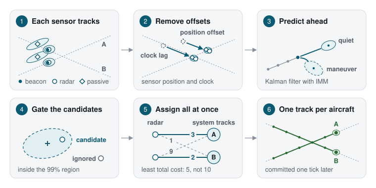

# How goat-processors decides which tracks are the same aircraft

Several sensors each report their own tracks of the same aircraft. The
correlator decides which of those tracks are one object. It predicts every
track with a Kalman filter, and a track must pass a statistical gate to be
considered. The default method then goes past sequential gating: it assigns all
of a sensor's tracks at once and checks each choice against the next update
before committing it.

<picture>
  <source media="(prefers-color-scheme: dark)" srcset="explainers/correlation-steps-dark.svg">
  
</picture>

1. **Each sensor tracks.** A radar, a transponder beacon and a passive sensor
   each report their own tracks of the same aircraft. Each track carries its
   own uncertainty: the beacon is tight, the radar wider, the passive sensor
   widest.
2. **Remove sensor offsets.** For each pair of sensors the correlator estimates
   a position offset (bias) and a clock offset. A lag along the track that
   grows with speed is read as a clock error, not a position bias, so a sensor
   a few hundred meters off, or running late, still joins
   ([correlate-assign.md, Sensor bias](../spec/correlate-assign.md#sensor-bias)).
3. **Predict ahead.** Every track keeps a constant-velocity Kalman filter (east
   and north, position and velocity). For targets that turn or accelerate, an
   interacting multiple model (IMM) filter runs two models, "quiet" and
   "maneuver", with probabilities of switching between them
   ([correlate.md, Track estimate](../spec/correlate.md#track-estimate)).
4. **Gate the candidates.** A track is a candidate only if it lies inside the
   other track's predicted 99 % uncertainty region, measured in units of their
   combined uncertainty (a chi-square, or Mahalanobis, gate).
5. **Assign all at once.** At each update (tick), all of one sensor's tracks
   are assigned to system tracks together by an exact minimum-cost assignment.
   In the drawing, pairing the closest tracks first would cost 1 + 9 = 10; the
   assignment takes 3 + 2 = 5. Every track belongs to exactly one system track.
6. **One track per aircraft.** The correlator keeps up to three candidate
   assignment histories over two ticks and commits a tick only after seeing
   the next one, so a choice the next reports contradict is never committed. A
   system track sits at the uncertainty-weighted combination of its members.

## Multi-gate sequential or Kalman?

Both. The older method, `confirm`, is sequential multi-gate: a position gate,
then course, speed and altitude checks, and a pair must pass on two reports in
a row. The default, `assign` (pack
[`correlate-assign-time`](../packs/correlate-assign-time/pack.def)), keeps the
Kalman filters and the gate and adds steps 2, 5 and 6.

## The technical description

The specification is complete: [spec/correlate.md](../spec/correlate.md) and
[spec/correlate-assign.md](../spec/correlate-assign.md). Seven independent
implementations follow it, checked by shared test vectors. The published
methods that were measured before these were chosen are in
[docs/research/correlation-and-fusion-methods.md](research/correlation-and-fusion-methods.md).
How well each pack does, against ground truth and an outside tracker, is in
[docs/benchmark.md](benchmark.md).

What goat adds around the correlator, such as clock quality on every report
and an explanation of every decision: [what-is-different.md](what-is-different.md).
